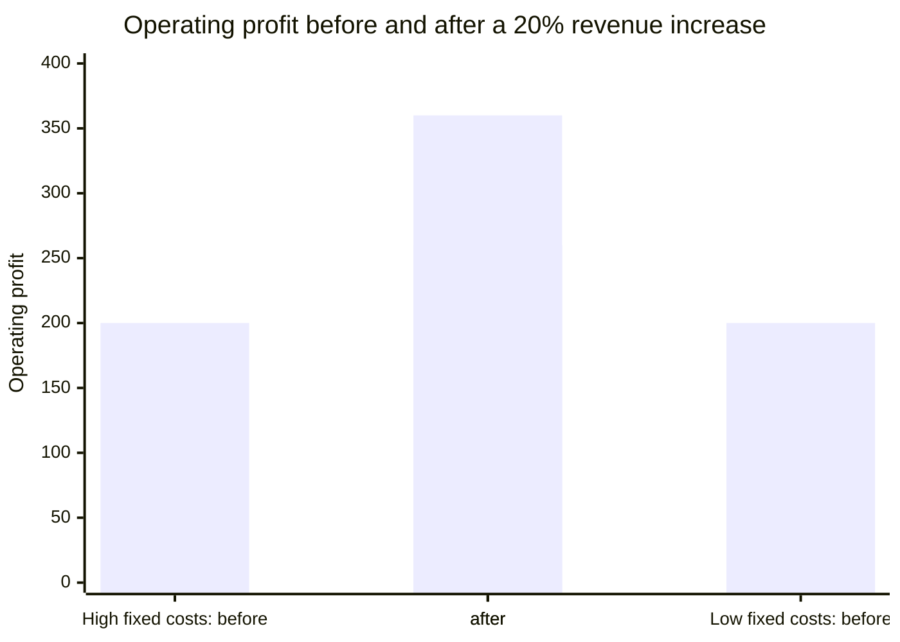

# Operating expenses (OpEx)

## Summary

Operating expenses (OpEx) are the day-to-day costs of running a business, consumed within the current period: salaries, rent, software subscriptions, marketing, research. They reduce profit immediately and are generally tax-deductible in the year they are incurred. Many companies now prefer an "OpEx-first" model, renting cloud servers and software instead of buying them, for flexibility. How OpEx is split between fixed and variable costs determines operating leverage: how strongly profit reacts to changes in revenue.

*This note is educational. It is not investment, tax or accounting advice.*

## Prerequisites

- [Financial statements](financial-statements.md)

## Core concepts

### Definition

*Operating expenditure* (OpEx) is spending on the ongoing operation of a business that is expensed in the income statement in the period it is incurred, as opposed to *capital expenditure* (CapEx), which is recorded as an asset and expensed gradually through depreciation (see [Capital expenditure (CapEx)](capital-expenditure.md)). In management accounts, OpEx often excludes cost of goods sold; in other usage it covers all operating costs. State which definition is used.

### Analogy

OpEx is like the running costs of a car: fuel, insurance, parking, servicing. CapEx is buying the car. Running costs hit your budget every month and stop when you stop driving; the purchase is paid once and loses value slowly.

### Mechanism

**Typical components.**

| Category | Examples |
| --- | --- |
| Selling, general and administrative (SG&A) | Salaries, office rent, utilities, insurance, legal fees |
| Research and development (R&D) | Costs of developing new products, unless capitalized |
| Sales and marketing | Advertising, trade fairs, sales commissions |

**OpEx-first.** Companies increasingly pay for software subscriptions instead of perpetual licenses and rent cloud capacity instead of buying servers. Reasons: flexibility (scale up and down with demand), cash flow (no large upfront purchase), and faster tax deduction (expensed now rather than depreciated over years). Accounting nuance: under IFRS 16, most leases longer than 12 months, such as a multi-year office lease, are recorded as a right-of-use asset and a liability, so they are not pure OpEx in IFRS accounts. Development costs that meet the criteria of IAS 38 can be capitalized.

**Operating leverage.** It measures how much operating profit changes for a change in revenue:

```text
Degree of operating leverage = % change in operating profit / % change in revenue
                             = contribution margin / operating profit
```

High operating leverage (mostly fixed costs, such as a software company) means that once fixed costs are covered, each extra unit of revenue is almost pure profit, and also that a fall in revenue hits profit hard. Low operating leverage (costs rise with revenue, such as consulting, where each new client needs more staff) means steadier but thinner profit growth.

**OpEx and EBITDA.** EBITDA = revenue - operating costs, excluding interest, taxes, depreciation and amortization. Every unit of OpEx saved adds one unit to EBITDA; at a 10x valuation multiple, cutting 10,000 of unnecessary OpEx adds about 100,000 to valuation, which is why private equity owners focus on cost discipline.

Operating leverage in two companies with the same revenue and profit but different cost structures, when revenue rises 20%:



The values come from the worked example.

## Worked example

```python
# Python 3.12. Operating leverage for two cost structures.
def op_profit(revenue, fixed, variable_ratio):
    return revenue - fixed - revenue * variable_ratio

for name, fixed, var in (("high fixed", 600, 0.20), ("low fixed", 100, 0.70)):
    before = op_profit(1000, fixed, var)
    after = op_profit(1200, fixed, var)
    dol = (after / before - 1) / 0.20
    print(name, before, after, "DOL", round(dol, 1))

# OpEx-to-revenue ratio drift
print("OpEx ratio before {:.0%}, after {:.0%}".format(800 / 1000, 960 / 1100))
```

Output:

```text
high fixed 200.0 360.0 DOL 4.0
low fixed 200.0 260.0 DOL 1.5
OpEx ratio before 80%, after 87%
```

The company with high fixed costs grows profit by 80% on a 20% revenue increase; the other by 30%. In the second calculation, revenue grew 10% and OpEx 20%, so the OpEx-to-revenue ratio worsened from 80% to 87%, an early sign of bloat.

## Trade offs and when to use it

OpEx keeps a business flexible and light on capital, but recurring commitments accumulate and, unlike assets, leave nothing behind. High fixed OpEx brings high operating leverage, which is good in growth and dangerous in a downturn.

## Common mistakes

- **Subscription creep.** Small recurring items (a 50 per month software seat) go unmonitored and add up. Review subscriptions every quarter.
- **Treating all OpEx as equal.** Spending on sales (growth OpEx) is an investment; a fancier office (lifestyle OpEx) is a drain.
- **Over-hiring in good times.** Easy OpEx growth leads to painful cuts when the market turns. Keep fixed costs low and variable, performance-based costs high.
- **Ignoring the OpEx-to-revenue ratio.** If OpEx grows faster than revenue, efficiency is falling.

## Practice

1. Revenue grows 10%, operating profit grows 30%. What is the degree of operating leverage?
2. Why might renting cloud servers be preferred to buying them?
3. Under IFRS 16, why is a five-year office lease not simply OpEx?

### Answers

1. 3.
2. Flexibility, no upfront cash and immediate expensing for tax.
3. It is recorded as a right-of-use asset and a lease liability, with depreciation and interest instead of rent expense.

## Further reading

- Brealey, R. A., Myers, S. C., Allen, F. et al. (2023). *Principles of Corporate Finance (14th ed.)*. McGraw Hill. Operating costs and operating leverage.
- IFRS Foundation (2016). *IFRS 16 Leases*. [Link](https://www.ifrs.org/issued-standards/list-of-standards/ifrs-16-leases/). Lease accounting.
- IFRS Foundation. *IAS 38 Intangible Assets*. [Link](https://www.ifrs.org/issued-standards/list-of-standards/ias-38-intangible-assets/). Capitalization of development costs.
