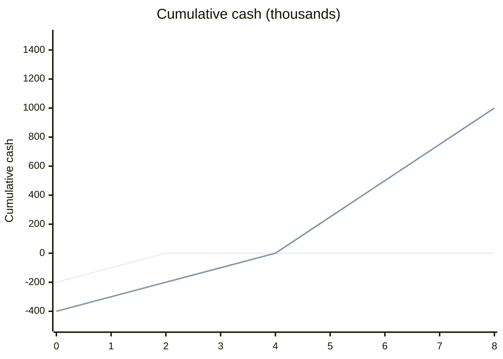

# Payback period

## Summary

The payback period is the time an investment takes to return its initial cost from the cash it generates. It measures liquidity and risk exposure: the shorter it is, the sooner the money is safe and available again. It is simple and popular, especially in small firms and fast-changing industries, but it ignores cash flows after payback and, in its simple form, the time value of money. The discounted payback period corrects the second problem.

*This note is educational. It is not investment, tax or accounting advice.*

## Prerequisites

- [Time value of money](time-value-of-money.md)

## Core concepts

### Definition

The *payback period* is:

```text
Equal annual cash flows:  payback = initial investment / annual cash flow
Uneven cash flows:        the year in which cumulative cash flow turns positive,
                          plus the fraction of that year needed
```

The *discounted payback period* uses cash flows discounted at the cost of capital (for example WACC) and is therefore longer and more conservative.

### Analogy

Payback is like asking how many months of savings on fuel it takes before a more efficient car has paid for its higher price. It says nothing about how long the car lasts after that, which is the method's main weakness.

### Mechanism

**Uses.**

1. **Risk management.** In fast-moving industries, a project that needs seven years to pay back is risky: the technology may be obsolete before the money returns.
2. **Cash and liquidity.** A cash-strapped business may prefer a one-year payback to a four-year one, even if the latter has a higher NPV, because it needs the cash back to run.
3. **Small business reality.** For companies without large credit lines, payback is often the main decision tool, because it keeps capital from being locked up too long.

**Comparison with other measures.**

| Measure | Primary question | Best for |
| --- | --- | --- |
| Payback period | How fast? | Liquidity and risk |
| NPV | How much wealth? | Long-term value creation |
| IRR | At what rate? | Comparing investment options |

Cumulative cash of two projects: A pays back in two years and stops; B pays back in four years and keeps earning.



## Worked example

```python
# Python 3.12. Simple and discounted payback.
def payback(outlay, flows, rate=0.0):
    cum = -outlay
    for t, cf in enumerate(flows, start=1):
        dcf = cf / (1 + rate) ** t
        if cum + dcf >= 0:
            return t - 1 + (-cum) / dcf
        cum += dcf
    return None

machine = [25_000] * 6
print("simple:", payback(100_000, machine))
print("discounted at 10%:", round(payback(100_000, machine, 0.10), 2))
print("uneven:", payback(50_000, [10_000, 40_000, 30_000]))
```

Output:

```text
simple: 4.0
discounted at 10%: 5.37
uneven: 2.0
```

A machine for 100,000 that saves 25,000 a year pays back in 4 years, or about 5.4 years once the time value of money is included. With uneven flows of 10,000 and 40,000, the cumulative cash reaches zero at the end of year 2.

## Trade offs and when to use it

Payback is simple, intuitive and protective of liquidity. It ignores everything after payback and does not measure profitability, so it should be a constraint or a tie-breaker, not the main criterion, when value matters.

## Common mistakes

- **Ignoring the tail.** Project A pays back in 2 years and then stops; project B pays back in 4 years and earns 1 million a year for a decade. Payback alone picks the worse project.
- **Treating speed as profit.** A project can pay back in one year and earn nothing afterwards.
- **Ignoring opportunity cost.** Use discounted payback, or NPV, to account for what else the money could do.

## Practice

1. Investment 60,000, cash flow 15,000 a year. Simple payback?
2. Why is discounted payback longer than simple payback?
3. When might a firm rationally choose a shorter payback over a higher NPV?

### Answers

1. 4 years.
2. Because future cash flows are worth less after discounting.
3. When it is short of cash and needs the money back quickly to operate.

## Further reading

- Brealey, R. A., Myers, S. C., Allen, F. et al. (2023). *Principles of Corporate Finance (14th ed.)*. McGraw Hill. Payback and its limitations.
- Graham, J. R., Harvey, C. R. (2001). The theory and practice of corporate finance: Evidence from the field. Journal of Financial Economics, 60(2-3), 187-243. [DOI](https://doi.org/10.1016/S0304-405X(01)00044-7). Use of payback in practice.
