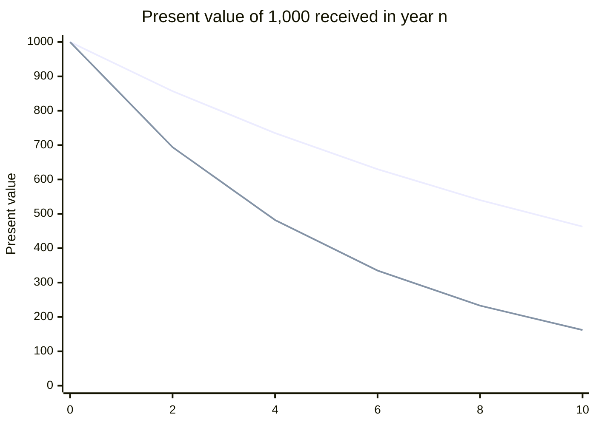

# Time value of money

## Summary

A sum of money today is worth more than the same sum in the future, because money available now can be invested to earn a return and because the future is uncertain. Compounding turns a present sum into a future value; discounting turns a future sum into its present value. Every valuation and investment method in corporate finance, from DCF to NPV and IRR, is built on this idea.

*This note is educational. It is not investment, tax or accounting advice.*

## Prerequisites

No prior notes are needed.

## Core concepts

### Definition

The *time value of money* is the principle that money now has a higher value than the same nominal amount later. For an interest or discount rate r per period:

```text
Future value:   FV = PV x (1 + r) ^ n
Present value:  PV = FV / (1 + r) ^ n
```

where n is the number of periods. The *discount rate* reflects the return available elsewhere at similar risk (the opportunity cost of capital), and it usually includes expected inflation.

### Analogy

Money is like a seed that can be planted. A seed in your hand today can grow into a plant by next year; a promise of a seed next year cannot. To compare the two, you ask how big the seed would grow if planted now. The analogy breaks because money does not grow by itself: it grows only if someone pays a return for using it.

### Mechanism

- **Compounding:** returns earned on earlier returns. 1,000 at 8% becomes 1,080 after one year and 1,166.40 after two.
- **Discounting:** the reverse. 1,166.40 received in two years is worth 1,000 today at 8%.
- **Annuity:** equal payments C for n periods have present value C × (1 - (1 + r) ^ -n) / r.
- **Perpetuity:** a payment C forever has present value C / r; growing at g per period, C / (r - g), provided r > g (the Gordon growth formula, Gordon, 1959).
- **Risk:** riskier cash flows are discounted at higher rates, so they are worth less today.

The chart shows the present value of 1,000 received in year n at two discount rates.



The upper line uses 8%, the lower 20%. Values are rounded from the worked example.

## Worked example

```python
# Python 3.12. Compounding, discounting, annuity and growing perpetuity.
def fv(pv, r, n): return pv * (1 + r) ** n
def pv(fv_, r, n): return fv_ / (1 + r) ** n

print(round(fv(1000, 0.08, 2), 2))
print([round(pv(1000, 0.08, n)) for n in range(0, 11, 2)])
print([round(pv(1000, 0.20, n)) for n in range(0, 11, 2)])

annuity = 500 * (1 - 1.08 ** -5) / 0.08          # 500 a year for 5 years at 8%
print(round(annuity, 2))
print(round(100 / (0.08 - 0.02), 2))              # 100 next year, growing 2% forever, at 8%
```

Output:

```text
1166.4
[1000, 857, 735, 630, 540, 463]
[1000, 694, 482, 335, 233, 162]
1996.36
1666.67
```

At 20%, 1,000 received in ten years is worth only 162 today, which is why high discount rates for risky businesses shrink valuations so much.

## Trade offs and when to use it

Discounting makes cash flows at different dates comparable and is the basis of rational investment decisions. The result depends heavily on the discount rate chosen, which is an estimate.

## Common mistakes

- **Mixing nominal cash flows with a real (inflation-free) rate.** Use nominal flows with nominal rates, or real with real.
- **Using the growing perpetuity formula with g close to or above r.** The formula requires r > g; small differences produce huge values.

## Practice

1. What is 2,000 received in three years worth today at 10%?
2. What is the present value of 50 per year forever at 5%?

### Answers

1. 2,000 / 1.331 ≈ 1,502.63.
2. 1,000.

## Further reading

- Brealey, R. A., Myers, S. C., Allen, F. et al. (2023). *Principles of Corporate Finance (14th ed.)*. McGraw Hill. Present value and discounting.
- Gordon, M. J. (1959). Dividends, earnings, and stock prices. Review of Economics and Statistics, 41(2), 99-105. [DOI](https://doi.org/10.2307/1927792). The growing perpetuity model.
