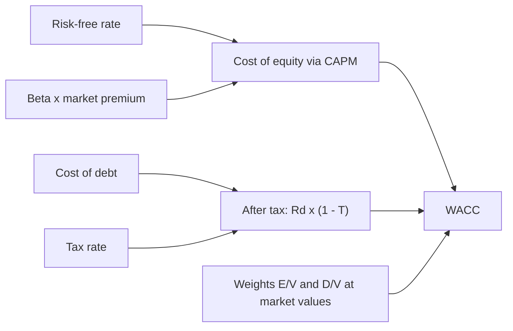

# Weighted average cost of capital (WACC)

## Summary

The weighted average cost of capital (WACC) is the average return a company must pay to its lenders and shareholders, weighted by how much of each kind of capital it uses. It is the hurdle rate for investments: a project that earns less than WACC destroys value, because investors could earn more elsewhere at similar risk. It is also the usual discount rate in DCF valuation. Because interest is tax-deductible, debt is cheaper than equity, but too much debt raises risk and the cost of both.

*This note is educational. It is not investment, tax or accounting advice.*

## Prerequisites

- [Time value of money](time-value-of-money.md)

## Core concepts

### Definition

```text
WACC = (E / V) x Re + (D / V) x Rd x (1 - T)
```

- E: market value of equity; D: market value of debt; V = E + D.
- Re: cost of equity, often estimated with the capital asset pricing model (CAPM, Sharpe, 1964): Re = Rf + β × (Rm - Rf), where Rf is the risk-free rate, β the sensitivity of the company's returns to the market and Rm - Rf the market risk premium.
- Rd: cost of debt (current borrowing rate).
- T: corporate tax rate. The factor (1 - T) is the *tax shield*.

### Analogy

WACC is like the average interest rate on a house financed partly by a mortgage and partly by money borrowed from family who expect a share of the gains. If the house (the project) does not appreciate faster than that average cost, the owner loses money even if the house gains value.

### Mechanism

**The tax shield.** In most tax systems interest on debt is deductible, while dividends are not. Debt therefore costs less after tax, and a sensible amount of debt can lower WACC and raise the value of the company in a DCF. Modigliani and Miller (1958, 1963) showed that without taxes and other frictions capital structure would not affect value, and that the tax deductibility of interest is what makes debt valuable. Too much debt raises the risk of financial distress, which pushes up the cost of both equity and debt. Many tax systems, Poland's among them, also limit the deductibility of interest above certain thresholds.

**Three uses.**

1. **Hurdle rate.** If a project's expected return exceeds WACC, it creates value; if not, it costs more to finance than it earns.
2. **Capital structure.** Management looks for the mix of debt and equity that minimizes WACC.
3. **Valuation.** WACC is the most common discount rate in DCF: when it falls, value rises; when interest rates rise or the business becomes riskier, value falls.

How the components combine:



## Worked example

```python
# Python 3.12. WACC with CAPM cost of equity and a 19% tax rate.
rf, beta, mrp = 0.05, 1.2, 0.06
re = rf + beta * mrp
rd, tax = 0.08, 0.19
equity, debt = 6_000, 4_000
v = equity + debt
wacc = equity / v * re + debt / v * rd * (1 - tax)
print("cost of equity: {:.1%}".format(re))
print("after-tax cost of debt: {:.2%}".format(rd * (1 - tax)))
print("WACC: {:.2%}".format(wacc))
```

Output:

```text
cost of equity: 12.2%
after-tax cost of debt: 6.48%
WACC: 9.91%
```

A project expected to return 12% clears this hurdle; one expected to return 8% does not, even though 8% sounds positive. The inputs are invented; real values depend on current rates and the company's risk.

## Trade offs and when to use it

WACC connects financial markets with day-to-day investment decisions in a single number. It is an estimate built on estimates (beta, the market risk premium), and using one company-wide WACC for projects of very different risk misallocates capital; risky projects should use higher rates.

## Common mistakes

- **Using book values instead of market values.** Weight equity and debt at current market values.
- **Assuming the owner's money is free.** Equity has an opportunity cost: the return available elsewhere, such as a broad stock index.
- **Ignoring interest rate changes.** With floating-rate debt, rising central bank rates raise WACC and can turn profitable projects unprofitable.
- **One rate for all projects.** Adjust the rate for project risk.

## Practice

1. E = 70, D = 30, Re = 11%, Rd = 6%, T = 19%. What is WACC?
2. Why is debt usually cheaper than equity?
3. What happens to company value in a DCF when WACC rises?

### Answers

1. 0.7 × 11% + 0.3 × 6% × 0.81 ≈ 9.16%.
2. Lenders take less risk than shareholders, and interest is tax-deductible.
3. It falls, because future cash flows are discounted more heavily.

## Further reading

- Modigliani, F., Miller, M. H. (1958). The cost of capital, corporation finance and the theory of investment. American Economic Review, 48(3), 261-297. Capital structure irrelevance.
- Modigliani, F., Miller, M. H. (1963). Corporate income taxes and the cost of capital: A correction. American Economic Review, 53(3), 433-443. The tax correction.
- Sharpe, W. F. (1964). Capital asset prices: A theory of market equilibrium under conditions of risk. Journal of Finance, 19(3), 425-442. [DOI](https://doi.org/10.1111/j.1540-6261.1964.tb02865.x). The capital asset pricing model.
- Damodaran, A.. Damodaran Online: data on cost of capital, multiples and margins by industry. [Link](https://pages.stern.nyu.edu/~adamodar/New_Home_Page/datacurrent.html). Cost of capital data by industry.
- Brealey, R. A., Myers, S. C., Allen, F. et al. (2023). *Principles of Corporate Finance (14th ed.)*. McGraw Hill. Cost of capital in practice.
