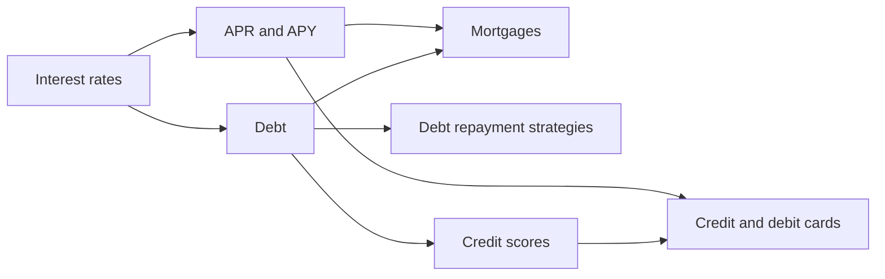

# Credit and debt

How borrowing works and what it costs: interest, annual percentage rates, loans and mortgages, credit cards and credit scores, and the methods for paying debt down. This subfield belongs to [Finance and investing](../README.md). It starts with the price of money, moves to debt as a tool and a risk, and ends with the products that most households meet: mortgages, cards and the credit score that governs access to them.

## Map of the subfield

The map shows how the notes build on interest.

## Notes in reading order

**The price of credit**

1. [Interest rates](interest-rates.md): simple and compound interest, real and nominal rates, what sets the rate.
2. [APR and APY](apr-and-apy.md): the two yearly measures and how compounding changes them.

**Debt**

3. [Debt](debt.md): types of debt, leverage, productive and unproductive borrowing, default and a framework for deciding.
4. [Debt repayment strategies](debt-repayment-strategies.md): avalanche, snowball and consolidation, with a computed comparison.

**Products and access**

5. [Mortgages](mortgages.md): amortization, fixed and adjustable rates, interest-only and reverse mortgages.
6. [Credit scores](credit-scores.md): what a score measures and how to improve it.
7. [Credit and debit cards](credit-and-debit-cards.md): grace periods, interest on balances, protections and rewards.

## Planned topics

- Student loans
- Bankruptcy and insolvency
- Consumer protection and debt collection

## How to use this subfield

Read notes 1 to 3 in order, then pick the product you are dealing with. Rules for the household budget are in [personal finance](../personal-finance/README.md). Company debt and the cost of capital are in [WACC](../corporate-finance/wacc.md).

These notes are educational. They are not investment, tax or legal advice.

## Navigation

- Back to [Finance and investing](../README.md).
