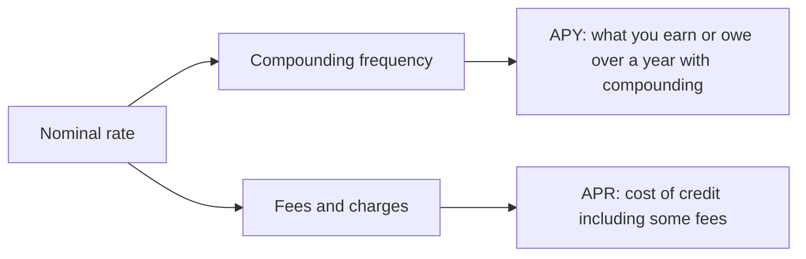

# APR and APY

## Summary

APR (annual percentage rate) and APY (annual percentage yield) are two ways to state a yearly rate. APR is the cost of borrowing as a yearly rate and in the US it includes certain fees, but it does not include compounding within the year. APY is the yearly rate that does include compounding, so it is the right figure to compare savings accounts and the true cost of a balance that compounds. The same account looks better or worse depending on which of the two is quoted.

*This note is educational. It is not financial advice. Definitions follow US practice; other countries use similar measures under different names (for example "effective annual rate" or "annual percentage rate of charge" in the EU).*

## Prerequisites

- [Interest rates](interest-rates.md).

## Core concepts

### Definition

- **Nominal rate:** the stated yearly rate before compounding.
- **APR:** in US consumer lending, the yearly cost of credit expressed as a rate, computed under Regulation Z. It reflects interest and some finance charges and fees, so it is a more complete cost measure than the interest rate alone. It does not reflect the compounding of interest on a revolving balance.
- **APY (effective annual rate):** the rate actually earned or paid over a year, including compounding: APY = (1 + r/m)^m - 1, where r is the nominal rate and m is the number of compounding periods per year.

### Analogy

The nominal rate is the price on the shelf, and the APY is the price at the till after the rules of the shop are applied. They differ when the shop's rules (compounding) add to the amount. APR sits in between for loans: it adds fees to the shelf price but still ignores compounding.

### Mechanism

The more often interest compounds, the higher the APY for the same nominal rate, with an upper limit at continuous compounding (e^r - 1).

| Nominal rate | Compounding | APY |
| --- | --- | --- |
| 5% | Monthly | 5.12% |
| 12% | Monthly | 12.68% |
| 18% | Daily | 19.72% |
| 24% | Monthly | 26.82% |

```python
# Python 3.12. Effective annual rate from a nominal rate.
def apy(rate, periods):
    return (1 + rate / periods) ** periods - 1

for rate, m in [(0.05, 12), (0.12, 12), (0.18, 365), (0.24, 12)]:
    print(f"{rate:.0%} compounded {m}x -> {apy(rate, m):.2%}")
```

Output:

```text
5% compounded 12x -> 5.12%
12% compounded 12x -> 12.68%
18% compounded 365x -> 19.72%
24% compounded 12x -> 26.82%
```



## Worked example

A credit card shows 24% APR with interest charged monthly (2% per month). If a balance of 1,000 is left unpaid for a year with no new purchases and no payments, it grows to 1,000 × 1.02^12 = 1,268.24, which is an effective yearly cost of 26.82%, not 24%. A savings account at 4.5% nominal compounded monthly has an APY of 4.59%, so a saver should look at APY and a borrower at APR plus the compounding terms.

## Trade offs and when to use it

Use APY to compare deposit products and APR to compare loans of the same type. APR is less reliable for comparing products with different fee structures or terms (for example a short loan with a high upfront fee), because spreading a fee over a short term raises the APR sharply. For a credit card, look at APR and at the grace period: balances paid in full each month usually do not accrue interest.

## Common mistakes

- **Reading APR as the exact yearly cost of a card balance.** Compounding makes the effective rate higher.
- **Comparing the APR of one loan with the APY of another.** Convert both to the same measure.
- **Ignoring fees outside the APR.** Some charges (late fees, for example) are not part of it.
- **Assuming a teaser rate lasts.** Check what the rate becomes after the introductory period.

## Practice

1. A bank advertises 3.6% nominal, compounded monthly. What is the APY?
2. Why is APY always at least as high as the nominal rate?
3. Which figure should a saver compare between two accounts?

### Answers

1. (1 + 0.036/12)^12 - 1 = 3.66%.
2. Interest on interest can only add to the nominal amount, and equals it only with annual compounding.
3. APY, because it includes compounding.

## Further reading

- Consumer Financial Protection Bureau. Regulation Z (Truth in Lending), 12 CFR 1026. CFPB. [Link](https://www.consumerfinance.gov/rules-policy/regulations/1026/). The US rule that defines how the annual percentage rate must be disclosed.
- Consumer Financial Protection Bureau. Credit cards. CFPB. [Link](https://www.consumerfinance.gov/consumer-tools/credit-cards/). Consumer guidance on card terms, fees and billing rights.
- Brealey, R. A., Myers, S. C., Allen, F. et al. (2023). *Principles of Corporate Finance (14th ed.)*. McGraw Hill. Covers valuation, risk and the cost of capital.
