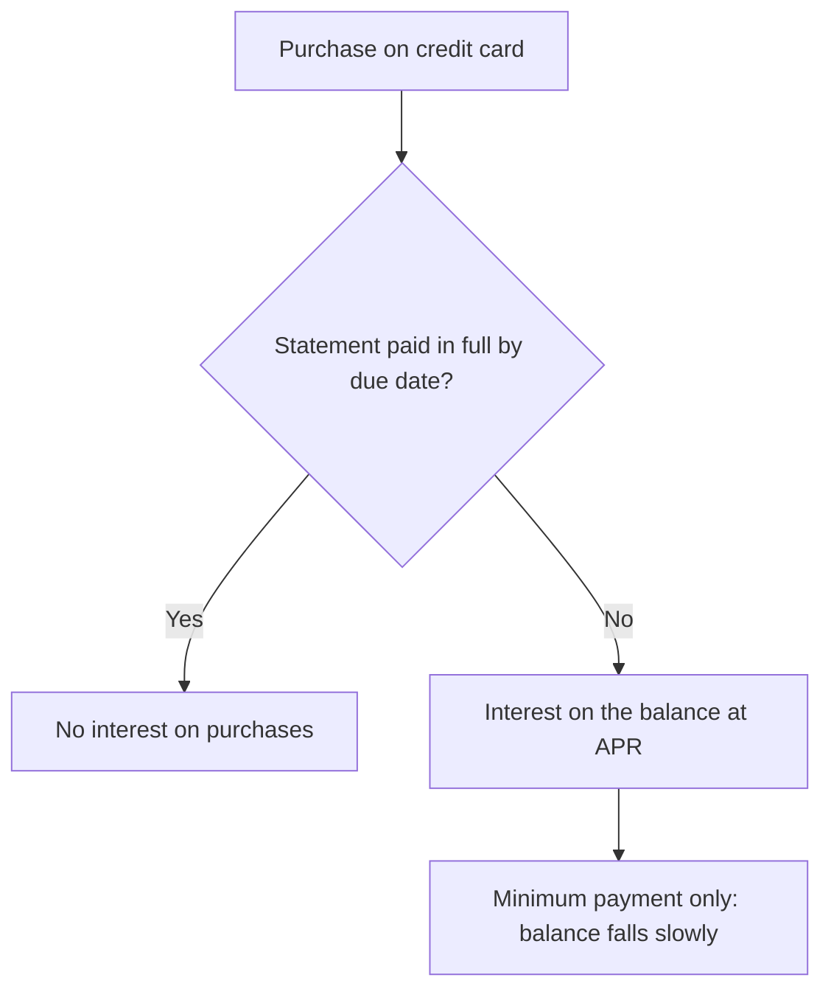

# Credit and debit cards

## Summary

A debit card spends your own money straight from a bank account. A credit card spends the issuer's money, which you must repay by the due date, and it charges interest on any balance left after that. Credit cards offer protections, rewards and a way to build a credit history, but unpaid balances are often charged above 20% a year. Debit cards cost nothing in interest and are limited by the balance in the account.

*This note is educational. It is not financial advice. Protections described are US ones and differ by country.*

## Prerequisites

- [Interest rates](interest-rates.md).
- [APR and APY](apr-and-apy.md).

## Core concepts

### Definition

- A *credit card* gives the holder a revolving line of credit up to a limit. Purchases are borrowed from the issuer, and the holder repays in full or in part each month.
- A *debit card* is linked to a deposit account, and each purchase reduces the balance of the account at once or within days.

### Analogy

A debit card is a wallet: you can only spend what is in it. A credit card is a tab at a shop: you can take now and pay later, and the shop charges interest if the tab stays open. The limit of the analogy is that the tab also builds your reputation with every lender, which a wallet does not.

### Mechanism

A credit card statement has a *grace period* between the end of the billing cycle and the due date. If the full statement balance is paid by the due date, no interest is charged on purchases. If only part is paid, interest accrues on the balance (and in many cases from the purchase date). The interest rate is quoted as APR.

| Feature | Credit card | Debit card |
| --- | --- | --- |
| Money used | Issuer's, repaid later | Your own, from the account |
| Interest | Charged on unpaid balance, often above 20% APR | None, apart from possible overdraft fees |
| Effect on credit history | Builds it when used and paid on time | None, normally |
| Fraud protection | In the US, liability for unauthorized charges is limited by law (up to 50, and zero with most issuers) | In the US, limits depend on how fast the loss is reported, and money leaves the account at once |
| Rewards | Cash back and points are common | Rare |
| Overspending risk | Debt | Limited by the balance (overdraft aside) |
| Typical extras | Purchase protection, travel perks | ATM access |



## Worked example

A balance of 2,000 on a card with 24% APR (2% per month), with a minimum payment of 2% of the balance plus the interest. To keep it simple, assume the cardholder pays a fixed 100 a month and makes no new purchases.

```python
# Python 3.12. Months to repay a card balance with a fixed payment.
balance, apr, pay = 2000.0, 0.24, 100.0
months, interest_total = 0, 0.0
while balance > 0:
    interest = balance * apr / 12
    interest_total += interest
    balance = balance + interest - min(pay, balance + interest)
    months += 1
print(months, round(interest_total, 2))
```

Output:

```text
26 579.75
```

It takes 26 months and 579.75 of interest to repay 2,000. Paying only 50 a month (just above the 40 of interest in the first month) takes 82 months, nearly 7 years, and costs 2,063.80 in interest. Paid in full inside the grace period, the same purchases cost nothing in interest.

## Trade offs and when to use it

Use a credit card for purchases you can pay in full each month, to get the rewards, the protections and the credit history. Use a debit card or cash when the risk of overspending is the problem. Do not carry a balance to earn rewards, because the interest costs more than the rewards pay. Watch fees (annual, foreign transaction, late, cash advance) and the rate that applies after an introductory offer.

## Common mistakes

- **Paying only the minimum.** It makes the debt last for years.
- **Taking a cash advance,** which usually has fees and interest from day one.
- **Using the full limit.** It raises utilization (see [credit scores](credit-scores.md)).
- **Treating the limit as income.**

## Practice

1. What is the grace period?
2. Why can a debit card still cause overdraft fees?
3. Balance 1,000, APR 18%, no payments for one month. What is the interest?

### Answers

1. The time between the end of the billing cycle and the due date, during which paying the full balance avoids interest on purchases.
2. If the account has insufficient funds and the bank allows the payment, it may charge an overdraft fee.
3. 1,000 × 0.18 / 12 = 15.

## Further reading

- Consumer Financial Protection Bureau. Credit cards. CFPB. [Link](https://www.consumerfinance.gov/consumer-tools/credit-cards/). Consumer guidance on card terms, fees and billing rights.
- Consumer Financial Protection Bureau. Regulation Z (Truth in Lending), 12 CFR 1026. CFPB. [Link](https://www.consumerfinance.gov/rules-policy/regulations/1026/). The US rule that defines how the annual percentage rate must be disclosed.
- Consumer Financial Protection Bureau. Credit reports and scores. CFPB. [Link](https://www.consumerfinance.gov/consumer-tools/credit-reports-and-scores/). The US consumer agency's guidance on credit reports, scores and disputes.
