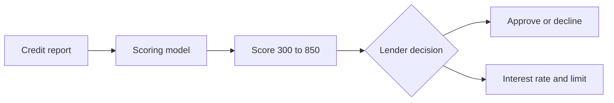
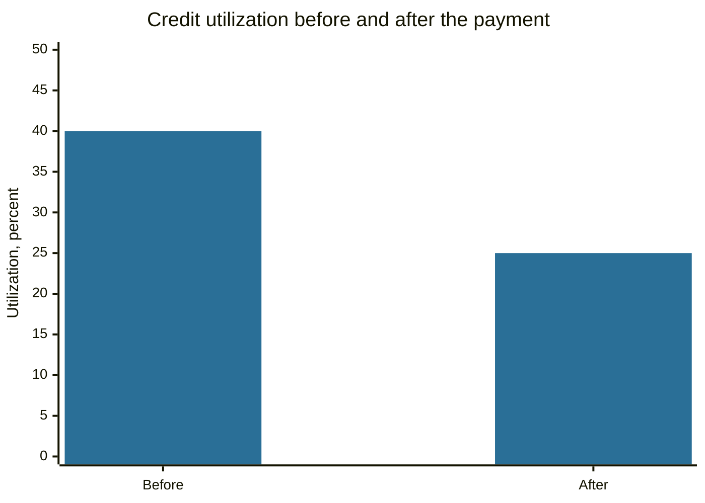

# Credit scores

## Summary

A credit score is a number, in the US usually between 300 and 850, that summarizes how likely a person is to repay borrowed money, based on the credit report kept by credit bureaus. Lenders use it to decide whether to lend and at what rate. The score is built from payment history, amounts owed, length of credit history, new credit and credit mix, and it can be improved mainly by paying on time and by using a small share of available revolving credit.

*This note is educational. It is not financial advice. Details are for the US system. Other countries use different bureaus, scoring ranges and rules.*

## Prerequisites

- [Debt](debt.md).

## Core concepts

### Definition

- A *credit report* is the record of a person's credit accounts, balances, payment history, inquiries and public records, kept by credit bureaus. In the US the three nationwide bureaus are Equifax, Experian and TransUnion.
- A *credit score* is a statistical estimate of credit risk calculated from the report. The best known models are FICO and VantageScore. Different bureaus and models can give different numbers on the same day.

### Analogy

A credit score is a school grade for repaying. It is a summary of past behavior used to predict the future, and like a grade it ignores the circumstances behind it (a missed payment in hospital looks like any other). It is not a measure of wealth: a rich person with no credit history can have no score.

### Mechanism: the five FICO categories

FICO publishes the approximate weights of the factors in its general score.

| Factor | Weight | What it measures |
| --- | --- | --- |
| Payment history | 35% | On-time payments, delinquencies, collections |
| Amounts owed | 30% | Balances, and the share of revolving credit limits in use (utilization) |
| Length of credit history | 15% | Age of the oldest and average accounts |
| New credit | 10% | Recent applications and new accounts |
| Credit mix | 10% | Variety of credit types (cards, installment loans) |

The report feeds a model, and the lender uses the output to decide whether to lend and on what terms.

How to improve a score:

1. Pay every bill on time. Automatic payments and reminders help.
2. Keep revolving balances low relative to limits. Utilization above about 30% is commonly advised against, and lower is better.
3. Avoid opening many accounts in a short time.
4. Keep old accounts open when they have no fee.
5. Check each report for errors and dispute them with the bureau. In the US, free reports are available at annualcreditreport.com.

## Worked example

A person has two cards with limits of 5,000 and 3,000, so total limits are 8,000. Balances are 2,800 and 400, a total of 3,200.

- Utilization = 3,200 / 8,000 = 40%.
- Paying 1,200 on the first card before the statement date gives balances 1,600 and 400, so utilization = 2,000 / 8,000 = 25%.

Utilization falls below 30% with the same total limit. The chart shows the two cases.

The effect on the score cannot be predicted exactly, because the models are proprietary, and it depends on the rest of the report.

## Trade offs and when to use it

A good score reduces the cost of borrowing and can affect rental applications and some insurance pricing in some places. Chasing a score has limits. Carrying a balance does not raise the score, and the interest paid is a cost. Closing a card can raise utilization and shorten average age. Checking your own score does not lower it (a soft inquiry), while applying for credit creates a hard inquiry.

## Common mistakes

- **Believing that carrying a balance improves the score.** Paying in full on time is enough.
- **Closing old cards without reason,** which can shorten history and raise utilization.
- **Applying for many cards at once.**
- **Never checking the report.** Errors and identity theft are found only by looking.

## Practice

1. Which factor has the largest weight in the FICO score?
2. A card has a limit of 10,000 and a balance of 6,000. What is the utilization?
3. Why can two lenders see different scores for the same person?

### Answers

1. Payment history, at 35%.
2. 60%.
3. They may use different bureaus' data and different scoring models or versions.

## Further reading

- FICO. What's in my FICO Scores. myFICO. [Link](https://www.myfico.com/credit-education/whats-in-your-credit-score). The publisher of the FICO score lists the five categories and their approximate weights.
- Consumer Financial Protection Bureau. Credit reports and scores. CFPB. [Link](https://www.consumerfinance.gov/consumer-tools/credit-reports-and-scores/). The US consumer agency's guidance on credit reports, scores and disputes.
- Lusardi, A. and Mitchell, O. S. (2014). The economic importance of financial literacy: theory and evidence. *Journal of Economic Literature*, 52(1), 5-44. [DOI](https://doi.org/10.1257/jel.52.1.5). Includes evidence on how financial knowledge relates to borrowing behavior
