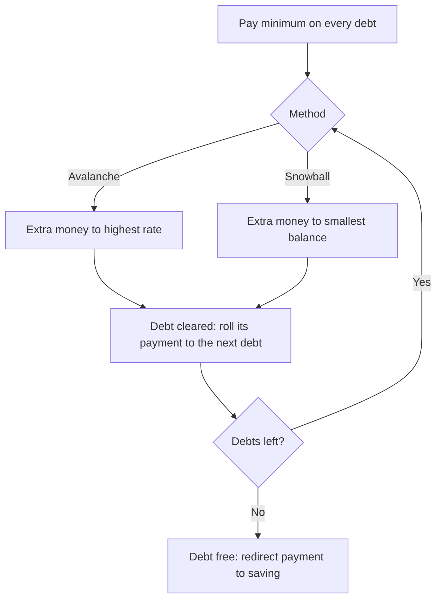
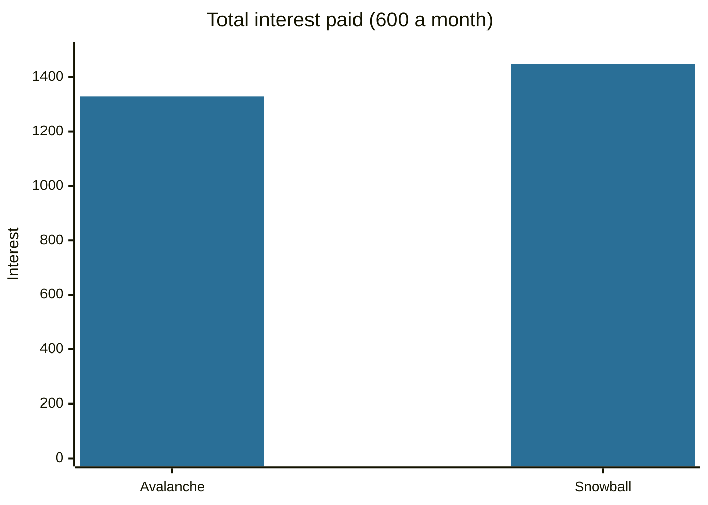

# Debt repayment strategies

## Summary

When a household has several debts, the order in which extra money is applied changes the total interest and the motivation to continue. The debt avalanche pays the highest interest rate first and minimizes total interest. The debt snowball pays the smallest balance first and gives quick wins. Both start by paying the minimum on every debt. The better method is the one the borrower will actually finish.

*This note is educational. It is not financial advice.*

## Prerequisites

- [Debt](debt.md).
- [Interest rates](interest-rates.md).

## Core concepts

### Definition

- **Debt avalanche:** pay the minimum on all debts, send all extra money to the debt with the highest interest rate, and when it is cleared move to the next highest rate.
- **Debt snowball:** pay the minimum on all debts, send all extra money to the debt with the smallest balance, and when it is cleared move to the next smallest balance.
- **Debt consolidation:** replace several debts with one loan, ideally at a lower rate. It helps only if the new rate and fees are lower and spending does not grow again.

### Analogy

Think of bailing a boat with several leaks. The avalanche plugs the largest leak (highest interest) first, which loses the least water. The snowball plugs the smallest leak first, which loses more water but gives a quick sense that progress is possible. The analogy fails because leaks do not rank by size and by count at the same time, while debts can.

### Mechanism

Interest accrues on each balance every month. Money paid to a debt with a higher rate removes more future interest per unit paid, so the avalanche is never worse than the snowball in total interest, given the same total payment. The snowball reduces the number of open accounts faster, which some borrowers find motivating, and for a borrower who gives up on a plan that feels slow, a plan that is followed beats a better plan that is dropped.



## Worked example

A household can pay 600 a month in total toward three debts, assuming no new borrowing and monthly interest of one twelfth of the annual rate.

| Debt | Balance | Annual rate | Minimum payment |
| --- | --- | --- | --- |
| Card A | 1,500 | 15% | 40 |
| Card B | 4,000 | 24% | 100 |
| Loan C | 6,000 | 8% | 150 |

```python
# Python 3.12. Compare avalanche (highest rate first) and snowball (smallest balance first).
def run(order_key, budget, debts):
    debts = [dict(b=b, r=r, m=m) for b, r, m in debts]
    interest, months = 0.0, 0
    while any(d["b"] > 0.005 for d in debts):
        months += 1
        for d in debts:                       # interest accrues first
            if d["b"] > 0:
                i = d["b"] * d["r"] / 12
                d["b"] += i
                interest += i
        left = budget
        for d in debts:                       # minimums on every open debt
            if d["b"] > 0:
                p = min(d["m"], d["b"]); d["b"] -= p; left -= p
        for d in sorted(debts, key=order_key):  # the rest goes to the target
            if d["b"] > 0 and left > 0:
                p = min(left, d["b"]); d["b"] -= p; left -= p
    return months, round(interest, 2)

debts = [(1500, 0.15, 40), (4000, 0.24, 100), (6000, 0.08, 150)]
print("avalanche", run(lambda d: -d["r"], 600, debts))
print("snowball ", run(lambda d: d["b"], 600, debts))
```

Output:

```text
avalanche (22, 1328.44)
snowball  (22, 1449.29)
```

Both plans finish in 22 months. The avalanche pays 1,328.44 in interest and the snowball 1,449.29, so the avalanche saves 120.85. The saving is modest here because the balances are small. With larger balances or a wider gap between rates the difference grows.



## Trade offs and when to use it

Use the avalanche when the rates differ a lot and you can stay disciplined without early wins. Use the snowball when motivation is the main risk, or when the smallest debts can be cleared in a few weeks. A hybrid is possible: clear one very small debt first, then switch to the avalanche. Before either, stop adding new debt, and keep a small cash buffer so that an unexpected cost does not go onto a card. If debt is beyond what income can service, contact lenders about hardship plans or consider non-profit credit counseling before any plan.

## Common mistakes

- **Stopping the minimum payments** on the debts that are not the target. This triggers fees and credit damage.
- **Not rolling the freed payment** to the next debt. The method works because the payment stays constant.
- **Borrowing again on cleared cards.** Without a changed spending pattern, the plan resets.
- **Choosing a consolidation loan that costs more** through a longer term or fees.

## Practice

1. Which method minimizes total interest, and why?
2. Three debts have balances 500, 2,000 and 5,000 and rates 12%, 20% and 9%. Which one does the snowball target first and which the avalanche?
3. What must happen to the payment of a cleared debt in both methods?

### Answers

1. The avalanche, because each unit paid to the highest rate removes the most future interest.
2. The snowball targets the 500 balance, and the avalanche targets the 20% debt.
3. It is added to the payment on the next target debt, so the total paid per month stays the same.

## Further reading

- Consumer Financial Protection Bureau. Credit reports and scores. CFPB. [Link](https://www.consumerfinance.gov/consumer-tools/credit-reports-and-scores/). Includes guidance on dealing with debt and disputing errors that affect borrowing costs
- Brealey, R. A., Myers, S. C., Allen, F. et al. (2023). *Principles of Corporate Finance (14th ed.)*. McGraw Hill. Covers valuation, risk and the cost of capital.
