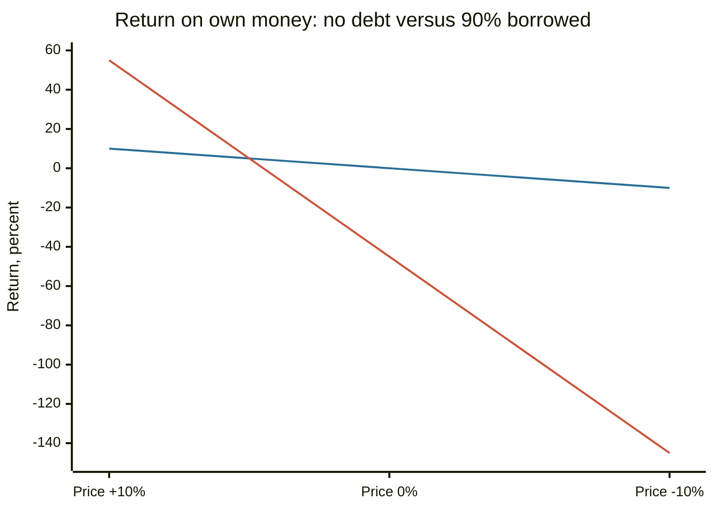

# Debt

## Summary

Debt is an obligation to repay borrowed money, normally with interest, by an agreed date. It moves purchasing power from the future to the present and lets people and companies buy assets they could not pay for in cash. Used to acquire something that produces more than the debt costs, it builds wealth. Used to consume at a high rate it destroys wealth. Because debt multiplies gains and losses alike, the questions to ask before borrowing are what the money is for, what it costs, what can go wrong, how long it lasts and what room remains if plans change.

*This note is educational. It is not financial advice.*

## Prerequisites

- [Interest rates](interest-rates.md).

## Core concepts

### Definition

*Debt* is money owed by a borrower to a lender under a contract. Its main parts are the *principal* (the amount borrowed), the *interest rate*, the *term* (time to repay), the *repayment schedule* and the *collateral* (an asset pledged to the lender, if any). Not all liabilities are debt: debt bears interest, while accounts payable, accrued wages or deferred revenue are liabilities without borrowing (see [liabilities](../accounting-basics/liabilities.md)).

### Analogy

Debt is a loan of a ladder. It lets you reach a shelf you could not reach, as long as you return it. If the shelf holds something valuable (a house, a business, an education), the ladder was worth renting. If you used the ladder to reach something you did not need, you still owe the rent. The limit of the analogy is that the rent on the ladder (interest) can grow if you are late.

### Types

| Basis | Types |
| --- | --- |
| Borrower | Consumer (household), corporate, government |
| Security | Secured (backed by collateral, such as a mortgage or car loan) and unsecured (credit cards, personal loans) |
| Repayment | Installment (fixed payments, such as a mortgage) and revolving (a limit that can be reused, such as a credit card) |
| Priority in bankruptcy | Senior debt is repaid first, subordinated debt after it |

Secured debt usually has a lower rate because the lender can seize the collateral. Unsecured debt has a higher rate because the lender has only a claim on the borrower.

### Mechanism: leverage

*Financial leverage* means using borrowed money to control a larger asset, which magnifies the result in both directions.

| Asset price change | Own money only, 10,000 | 10,000 own plus 90,000 borrowed at 5% |
| --- | --- | --- |
| +10% | +10% | +55% (gain 10,000 less interest 4,500 = 5,500) |
| 0% | 0% | -45% (interest of 4,500 on 10,000 of own money) |
| -10% | -10% | -145% (loss 10,000 plus interest 4,500) |

The last row exceeds 100%: the borrower loses more than they put in, and still owes the debt. The chart shows the return on the borrower's own money. The shallower line is the case without debt and the steeper line is the case with 90% borrowed.

### Productive and unproductive debt

*Productive debt* finances an asset that raises income or keeps value: an education that raises earnings, a business loan, a home bought to live in for many years. *Unproductive debt* finances consumption that leaves no asset, particularly at high interest. The line is not sharp: a car needed to commute can be productive, and a mortgage on an over-sized house can be a burden.

### Risk and default

*Default* is the failure to pay as agreed. Lenders judge it through the borrower's credit history ([credit scores](credit-scores.md)), income, existing debts and collateral. Useful household measures:

- **Debt-to-income ratio (DTI):** monthly debt payments divided by gross monthly income. Lenders often look for totals under about 36%, and some mortgage programs accept higher ratios, in the 43% to 50% range.
- **Debt service ratio** in a company: operating cash flow divided by debt payments.

### Debt versus equity

A company can raise money by borrowing (debt) or by selling ownership (equity). Debt must be repaid and interest is a fixed claim, but it does not dilute ownership and the interest is tax-deductible in many systems. Equity needs no repayment but shares profits and control. The choice is the *capital structure* decision covered in [WACC](../corporate-finance/wacc.md).

## Worked example

A household has a mortgage of 200,000 at a fixed 6% for 30 years (monthly payment 1,199.10, see [mortgages](mortgages.md)) and a 4-year car loan of 15,000 at 9% (monthly payment 373.28). Gross income is 6,000 a month. Payments are 1,199.10 + 373.28 = 1,572.38, so DTI = 1,572.38 / 6,000 = 26.2%, which is below the common 36% guideline. After a job loss of one earner, income halves to 3,000 and DTI doubles to 52.4%, which shows why the debt that looks safe at full income needs a cash reserve behind it (see [emergency fund](../personal-finance/emergency-fund.md)).

## Trade offs and when to use it

Debt is useful when the expected return on the asset is above the after-tax cost of the loan, when the repayment can be met in a bad scenario, and when it can be repaid before the asset loses its value. A low monthly payment is not a sign of a good loan: a longer term lowers the payment and raises the total interest. Variable rates add risk, and refinancing is not guaranteed because rates or your credit can change.

A framework for deciding:

1. **Purpose:** does it buy an asset or income, or only consumption?
2. **Cost:** what is the all-in cost (APR, fees)?
3. **Risk:** what happens if income falls or rates rise?
4. **Horizon:** is the term shorter than the useful life of the asset?
5. **Optionality:** can it be repaid early without penalty?

## Common mistakes

- **"All debt is bad."** Debt that finances an income-producing asset at a low rate can raise wealth.
- **"A low payment means a good loan."** Compare the total cost and the term.
- **"I can always refinance."** Not if rates rise, the asset falls in value or your credit worsens.
- **Borrowing for an asset that depreciates faster than the loan is repaid,** which leaves you owing more than it is worth.

## Practice

1. What does secured mean, and why is the rate usually lower?
2. In the leverage table, why does a price fall of 10% cost 145% of own money?
3. A household has debt payments of 900 and gross income of 3,000 a month. What is the DTI?

### Answers

1. Backed by collateral that the lender can seize. Lower lender risk gives a lower rate.
2. The loss on the whole 100,000 asset (10,000) plus the interest of 4,500 is 14,500, which is 145% of the 10,000 own money.
3. 900 / 3,000 = 30%.

## Further reading

- Brealey, R. A., Myers, S. C., Allen, F. et al. (2023). *Principles of Corporate Finance (14th ed.)*. McGraw Hill. Covers valuation, risk and the cost of capital.
- Consumer Financial Protection Bureau. Credit reports and scores. CFPB. [Link](https://www.consumerfinance.gov/consumer-tools/credit-reports-and-scores/). The US consumer agency's guidance on credit reports, scores and disputes.
- American Economic Association. JEL classification system. American Economic Association. [Link](https://www.aeaweb.org/econlit/jelCodes.php?view=jel). Shows where household credit and debt sit in the classification of economics (JEL D14 and G51)
