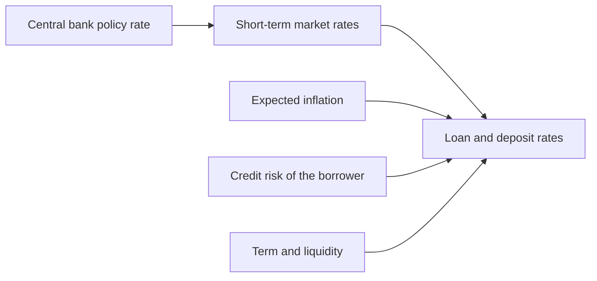
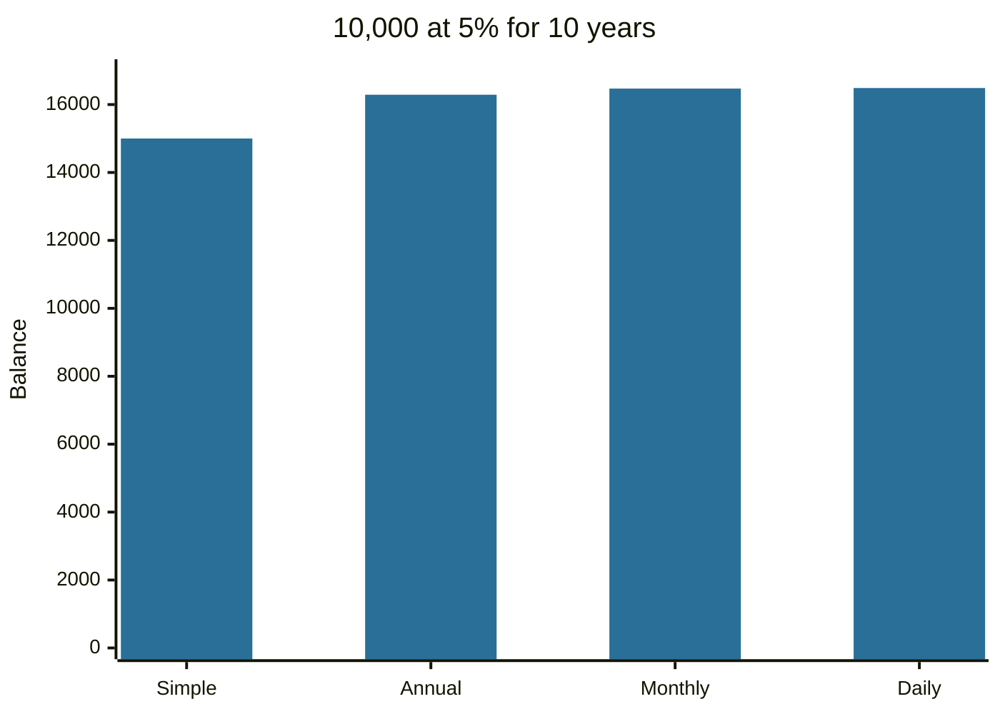

# Interest rates

## Summary

An interest rate is the price of using money for a period, expressed as a percentage of the amount. Borrowers pay it, savers and lenders receive it. Interest is either simple (charged on the original amount only) or compound (charged on the amount plus earlier interest), and compounding is what makes both savings and debts grow faster than the rate suggests. Central banks, inflation and credit risk together set the level of rates in an economy.

*This note is educational. It is not financial advice.*

## Prerequisites

No prior notes are needed. The compounding formula is derived in [time value of money](../corporate-finance/time-value-of-money.md).

## Core concepts

### Definition

The *interest rate* is the amount of interest charged or paid per period divided by the principal. The *principal* is the amount borrowed or deposited. A rate is always tied to a period, usually one year, so "5%" normally means 5% per year.

### Analogy

Interest is rent on money. A borrower rents a sum for a time and pays a price proportional to the size of the sum and the length of the rental. The analogy breaks because rent on a flat does not usually get charged again on earlier rent, while compound interest does.

### Mechanism

**Simple interest:** interest = principal × rate × time. Interest is always computed on the original principal.

**Compound interest:** interest is added to the balance each period and then earns interest itself. With annual rate r, m compounding periods per year and t years: balance = principal × (1 + r/m)^(m×t).

**What sets the level of rates.** A rate has parts:

- the real return lenders require for giving up money now,
- expected inflation (the *Fisher relation*: nominal rate ≈ real rate + expected inflation),
- a premium for default risk (borrowers with worse credit pay more),
- a premium for time and illiquidity (longer and harder-to-sell loans pay more),
- the policy rate set by the central bank, which anchors short-term rates.

The *real* interest rate is the nominal rate adjusted for inflation: (1 + nominal) / (1 + inflation) - 1.



The diagram shows the inputs that combine into the rate a borrower or saver actually sees.

## Worked example

10,000 at 5% a year for 10 years.

| Method | Balance after 10 years |
| --- | --- |
| Simple interest | 15,000.00 |
| Compound, annual | 16,288.95 |
| Compound, monthly | 16,470.09 |
| Compound, daily | 16,486.65 |

```python
# Python 3.12. Simple versus compound interest.
P, r, t = 10_000, 0.05, 10
print(P * (1 + r * t))                 # simple
print(round(P * (1 + r) ** t, 2))      # annual compounding
print(round(P * (1 + r / 12) ** (12 * t), 2))   # monthly compounding
print(round(P * (1 + r / 365) ** (365 * t), 2)) # daily compounding
```

Output:

```text
15000.0
16288.95
16470.09
16486.65
```

With inflation of 3%, the real rate is (1.05 / 1.03) - 1 = 1.94%, which is why a 5% deposit adds less purchasing power than the headline suggests.



## Trade offs and when to use it

Compounding helps savers and hurts borrowers: on a savings account you want frequent compounding and a long horizon, on a loan you want the lowest rate and a short term. Fixed rates give certainty, and variable rates move with the market, so they start lower in some periods and cost more when rates rise. To compare loans or accounts with different compounding, convert to a common measure (see [APR and APY](apr-and-apy.md)).

## Common mistakes

- **Comparing a monthly rate with an annual rate.** Convert to the same period first.
- **Ignoring inflation.** A nominal gain can be a real loss.
- **Believing that "daily compounding" changes the result a lot.** Between monthly and daily the difference is small. The rate itself and the time matter far more.
- **Using simple interest for long horizons.** It understates growth and debt.

## Practice

1. What is the balance after 3 years on 1,000 at 6% compounded annually?
2. A loan charges 1.5% per month. Is the yearly rate 18%?
3. The nominal rate is 4% and inflation is 2.5%. What is the real rate?

### Answers

1. 1,000 × 1.06^3 = 1,191.02.
2. Not exactly. The nominal annual rate is 18%, and with monthly compounding the effective annual rate is 19.56%.
3. (1.04 / 1.025) - 1 = 1.46%.

## Further reading

- Brealey, R. A., Myers, S. C., Allen, F. et al. (2023). *Principles of Corporate Finance (14th ed.)*. McGraw Hill. Covers valuation, risk and the cost of capital.
- Consumer Financial Protection Bureau. Regulation Z (Truth in Lending), 12 CFR 1026. CFPB. [Link](https://www.consumerfinance.gov/rules-policy/regulations/1026/). The US rule that sets how lenders must state the cost of credit, including rates
- Bodie, Z., Kane, A. and Marcus, A. J. (2021). *Investments (12th ed.)*. McGraw Hill. The standard university textbook on securities, portfolio theory and market efficiency.
