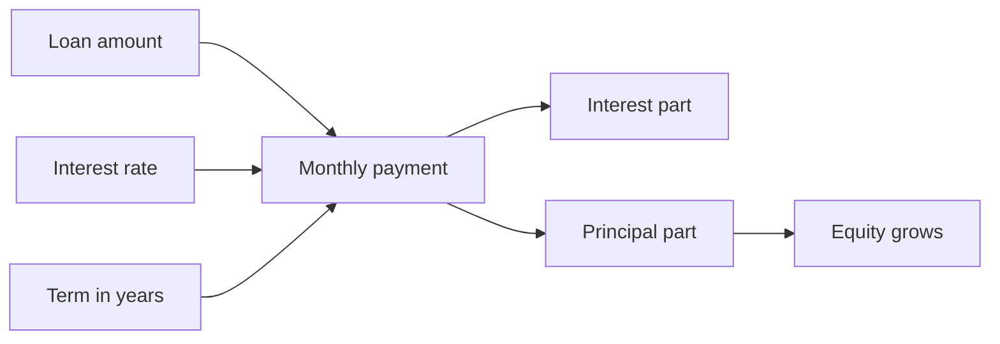
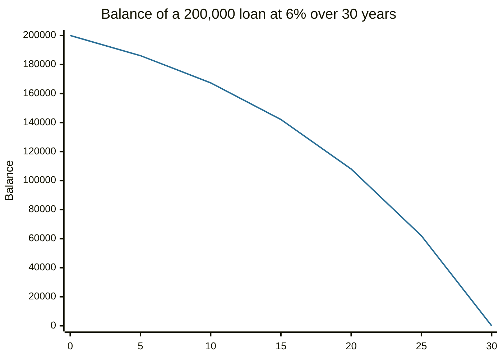

# Mortgages

## Summary

A mortgage is a loan secured by real estate. The borrower repays principal and interest in regular installments, and if payments stop the lender can take the property. Fixed-rate mortgages keep the same rate for the whole term, adjustable-rate mortgages reset after an initial period, interest-only loans defer principal, and reverse mortgages pay an older homeowner against the value of the home. Early payments are mostly interest, so the balance falls slowly at first.

*This note is educational. It is not financial advice. Terms, taxes and consumer protections differ by country; examples use US-style loans.*

## Prerequisites

- [Debt](debt.md).
- [Interest rates](interest-rates.md).
- [APR and APY](apr-and-apy.md).

## Core concepts

### Definition

A *mortgage* is a loan in which real estate is the collateral. The borrower gets the property and the lender gets a claim on it (a lien) until the loan is repaid. A loan is *amortizing* when each payment covers the interest for the period and part of the principal, so the balance reaches zero at the end of the term.

### Analogy

A mortgage is a long staircase where the first flights are mostly interest. In the first years, a payment pays the rent on the borrowed money and only a little of the stairs down. Later the proportions flip. The analogy has a limit: unlike stairs, the rate on some mortgages can change during the climb.

### Mechanism

For principal P, monthly rate i (annual rate / 12) and n monthly payments:

```text
payment = P × i / (1 - (1 + i) ^ -n)
interest in a month = balance × i
principal in a month = payment - interest
```

Common types:

| Type | How it works | Main risk |
| --- | --- | --- |
| Fixed-rate | Same rate and payment for the whole term, typically 15 or 30 years in the US | Higher starting rate than variable. Refinancing needed to benefit if rates fall |
| Adjustable-rate (ARM) | A fixed initial period, then the rate resets with an index plus a margin, within caps | Payment can rise sharply at reset |
| Interest-only | Only interest is paid for an initial period, then principal is added | Payment jumps, no equity is built early |
| Reverse mortgage | A homeowner (in the US usually 62 or older) receives money against the home equity, and the loan is repaid when they move or die | Balance grows, equity shrinks, fees are high |

Other costs: down payment, closing costs, property tax, homeowner insurance and, with a small down payment, mortgage insurance.



## Worked example

A 200,000 loan, 30 years, fixed at 6% a year.

- Monthly payment: 1,199.10.
- First month: interest 1,000.00 (200,000 × 0.005), principal 199.10.
- Total paid over 30 years: 431,676.38, of which 231,676.38 is interest.

The same loan over 15 years at 5.5% (a lower rate, because shorter loans usually cost less):

- Monthly payment: 1,634.17.
- Total interest: 94,150.04.

The balance of the 30-year loan after 5, 10, 15, 20, 25 and 30 years:

| Year | 5 | 10 | 15 | 20 | 25 | 30 |
| --- | --- | --- | --- | --- | --- | --- |
| Balance | 186,109 | 167,371 | 142,098 | 108,007 | 62,024 | 0 |



After 5 years, only 13,891 of principal has been repaid even though 71,946 was paid in total. The figures are computed with the formula above and rounded to the unit.

## Trade offs and when to use it

A mortgage lets a household buy a home that would take decades to save for, and it forces saving through principal repayment. The costs are interest, transaction costs and the loss of flexibility. A shorter term raises the payment and cuts total interest. A longer term lowers the payment and raises total interest. An ARM can suit a borrower who plans to sell or refinance before the reset and can afford the worst case payment. Check the payment against income (see debt-to-income in [debt](debt.md)) and keep a reserve for repairs and rate resets.

## Common mistakes

- **Focusing on the monthly payment only.** Compare total cost and the cost of a rate increase.
- **Ignoring closing costs and maintenance,** which can be a few percent of the price.
- **Taking an ARM without computing the worst case** after the cap.
- **Treating the home as an emergency fund.** Equity is not liquid.
- **Skipping the check of prepayment penalties** before planning to pay early.

## Practice

1. Why is most of the early payment interest?
2. Why does a 15-year loan have a higher payment but a lower total cost?
3. A loan has balance 150,000 and rate 4.8%. What is the interest in the next month?

### Answers

1. Interest is charged on the full outstanding balance, which is largest at the beginning.
2. The balance is repaid faster, so interest accrues on smaller balances for less time.
3. 150,000 × 0.048 / 12 = 600.

## Further reading

- Consumer Financial Protection Bureau. Owning a home: mortgages. CFPB. [Link](https://www.consumerfinance.gov/consumer-tools/mortgages/). Consumer guidance on mortgage types, costs and shopping around.
- Consumer Financial Protection Bureau. Regulation Z (Truth in Lending), 12 CFR 1026. CFPB. [Link](https://www.consumerfinance.gov/rules-policy/regulations/1026/). The US rule that defines how the annual percentage rate must be disclosed.
- Brealey, R. A., Myers, S. C., Allen, F. et al. (2023). *Principles of Corporate Finance (14th ed.)*. McGraw Hill. Covers valuation, risk and the cost of capital.
