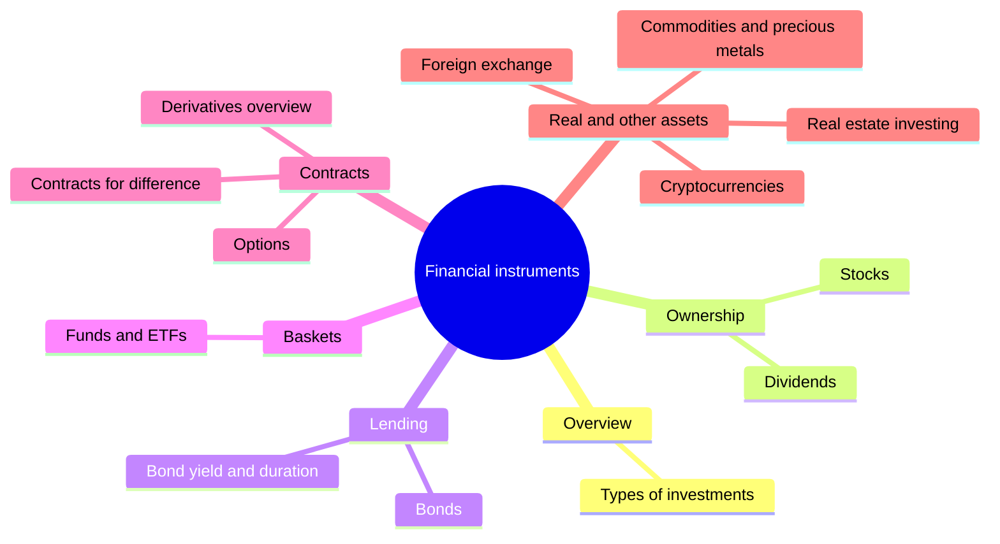

# Financial instruments

The assets and contracts that investors buy and sell: the main asset classes, stocks and dividends, bonds, funds and ETFs, derivatives, real estate, commodities, currencies and cryptocurrencies. This subfield belongs to [Finance and investing](../README.md). It describes what each instrument is, how it works, what it costs and how it fails. How instruments are traded is in [financial markets](../financial-markets/README.md), and how to combine them is in [portfolio management](../portfolio-management/README.md).

## Map of the subfield

The map groups the instruments by what the holder owns or is owed.

## Notes in reading order

**Overview**

1. [Types of investments](types-of-investments.md): asset classes compared, with US return and risk data.

**Ownership and lending**

2. [Stocks](stocks.md): shares, rights, types and risks.
3. [Dividends](dividends.md): how dividends are decided, dates, yield and payout.
4. [Bonds](bonds.md): parameters, types and risks.
5. [Bond yield and duration](bond-yield-and-duration.md): price, yield to maturity and interest rate sensitivity.
6. [Funds and ETFs](funds-and-etfs.md): active and index funds, how ETFs work, costs and distribution policy.

**Derivatives**

7. [Derivatives overview](derivatives-overview.md): forwards, futures, options, swaps, hedging and speculation.
8. [Options](options.md): calls, puts, payoffs and value.
9. [Contracts for difference](contracts-for-difference.md): leveraged cash-settled contracts and their regulation.

**Real and other assets**

10. [Real estate investing](real-estate-investing.md): rental yields, REITs and the effect of a mortgage.
11. [Commodities and precious metals](commodities-and-precious-metals.md): ways to invest, price drivers and the roll.
12. [Foreign exchange](foreign-exchange.md): pairs, pips, drivers and leverage.
13. [Cryptocurrencies](cryptocurrencies.md): blockchain, proof of work, risks and position sizing.

## Planned topics

- Money market instruments
- Swaps and interest rate derivatives
- Structured products
- Preferred shares and convertible bonds
- Private equity and venture capital

## How to use this subfield

Read note 1, then the notes on the instruments that interest you. Before notes 7 to 9 and 12, read [leverage and margin](../portfolio-management/leverage-and-margin.md).

These notes are educational. They are not investment advice.

## Navigation

- Back to [Finance and investing](../README.md).
