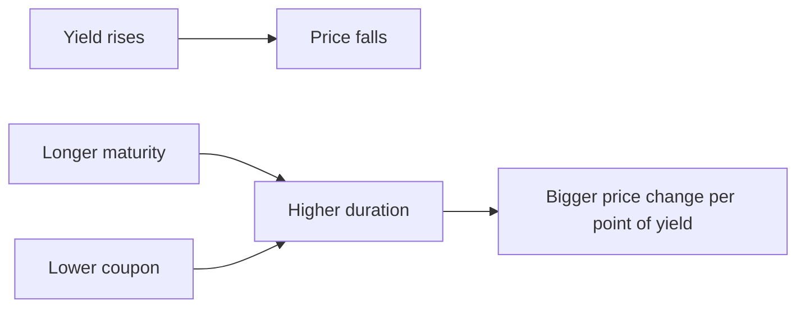
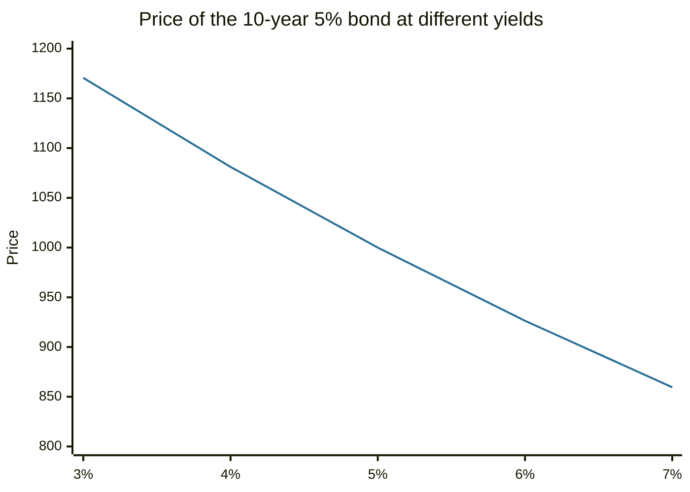

# Bond yield and duration

## Summary

The yield to maturity (YTM) is the single annual rate that makes the present value of a bond's payments equal to its price, so it is the bond's return if held to maturity and if the issuer pays. Price and yield move in opposite directions. Duration measures how sensitive the price is to a change in yield: a bond with a modified duration of 7.7 loses about 7.7% for each 1 percentage point rise in yield. Convexity explains why that estimate is only approximate.

*This note is educational. It is not investment advice.*

## Prerequisites

- [Bonds](bonds.md).
- [Time value of money](../corporate-finance/time-value-of-money.md).

## Core concepts

### Definition

For a bond with coupon C per year, face value F, n years to maturity and yield y:

```text
Price = C/(1+y) + C/(1+y)^2 + ... + (C+F)/(1+y)^n
```

- **Yield to maturity (YTM):** the y that solves the equation for the observed price. It assumes that all payments are made on time and that coupons are reinvested at the same yield.
- **Current yield:** coupon divided by price. It ignores the gain or loss at maturity.
- **Macaulay duration:** the weighted average time until the payments are received, with weights equal to the present value of each payment, measured in years.
- **Modified duration:** Macaulay duration divided by (1 + y). It estimates the percentage price change for a 1 percentage point change in yield: change in price ≈ -modified duration × change in yield.

### Analogy

A bond is a seesaw balanced on its yield. A long bond is a long seesaw: a small push at the yield end moves the price end a lot. Duration is the length of the seesaw. The analogy breaks because a seesaw is straight, and the price-yield curve is curved, so the estimate from duration alone is too pessimistic for yield rises and too optimistic for falls.

### Mechanism

The price-yield relationship is convex: the price rises more when yields fall than it drops when yields rise by the same amount. Duration is the slope at the current point and convexity is the curvature.



Duration rises with maturity and falls with the coupon rate and the yield. A zero-coupon bond has a duration equal to its maturity.

## Worked example

A bond has a face value of 1,000, a 5% annual coupon and 10 years to maturity.

```python
# Python 3.12. Bond price, yield to maturity and duration for a 10-year, 5% annual-coupon bond.
def price(y, c=50, face=1000, n=10):
    return sum(c / (1 + y) ** k for k in range(1, n + 1)) + face / (1 + y) ** n

def ytm(p, lo=0.0, hi=0.5):
    for _ in range(100):                      # bisection: price falls as yield rises
        mid = (lo + hi) / 2
        lo, hi = (mid, hi) if price(mid) > p else (lo, mid)
    return mid

for y in (0.03, 0.04, 0.05, 0.06, 0.07):
    print(f"yield {y:.0%}: price {price(y):.2f}")

p0, y0 = price(0.05), 0.05
flows = [50] * 9 + [1050]
mac = sum(k * cf / (1 + y0) ** k for k, cf in enumerate(flows, 1)) / p0
mod = mac / (1 + y0)
print(f"Macaulay {mac:.2f} years, modified {mod:.2f}")
print(f"duration estimate for +1 point: {-mod * 1:.2f}%, exact: {(price(0.06) / p0 - 1) * 100:.2f}%")
print(f"YTM at price 950: {ytm(950):.3%}")
```

Output:

```text
yield 3%: price 1170.60
yield 4%: price 1081.11
yield 5%: price 1000.00
yield 6%: price 926.40
yield 7%: price 859.53
Macaulay 8.11 years, modified 7.72
duration estimate for +1 point: -7.72%, exact: -7.36%
YTM at price 950: 5.669%
```

Reading the output: at a yield of 5% the bond sells at par. If the yield rises to 6%, the price falls 7.36%, and the duration estimate of 7.72% overstates the fall because of convexity. If the bond sells at 950, the yield is 5.669%, higher than the coupon rate because the buyer also gains 50 at maturity.



The line bends toward the axis: equal steps in yield cause price changes that are not equal, which is the convexity.

For comparison, the same calculation for 5% bonds at a 5% yield gives a modified duration of 1.86 for 2 years, 7.72 for 10 years and 15.37 for 30 years. A 30-year bond is therefore about twice as sensitive as a 10-year bond.

## Trade offs and when to use it

Use YTM to compare bonds with different coupons and prices. Use duration to measure and control interest rate risk: an investor who expects rates to rise can choose shorter duration, and a pension fund can match the duration of assets to that of its liabilities (immunization). YTM assumes reinvestment at the same rate and no default, so for risky bonds it overstates the expected return. Duration works for small yield changes and parallel shifts of the yield curve. For options such as callable bonds, effective duration is needed.

## Common mistakes

- **Mixing up coupon and yield.** The coupon is fixed by contract, the yield changes with price.
- **Using duration for large moves** without a convexity adjustment.
- **Reading YTM as a promised return.** It holds only if the bond is held to maturity, the issuer pays and coupons are reinvested at the YTM.
- **Comparing durations of bonds in different currencies or with embedded options without adjustment.**

## Practice

1. A bond with modified duration 6 loses about how much if the yield rises by 0.5 percentage points?
2. If a bond's price is below par, is the YTM above or below the coupon rate?
3. Why does a zero-coupon bond have the highest duration for a given maturity?

### Answers

1. About 3%.
2. Above, because the holder also earns the gain up to par at maturity.
3. All the value arrives at maturity, so the average time to payment equals the maturity.

## Further reading

- Fabozzi, F. J. (2016). *Bond Markets, Analysis, and Strategies (9th ed.)*. Pearson. Covers bond pricing, yield measures and duration.
- U.S. Securities and Exchange Commission, Office of Investor Education and Advocacy. Bonds. Investor.gov. [Link](https://www.investor.gov/introduction-investing/investing-basics/investment-products/bonds-or-fixed-income-products/bonds). Regulator guide to how bonds work and what risks they carry.
- U.S. Department of the Treasury, TreasuryDirect. Marketable securities. TreasuryDirect. [Link](https://www.treasurydirect.gov/marketable-securities/). Official description of Treasury bills, notes, bonds, TIPS and floating rate notes.
