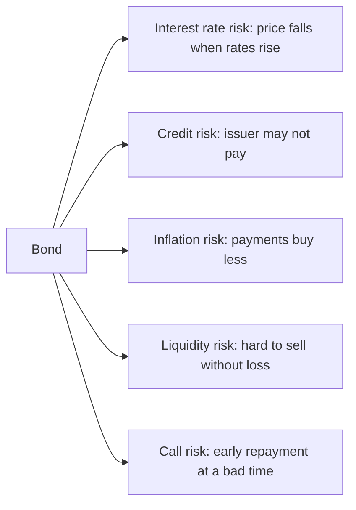

# Bonds

## Summary

A bond is a tradable loan. The issuer (a government, a municipality or a company) borrows an amount, pays interest called the coupon, and repays the face value on a set maturity date. The bondholder is a lender with a contractual claim, not an owner, and ranks ahead of shareholders if the issuer fails. Bond prices move opposite to market interest rates, and the main risks are interest rate risk, credit risk, inflation risk and liquidity risk.

*This note is educational. It is not investment advice.*

## Prerequisites

- [Debt](../credit-and-debt/debt.md).
- [Interest rates](../credit-and-debt/interest-rates.md).

## Core concepts

### Definition

A *bond* is a debt security in which the *issuer* promises the *bondholder* (the lender) to pay interest and to repay the principal under stated terms. Bonds can be held to maturity or sold earlier on the secondary market. Bond markets are large: government bonds fund public budgets, and corporate bonds fund companies without issuing shares.

### Analogy

A bond is an IOU with a schedule: "I owe you 1,000. I will pay you 50 each year, and give you the 1,000 back in ten years." You can hand the IOU to someone else, who then collects the payments. The analogy has a limit: the IOU's market price changes every day with interest rates, so selling early can mean a gain or a loss.

### Parameters

| Parameter | Meaning |
| --- | --- |
| Face value (par, nominal) | The amount repaid at maturity and the base for coupon calculation |
| Coupon | The yearly interest rate on face value, fixed or floating |
| Coupon frequency | How often interest is paid: monthly, quarterly, semi-annually, annually |
| Maturity date | The date the face value is repaid |
| Issue price and market price | The price at issue (at par, at a discount or at a premium) and the current trading price |
| Yield to maturity (YTM) | The annual return if bought at the market price and held to maturity (see [bond yield and duration](bond-yield-and-duration.md)) |
| Credit rating | An agency's opinion of the issuer's ability to pay (for example Moody's, S&P, Fitch) |
| Seniority and security | Whether the claim is secured by assets and where it ranks in insolvency |

### Types

- **By issuer:** government (Treasury bonds in the US, national government bonds elsewhere), municipal, corporate, supranational.
- **By coupon:** *fixed-rate*, *floating-rate* (the coupon follows a reference rate), *zero-coupon* (no coupons, sold at a discount and repaid at face value), *inflation-linked* (principal or coupon adjusts with consumer prices).
- **By options:** *callable* (the issuer may repay early, usually when rates fall) and *putable* (the holder may demand early repayment).
- **By credit quality:** *investment grade* (rated BBB- or Baa3 and above) and *high yield* (below that), with higher yield and higher default risk.

### Risks



*Interest rate risk* is the main risk for high-quality bonds. A fixed coupon becomes less attractive when new bonds pay more, so the market price falls until the yield matches. The longer the maturity, the larger the effect. *Credit risk* is higher for corporate and high-yield issuers and is compensated by a higher yield (the credit spread).

## Worked example

A bond has a face value of 1,000, a coupon of 5% paid yearly (50) and 10 years to maturity. The investor buys at 1,000, so the yield is 5%. Two years later, new 8-year bonds of the same quality yield 6%.

- The old bond still pays 50, which is less attractive. The market price falls until its yield rises to about 6%: price = 50 × annuity factor(6%, 8) + 1,000 / 1.06^8 = 937.90.
- A holder who sells now loses 62.10 per bond compared with the purchase price, though the coupons of 100 received so far offset part of the loss.
- A holder who keeps the bond to maturity still receives 50 a year and 1,000 at the end. The paper loss does not become real unless the bond is sold or the issuer defaults.

The bond price at the new yield is calculated below.

```python
# Python 3.12. Price of a 5% annual-coupon bond with 8 years left at a 6% yield.
face, coupon, y, n = 1000, 50, 0.06, 8
price = sum(coupon / (1 + y) ** k for k in range(1, n + 1)) + face / (1 + y) ** n
print(round(price, 2))
```

Output:

```text
937.9
```

## Trade offs and when to use it

High-quality bonds give predictable income and have been less volatile than stocks, so they stabilize a portfolio and fit goals with a known date. The cost is lower long-run returns than stocks in the historical record, exposure to inflation and, for long maturities, large price swings when rates move. Government bonds of stable countries carry little credit risk in their own currency, and corporate and emerging market bonds pay more for more risk. Bond funds and ETFs give diversification but have no maturity date (see [funds and ETFs](funds-and-etfs.md)).

A common claim needs correction: bonds are not issued only by the state, and bondholders are not owners. A bond listed on an exchange is still a bond. Bonds of private issuers are traded on dedicated markets as well (in Poland, for example, on the Catalyst market run by the Warsaw Stock Exchange).

## Common mistakes

- **Treating bonds as risk-free.** Rate rises, inflation and defaults all hurt.
- **Comparing coupons instead of yields.** The coupon is set at issue, and the yield uses the current price.
- **Ignoring call features.** A callable bond is repaid when it is most attractive to the holder.
- **Reaching for yield.** A much higher yield than similar bonds usually means higher default risk.

## Practice

1. What happens to the price of a fixed-rate bond when market yields rise?
2. A bond with face value 1,000 and coupon 4% pays how much interest a year?
3. Why does a longer maturity make a bond riskier to interest rate changes?

### Answers

1. It falls, so that the yield on the bond matches the new market yield.
2. 40.
3. The fixed payments are discounted over a longer period, so the present value changes more for each point of rate change.

## Further reading

- U.S. Securities and Exchange Commission, Office of Investor Education and Advocacy. Bonds. Investor.gov. [Link](https://www.investor.gov/introduction-investing/investing-basics/investment-products/bonds-or-fixed-income-products/bonds). Regulator guide to how bonds work and what risks they carry.
- FINRA. Bonds. Financial Industry Regulatory Authority. [Link](https://www.finra.org/investors/investing/investment-products/bonds). Industry regulator overview of bond types and risks.
- U.S. Department of the Treasury, TreasuryDirect. Marketable securities. TreasuryDirect. [Link](https://www.treasurydirect.gov/marketable-securities/). Official description of Treasury bills, notes, bonds, TIPS and floating rate notes.
- Fabozzi, F. J. (2016). *Bond Markets, Analysis, and Strategies (9th ed.)*. Pearson. Covers bond pricing, yield measures and duration.
