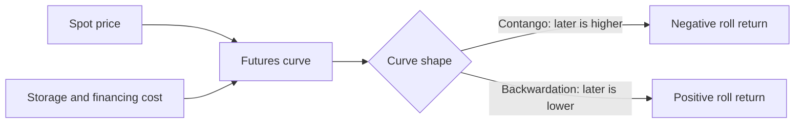
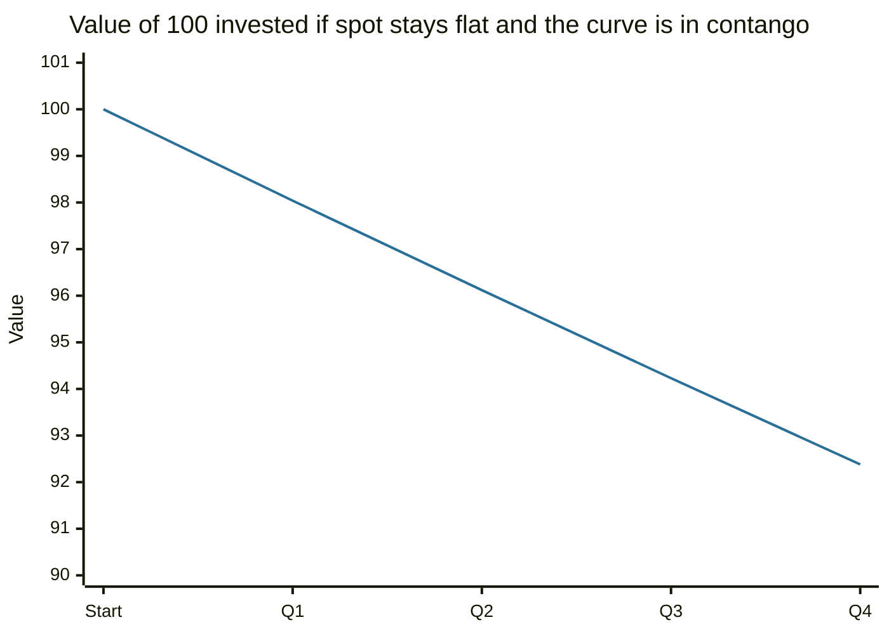

# Commodities and precious metals

## Summary

Commodities are standardized raw materials such as oil, natural gas, wheat, copper and gold. Investors gain exposure through physical holding (mostly for precious metals), futures, funds and ETFs, and shares of producers. Prices are driven by supply and demand, weather, stocks in storage, export restrictions and the currency in which they are quoted. Commodities pay no income, and futures-based exposure has a cost or gain from rolling contracts that can be as large as the price move itself.

*This note is educational. It is not investment advice.*

## Prerequisites

- [Derivatives overview](derivatives-overview.md).
- [Types of investments](types-of-investments.md).

## Core concepts

### Definition

A *commodity* is a basic good that is interchangeable with others of the same grade, so its price is set by the market and not by the producer. Groups: energy (crude oil, natural gas), agricultural products (wheat, coffee), industrial metals (copper, aluminum), livestock, and precious metals (gold, silver, platinum, palladium). Gold and silver also serve as a store of value, which separates them from other commodities.

### Analogy

A commodity is a bucket of water in a market where all buckets are the same: the only thing that varies is the price, and it moves with how much water exists and how thirsty people are. The analogy breaks because water cannot be stored at no cost, while gold can, and oil and wheat are costly to store, which affects futures prices.

### Ways to invest

| Route | How it works | Issues |
| --- | --- | --- |
| Physical | Buy and store (bars, coins) | Storage, insurance, dealer spreads. Common for gold |
| Futures | Contracts on the commodity | Leverage, rolling, expertise needed |
| Commodity funds and ETFs | Hold futures, physical metal or swaps | Fees, roll costs, tracking |
| Shares of producers | Mining or oil companies | Company and market risk, not a pure commodity bet |
| Derivatives such as CFDs | Leveraged exposure | See [contracts for difference](contracts-for-difference.md) |

### What drives prices

1. **Supply and demand.** Production, discoveries, demand from industry and consumers.
2. **Weather.** Harvests, hydropower, heating and cooling demand.
3. **Export restrictions and policy.** Quotas, sanctions, tariffs.
4. **Stocks.** Low inventories make prices more sensitive to shocks.
5. **Currency.** Most commodities are priced in US dollars, so a stronger dollar often lowers the price for holders of other currencies, and the reverse. The relationship is not constant.
6. **Costs of storage and financing.** They determine the shape of the futures curve.

### Mechanism: the roll

A futures contract expires, so a fund that wants to keep exposure sells the expiring contract and buys the next one (*rolling*). If later contracts cost more than the current one (*contango*), each roll buys at a higher price and the investor loses that gap if the spot price stays flat. If later contracts cost less (*backwardation*), the roll gains. Gorton and Rouwenhorst (2006) studied an index of commodity futures from 1959 to 2004 and reported returns comparable to stocks, low or negative correlation with stocks and bonds, and positive correlation with inflation. Their results concern futures positions, which earn the roll return and a risk premium, and not the spot price.

## Worked example

Spot is 100 and the three-month future trades at 102 (contango). A fund buys the future and holds it to expiry, when it converges to the spot price. If spot is unchanged at 100, the fund loses 2 on a 102 contract, which is 1.96%. If this repeats every quarter, the annual effect is (1 - 0.0196)^4 - 1 = -7.6%, even though the spot price did not move.

The values are 100 × 0.9804^n. An investor in physical gold has no roll cost, and pays for storage and insurance instead. An investor holding the shares of a gold miner has leverage to the gold price, and the operating risk of the mine.

## Trade offs and when to use it

Commodities can diversify a portfolio, since their drivers differ from those of stocks and bonds, and can hedge inflation shocks that come from supply problems. The correlation to stocks is not stable, and in the long run commodities have not matched stocks. They give no income and are very volatile. Precious metals suit investors who want a store of value outside the financial system, with the understanding that gold has had long periods of weak returns. For small investors, a broad fund is simpler than futures.

## Common mistakes

- **Equating an ETF's return with the spot price.** The roll and fees can differ a lot.
- **Treating gold as risk-free.** Its price fell by a third in some years of the Damodaran dataset (see [types of investments](types-of-investments.md)).
- **Buying a producer's shares and expecting the commodity's return.**
- **Using leverage in thinly traded contracts.**

## Practice

1. What is contango, and what does it do to the return of a futures-based fund?
2. Why does a stronger US dollar often weigh on commodity prices?
3. Name two ways to hold gold.

### Answers

1. Later futures cost more than earlier ones. Rolling costs the gap, which reduces the return when the spot price is flat.
2. Commodities are priced in dollars, so they become more expensive in other currencies and demand can fall. The effect is not fixed.
3. Physical bars or coins, and gold ETFs or producer shares.

## Further reading

- Gorton, G. and Rouwenhorst, K. G. (2006). Facts and fantasies about commodity futures. *Financial Analysts Journal*, 62(2), 47-68. Documents the historical return and risk of commodity futures compared with stocks and bonds.
- Hull, J. C. (2021). *Options, Futures, and Other Derivatives (11th ed.)*. Pearson. The standard reference on how forwards, futures, options and swaps work and are priced.
- Damodaran, A. Damodaran Online. NYU Stern. [Link](https://pages.stern.nyu.edu/~adamodar/). Free datasets on historical returns, multiples and valuation by industry.
