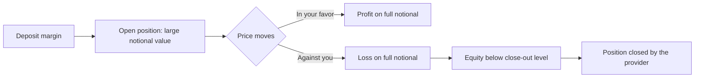
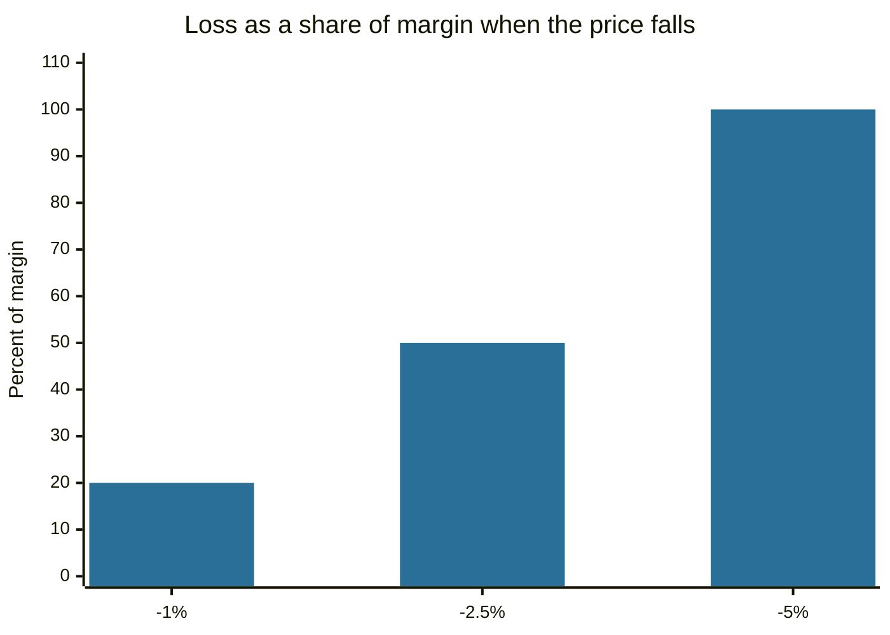

# Contracts for difference

## Summary

A contract for difference (CFD) is an agreement between a client and a broker to exchange the difference between the opening and closing price of an underlying asset. The client never owns the asset, and trades on margin, so a small deposit controls a large position. This leverage magnifies gains and losses, and CFD providers must warn that most retail accounts lose money. The EU restricts retail CFD leverage, and CFDs are generally not available to retail clients in the United States.

*This note is educational. It is not investment advice. CFDs are complex, leveraged and high-risk. Rules differ by country, so check what applies to you.*

## Prerequisites

- [Derivatives overview](derivatives-overview.md).
- [Leverage and margin](../portfolio-management/leverage-and-margin.md).

## Core concepts

### Definition

A *contract for difference* is an OTC derivative in which the buyer (long) receives from the seller the increase in the price of the underlying from the open to the close of the contract, and pays the seller the decrease. A short CFD works the other way. The underlying can be a share, an index, a commodity, a currency pair or a cryptocurrency. Because the contract is settled in cash, there is no delivery and no ownership, so shareholder rights such as voting do not pass to the holder (a dividend adjustment is credited or debited instead).

### Analogy

A CFD is a bet with the broker on the difference between two prices, with a deposit as the stake. The broker is usually the counterparty, not an exchange. The analogy has a limit: unlike a one-time bet, you keep a position open and pay a financing charge for each night, which makes holding costly.

### Mechanism

- **Margin.** A deposit (a fraction of the position's value) is required. Leverage of 20:1 means a margin of 5%.
- **Profit and loss.** Position size × (closing price - opening price) for a long, and the opposite for a short.
- **Costs.** The spread, overnight financing on the full position value, commissions on some products and currency conversion.
- **Margin close-out.** If losses reduce the account equity below a set share of the margin, the provider closes the position.

In 2018 the European Securities and Markets Authority (ESMA) adopted measures for retail CFDs: leverage limits between 30:1 (major currency pairs) and 2:1 (cryptocurrencies), a margin close-out at 50% of the required margin per account, negative balance protection, a ban on incentives and a standard risk warning.

## Worked example

A trader buys 100 ounces of gold CFD at 2,000, a notional value of 200,000. Retail leverage for gold in the EU is limited to 20:1, so the margin is 5%, or 10,000.

| Price change | Profit or loss | As a share of the margin |
| --- | --- | --- |
| +1% (to 2,020) | +2,000 | +20% |
| -1% (to 1,980) | -2,000 | -20% |
| -2.5% (to 1,950) | -5,000 | -50%, close-out level |
| -5% (to 1,900) | -10,000 | -100%, the margin is gone |

At the 50% close-out rule, the provider closes the position when the loss reaches 5,000, which is a fall of 2.5% in the price, before spread and financing costs. A 2.5% move in gold can occur in a day.

## Trade offs and when to use it

CFDs allow short positions and exposure to many markets from one account with a small deposit. The costs are the spread, daily financing, leverage risk and the broker as counterparty (check regulation and client money protection). In the EU, providers must give a standardized risk warning that states the percentage of their retail accounts that lose money. For most people a diversified fund is a better fit. Where a CFD is used, small position sizes and stop orders limit the damage, and a trader should know that a stop order may not fill at the stop price in a gap.

## Common mistakes

- **Sizing by the margin instead of the notional value.** The risk is on the full position.
- **Holding for weeks.** Overnight financing accumulates.
- **Trading without a loss limit.**
- **Choosing an unregulated provider** with high leverage offered from abroad.

## Practice

1. A CFD position has a notional value of 50,000 and leverage of 10:1. What is the margin, and what is a 3% loss as a share of it?
2. Does the holder of a CFD on a share have voting rights?
3. Why are CFDs costly to hold for a long time?

### Answers

1. The margin is 5,000. A 3% loss is 1,500, or 30% of the margin.
2. No, because the holder does not own the share.
3. Overnight financing is charged on the whole position and accumulates each day.

## Further reading

- ESMA (2018). ESMA adopts final product intervention measures on CFDs and binary options. European Securities and Markets Authority. [Link](https://www.esma.europa.eu/press-news/esma-news/esma-adopts-final-product-intervention-measures-cfds-and-binary-options). States the leverage limits, margin close-out and negative balance protection for retail CFDs in the EU.
- Hull, J. C. (2021). *Options, Futures, and Other Derivatives (11th ed.)*. Pearson. The standard reference on how forwards, futures, options and swaps work and are priced.
