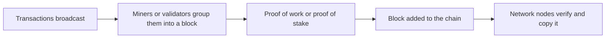
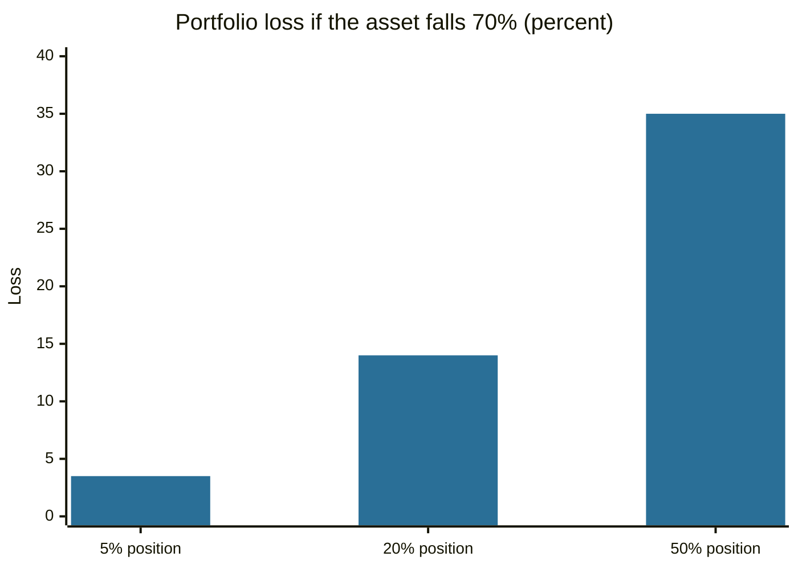

# Cryptocurrencies

## Summary

A cryptocurrency is a digital asset recorded on a shared ledger (a blockchain) and secured by cryptography, with no central issuer in the original design. Bitcoin, introduced in 2008, showed how a network of strangers can agree on who owns what through proof of work. Cryptocurrencies produce no cash flows, so their prices depend on adoption and speculation, and they have been extremely volatile. Regulation is developing, for example in the EU under the MiCA regulation.

*This note is educational. It is not investment advice. Crypto-assets are high-risk, and fraud is common in this market.*

## Prerequisites

- [Types of investments](types-of-investments.md).
- [Risk and return](../portfolio-management/risk-and-return.md).

## Core concepts

### Definition

A *cryptocurrency* is a digital unit of value whose ownership and transfers are recorded on a *distributed ledger* that many computers maintain, with rules enforced by software and cryptography (public-key signatures and hash functions). A *token* is a unit created on top of an existing blockchain (for example, to represent a right or a stablecoin), while a *coin* belongs to the network's own base layer.

### Analogy

A blockchain is a public notebook that thousands of people keep copies of, and everyone agrees on the next page by following the same rules. Nobody can erase a page without the others noticing. The analogy has a limit: unlike a notebook, the keys that give access to the coins are held by owners, and a lost key means lost coins, with no one to call.

### Mechanism

In Bitcoin, transactions are grouped into *blocks*, each linked to the previous one by a hash, which makes the history tamper-evident. Participants called *miners* compete to add the next block by solving a computational puzzle (*proof of work*), and the winner receives newly issued coins and fees. This secures the ledger at the cost of energy, and the supply rule is fixed in the software (Nakamoto, 2008). Other networks use *proof of stake*, in which validators put up coins as collateral instead of computing power.

Main features: **decentralization** (no single operator), **transparency** (the ledger is public), **limited or rule-based supply** and **self-custody** (the owner holds the private key, or a custodian does).

### Investing approaches

- **Holding ("hodl")** a coin for years, betting on adoption.
- **Trading** on exchanges, which are often unregulated or lightly regulated, with leverage on some platforms.
- **Staking and lending**, which earn a return but add platform and smart contract risk.

### Risks

- **Volatility.** Drops of more than half have repeated in the history of major coins.
- **No fundamental anchor.** There is no earnings stream to value, so models such as [DCF](../corporate-finance/discounted-cash-flow.md) do not apply directly.
- **Custody and fraud.** Exchange failures, hacks, phishing and scams have caused large losses.
- **Regulatory and tax risk.** Rules are changing. The EU's MiCA regulation (Regulation (EU) 2023/1114) sets rules for issuers of crypto-assets and for service providers.
- **Market immaturity.** Thin liquidity, manipulation and linked failures.

## Worked example

Volatility matters for how large a position should be. Suppose an investor holds a portfolio of 100,000 and considers putting a share in a crypto-asset that, in a bad scenario, loses 70% (a hypothetical figure for the illustration).

| Share in the asset | Amount | Portfolio loss if the asset loses 70% |
| --- | --- | --- |
| 5% | 5,000 | 3,500 (3.5% of the portfolio) |
| 20% | 20,000 | 14,000 (14%) |
| 50% | 50,000 | 35,000 (35%) |

A 5% position keeps the portfolio loss small enough to bear, and a 50% position does not.

## Trade offs and when to use it

Some investors treat a small crypto holding as a speculative satellite, with the awareness that it can go to zero. The benefits claimed (decentralization, hedge against currency debasement, access outside banks) are real design features, and their value for any one investor is uncertain. The costs are volatility, custody work, scams and tax complexity. Do not invest money needed soon, never share private keys or seed phrases, and prefer regulated venues.

## Common mistakes

- **Buying after a large rise because of news.** Performance chasing is common in volatile markets.
- **Keeping coins on a platform you do not trust.**
- **Falling for guaranteed returns.** Promises of fixed high returns signal fraud.
- **Putting a large share of savings in one asset.**
- **Forgetting taxes** on gains and on trades between coins.

## Practice

1. What is the difference between a coin and a token?
2. Why can models like DCF not value a coin directly?
3. What does proof of work secure, and at what cost?

### Answers

1. A coin belongs to a network's base layer, a token is created on top of an existing blockchain.
2. A coin pays no cash flows, so there is no stream to discount.
3. It secures the ledger against rewriting, at the cost of energy used by miners.

## Further reading

- Nakamoto, S. (2008). Bitcoin: a peer-to-peer electronic cash system. bitcoin.org. [Link](https://bitcoin.org/bitcoin.pdf). The original design of Bitcoin and its proof-of-work ledger.
- Regulation (EU) 2023/1114 on markets in crypto-assets (MiCA). European Union. [Link](https://eur-lex.europa.eu/eli/reg/2023/1114/oj). The EU regulation that sets rules for issuers and service providers of crypto-assets.
- Bodie, Z., Kane, A. and Marcus, A. J. (2021). *Investments (12th ed.)*. McGraw Hill. Textbook treatment of risk and diversification that applies to any speculative asset
