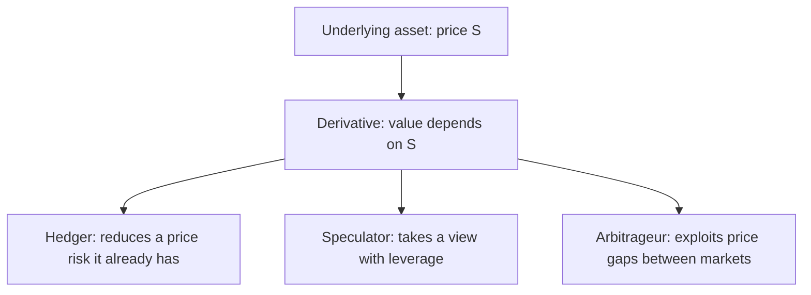
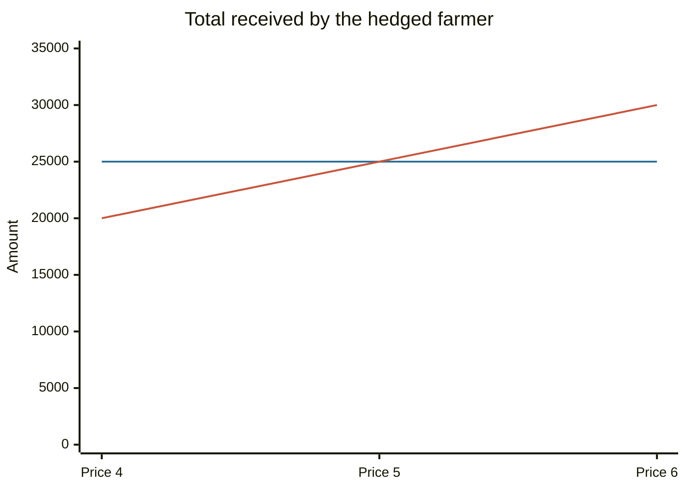

# Derivatives overview

## Summary

A derivative is a contract whose value depends on the price of an underlying asset such as a commodity, a share, an index, a currency or an interest rate. The main kinds are forwards, futures, options and swaps. They are used to hedge risk (lock in a price) and to speculate (take a leveraged view). Because they involve little or no upfront payment relative to exposure, they can magnify gains and losses.

*This note is educational. It is not investment advice. Derivatives are complex and high-risk instruments.*

## Prerequisites

- [Types of investments](types-of-investments.md).
- [Time value of money](../corporate-finance/time-value-of-money.md).

## Core concepts

### Definition

A *derivative* is a financial contract that derives its value from an *underlying* asset or reference rate. It has no value of its own beyond the contract. The two sides are called the *long* (buyer) and the *short* (seller).

### Analogy

A derivative is a bet or an insurance policy written on a price. If you are a farmer, a forward contract is insurance on the price of your crop. If you do not own wheat but buy a wheat future, it is a bet. The contract is the same, and the purpose differs. The analogy breaks because, unlike a casino bet, a derivative can be a hedge that reduces the total risk of a business.

### The main kinds

| Kind | Obligation | Where traded | Payoff shape |
| --- | --- | --- | --- |
| Forward | Both sides must trade at the agreed price on a date | Over the counter (OTC), tailored | Linear |
| Future | Standardized forward on an exchange, settled daily (marked to market) | Exchange | Linear |
| Option | The buyer has the right, not the duty, to buy (call) or sell (put) at a strike price | Exchange and OTC | Asymmetric (see [options](options.md)) |
| Swap | Two parties exchange cash flows (for example fixed for floating interest) | OTC | Linear in rates |
| Contract for difference | Pay the change in price between opening and closing | Broker (OTC) | Linear (see [contracts for difference](contracts-for-difference.md)) |

*Symmetric* derivatives (forwards, futures, swaps) oblige both sides, so each can gain or lose without limit. *Asymmetric* derivatives (options) limit the buyer's loss to the premium paid.

### Mechanism: futures

A futures contract fixes the price, quantity, quality and delivery date of an underlying asset. An exchange clearing house stands between buyer and seller. Both post *margin*, and gains and losses are settled every day. Few futures end in physical delivery, and most are closed out before expiry by an opposite trade.

For an asset with no income and storage cost, the no-arbitrage futures price is the spot price compounded at the risk-free rate: F = S × (1 + r)^T. Storage, income and convenience adjust this.

## Worked example

A farmer expects to harvest 5,000 bushels of wheat in six months. The price now is 5.00 a bushel, and the farmer fears a fall. The farmer sells one futures contract of 5,000 bushels at 5.00.

| Wheat price at harvest | Sale of crop at spot | Gain on futures | Total received |
| --- | --- | --- | --- |
| 4.00 | 20,000 | +5,000 (5.00 - 4.00 per bushel) | 25,000 |
| 5.00 | 25,000 | 0 | 25,000 |
| 6.00 | 30,000 | -5,000 | 25,000 |

The farmer receives 25,000 whatever happens. The hedge removes the loss from a falling price and the gain from a rising one (and the buyer on the other side, such as a baker, is protected against a rise). Basis risk remains: the futures price and the price the farmer gets locally may not move by the same amount.

The first line is the hedged farmer and the second line is the unhedged farmer.

## Trade offs and when to use it

Hedging is useful when a price risk threatens a business, such as airlines on fuel, exporters on currencies or borrowers on interest rates. Speculation with derivatives concentrates risk through leverage: a small price move can wipe out the margin. Derivatives are priced with models (Black and Scholes, 1973, for options) that rest on assumptions. Counterparty risk matters in OTC markets, and central clearing and margin rules reduce it.

## Common mistakes

- **Treating a derivative as a cheap way to own the asset.** Leverage makes losses larger.
- **Ignoring margin calls.** A position can be closed at a loss when margin is not met.
- **Confusing a hedge with a profit.** A perfect hedge removes risk and also the upside.
- **Forgetting the contract size and expiry.**

## Practice

1. Name two differences between a forward and a future.
2. Why does a hedged farmer receive the same amount at any harvest price?
3. Which kind of derivative limits the buyer's loss to the premium?

### Answers

1. A future is standardized, exchange-traded and settled daily, and a forward is tailored, OTC and settled at the end.
2. A loss on the crop sale is offset by a gain on the futures position, and the reverse.
3. An option.

## Further reading

- Hull, J. C. (2021). *Options, Futures, and Other Derivatives (11th ed.)*. Pearson. The standard reference on how forwards, futures, options and swaps work and are priced.
- Black, F. and Scholes, M. (1973). The pricing of options and corporate liabilities. *Journal of Political Economy*, 81(3), 637-654. [DOI](https://doi.org/10.1086/260062). The option pricing model behind modern derivatives valuation.
- FINRA. Options. Financial Industry Regulatory Authority. [Link](https://www.finra.org/investors/investing/investment-products/options). Explains calls, puts and the risks of options trading.
- Bank for International Settlements (2025). Triennial Central Bank Survey of foreign exchange and OTC derivatives markets in 2025. Bank for International Settlements. [Link](https://www.bis.org/statistics/rpfx25.htm). Reports turnover in OTC foreign exchange and interest rate derivatives, which shows how large these markets are
