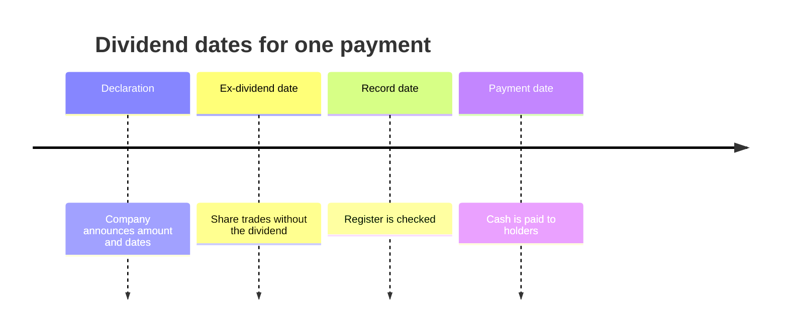
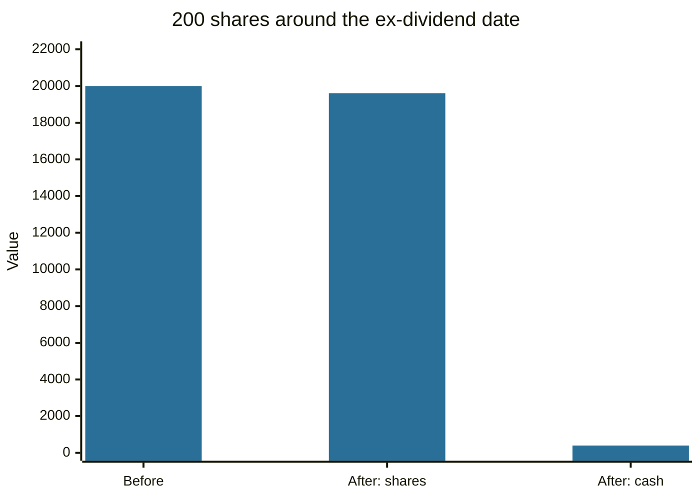

# Dividends

## Summary

A dividend is a payment from a company's profits to its shareholders. It is not a right to a fixed amount: the board proposes it and, in many countries, the shareholders' general meeting approves it, after the financial statements show distributable profit. On the day the share starts trading without the right to the dividend (the ex-dividend date), its price falls by about the amount paid, so the dividend moves value from the company to the shareholder and does not create new value.

*This note is educational. It is not investment or tax advice. Dividend taxation differs by country.*

## Prerequisites

- [Stocks](stocks.md).

## Core concepts

### Definition

A *dividend* is a distribution of profit to owners as compensation for providing capital. It is paid in cash, in additional shares (a stock dividend) or in other assets. Related measures:

- **Dividend per share (DPS):** total dividend divided by the number of shares.
- **Dividend yield:** DPS divided by the share price.
- **Payout ratio:** dividends divided by net income (or DPS divided by EPS, see [earnings per share](../fundamental-analysis/earnings-per-share.md)).
- **Retention ratio:** 1 minus the payout ratio, the share of profit kept to reinvest.

### Analogy

A dividend is like a farmer taking part of the harvest to the table instead of planting it again. The money is enjoyed now, and the field grows less next year. The analogy breaks because shareholders can plant the money again themselves by buying more shares, which is what dividend reinvestment does.

### Mechanism: from decision to payment

In a listed company, the process has fixed steps. Details vary by country and company law.

1. The financial year ends and the statements are prepared and, for most listed companies, audited.
2. The board (or management) proposes a dividend, and the general meeting approves the profit distribution. Some systems also allow an interim dividend paid in advance of the annual decision.
3. **Declaration date:** the company announces the amount and the dates.
4. **Ex-dividend date:** from this day, buyers of the share do not receive the dividend. The price opens lower by about the dividend.
5. **Record date:** shareholders registered at the end of this day receive the dividend. Because trades settle after a short delay, the ex-dividend date is the same day as the record date or one business day before it, depending on the settlement cycle of the market.
6. **Payment date:** the cash is paid.

### Why a dividend does not create value

Before the ex-date, the share price includes the right to the dividend. After it, the company has less cash by the amount paid, and the price adjusts down by about the same amount. An investor who holds through the date has the same total wealth as before (before taxes and trading frictions), split between a lower share price and cash.

### Dividends and growth

Theory links the price to the present value of future dividends (see [price-to-earnings ratio](../fundamental-analysis/price-to-earnings-ratio.md) and the Gordon growth model in [time value of money](../corporate-finance/time-value-of-money.md)). Young growth companies usually retain profit to reinvest, and mature companies pay out more. Share buybacks are an alternative way to return cash.

## Worked example

A share trades at 100 and the company earned 5 per share, paying 2 per share as dividend.

| Measure | Calculation | Result |
| --- | --- | --- |
| Dividend yield | 2 / 100 | 2.0% |
| Payout ratio | 2 / 5 | 40% |
| Retention ratio | 1 - 0.40 | 60% |
| Expected ex-date price | 100 - 2 | about 98 |

An investor with 200 shares receives 400. The shares are worth about 19,600 after the ex-date instead of 20,000, so the total of shares plus cash is unchanged at 20,000, before tax. If the company keeps 60% of earnings and earns a return on it, future profit and the price can grow, and that growth is the other source of return.

## Trade offs and when to use it

Dividends give regular income and can signal that management expects stable profit. They are taxed in many countries at the time of payment, while price gains are taxed only when realized, so some investors prefer low-dividend growth stocks. A very high yield can signal that the market expects a cut. Check the payout ratio and the cash flow behind it. Funds come in distributing and accumulating forms (see [funds and ETFs](funds-and-etfs.md)).

## Common mistakes

- **Buying a stock just before the ex-date to "capture" the dividend.** The price drops by about the dividend.
- **Choosing by yield alone.** A high yield can come from a falling price.
- **Assuming dividends are guaranteed.** They can be cut or stopped.
- **Comparing the payout ratio across sectors without context.** Some sectors pay out most of their profit.

## Practice

1. A share costs 80 and pays 3.2 a year. What is the yield?
2. A company earns 6 per share and pays 1.5. What is the retention ratio?
3. Why does the price fall on the ex-dividend date?

### Answers

1. 4%.
2. 1 - 1.5/6 = 75%.
3. New buyers do not receive the dividend, and the company has paid the cash out, so the value of the share is lower by about the payment.

## Further reading

- U.S. Securities and Exchange Commission, Office of Investor Education and Advocacy. Stocks. Investor.gov. [Link](https://www.investor.gov/introduction-investing/investing-basics/investment-products/stocks). Plain-language regulator guide to common and preferred stock and their risks.
- Damodaran, A. (2012). *Investment Valuation: Tools and Techniques for Determining the Value of Any Asset (3rd ed.)*. Wiley. A detailed treatment of intrinsic and relative valuation, including the earnings multiples.
- Brealey, R. A., Myers, S. C., Allen, F. et al. (2023). *Principles of Corporate Finance (14th ed.)*. McGraw Hill. Covers valuation, risk and the cost of capital.
