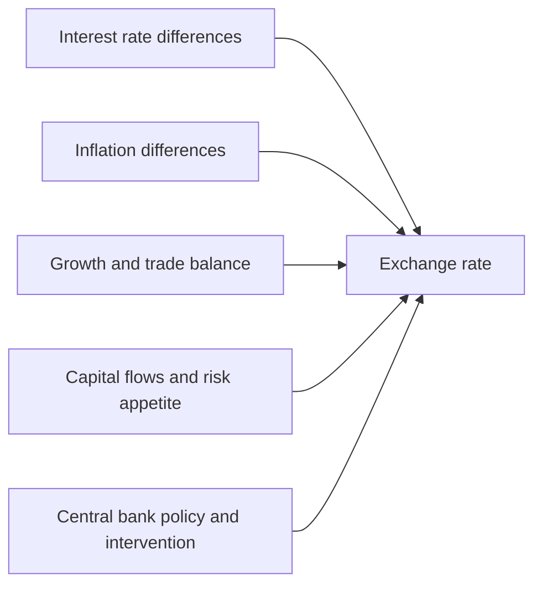
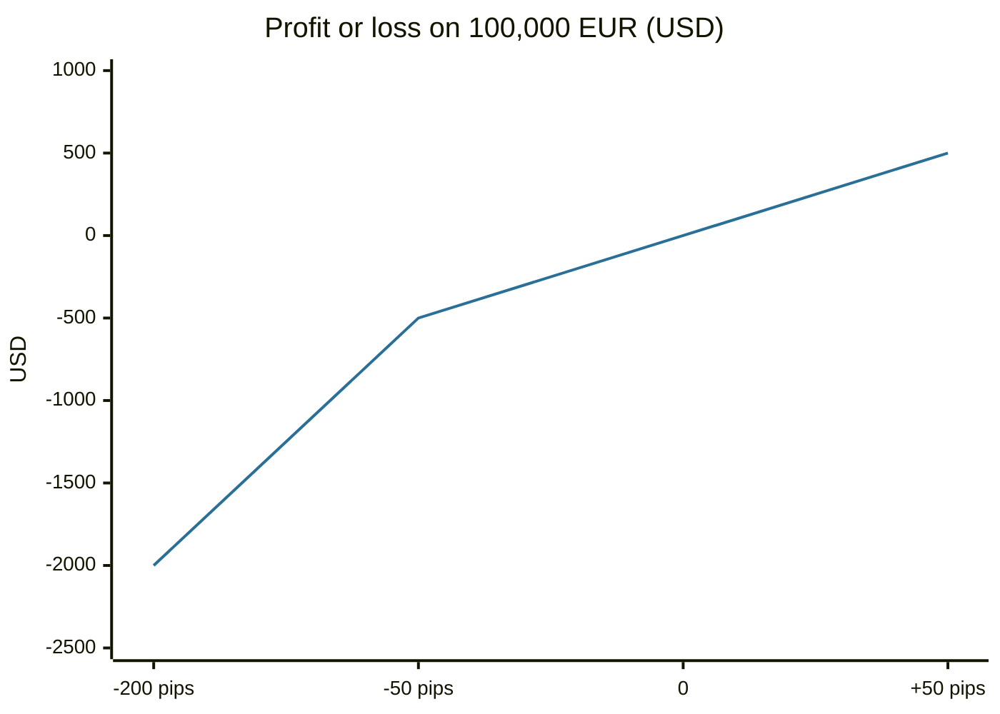

# Foreign exchange

## Summary

The foreign exchange (forex, FX) market is where currencies are exchanged. Prices are quoted in pairs such as EUR/USD, which says how many US dollars one euro costs. It is the largest financial market, with an average turnover of about 9.6 trillion US dollars a day in April 2025 according to the Bank for International Settlements, and it is traded over the counter by banks, companies, funds and individuals. Exchange rates follow interest rates, inflation, growth and capital flows. Retail forex trading is usually leveraged and carries a high risk of loss.

*This note is educational. It is not investment advice. Leveraged currency trading is high-risk.*

## Prerequisites

- [Financial markets overview](../financial-markets/financial-markets-overview.md).
- [Interest rates](../credit-and-debt/interest-rates.md).

## Core concepts

### Definition

An *exchange rate* is the price of one currency in terms of another. In a *currency pair* such as EUR/USD = 1.0800, the first currency (EUR) is the *base* and the second (USD) is the *quote* currency: 1 euro costs 1.0800 dollars. Buying the pair means buying the base and selling the quote. A *pip* is the smallest standard price step, 0.0001 for most pairs (0.01 for pairs with the yen). The *spot* rate is for immediate delivery (in practice two business days for most pairs), and forwards and swaps fix a rate for a future date.

### Analogy

Currency is like a product sold in two shops, each with its own price tag. The exchange rate says how much of one shop's money buys the other shop's. A trader who buys EUR/USD bets that euros will become more expensive in dollars. The analogy breaks because each currency has an issuer, a central bank, which can act to move its price.

### Who trades and why

Central banks, commercial banks (the interbank market), corporations paying for imports or repatriating profit, investment funds, tourists and retail traders. Most volume is not tourism or trade, and is investment and speculation.

### What moves exchange rates

- **Interest rates.** Higher rates attract capital and support a currency, all else equal. The *carry trade* borrows in a low-rate currency to hold a high-rate one, and it can lose sharply when currencies reverse.
- **Inflation.** In the long run, a currency with persistently higher inflation tends to weaken (purchasing power parity), although the relation is loose over short periods.
- **Growth and trade.** Strong growth and current account surpluses support a currency.
- **Risk appetite.** In stress, investors buy safe-haven currencies.
- **Policy.** Central bank actions and interventions.

### Costs and risks

The cost of trading is the bid-ask spread (a pip or less in major pairs), and overnight swap charges when positions are held. Most retail brokers offer leverage, which the EU limits to 30:1 for major pairs for retail clients (see [contracts for difference](contracts-for-difference.md) and [leverage and margin](../portfolio-management/leverage-and-margin.md)). Risks are leverage, gaps over weekends and events, and broker quality.

## Worked example

A trader buys 100,000 EUR against USD at 1.0800, which costs 108,000 USD. At 30:1 leverage, the required margin is 108,000 / 30 = 3,600 USD. The spread is 1 pip, which costs 100,000 × 0.0001 = 10 USD on entry.

| EUR/USD at exit | Change in pips | Profit or loss in USD |
| --- | --- | --- |
| 1.0850 | +50 | +500 |
| 1.0800 | 0 | 0 |
| 1.0750 | -50 | -500 |
| 1.0600 | -200 | -2,000 |

A fall of 200 pips (1.85%) loses 2,000 USD, which is 56% of the margin. Leverage makes a 1.85% move large relative to the deposit, which is one reason retail forex trading carries a high risk of loss.

The line shows the result in USD for each move of the exchange rate: it crosses zero at the entry rate.

## Trade offs and when to use it

Forex is liquid, trades nearly around the clock on weekdays and allows long and short positions. Exchange rates are hard to predict, and the market is dominated by professionals, so the chance of retail success is low. Most people need currency only for travel, imports or foreign investments, and hedging is more relevant than speculating: a company can fix a rate with a forward, and an investor in foreign assets faces currency risk that adds to the asset's own volatility.

## Common mistakes

- **Over-leveraging.** A small adverse move triggers a margin call.
- **Ignoring swap costs** for positions held for days.
- **Reading a pair backwards.** In EUR/USD, a rise means the euro is stronger.
- **Trading news events with market orders,** which can fill far from the quoted price.
- **Forgetting currency risk in foreign investments.**

## Practice

1. EUR/USD rises from 1.0800 to 1.0900. How many pips is that, and what is the gain on 50,000 EUR?
2. What is the carry trade, and what is its risk?
3. In GBP/JPY, which currency is the base?

### Answers

1. 100 pips, and a gain of 50,000 × 0.0100 = 500 USD.
2. Borrowing in a low-rate currency to hold a high-rate one. The risk is a sudden reversal of the exchange rates that wipes out the interest earned.
3. The British pound.

## Further reading

- Bank for International Settlements (2025). Triennial Central Bank Survey of foreign exchange and OTC derivatives markets in 2025. Bank for International Settlements. [Link](https://www.bis.org/statistics/rpfx25.htm). The standard source for the size of the global foreign exchange market.
- ESMA (2018). ESMA adopts final product intervention measures on CFDs and binary options. European Securities and Markets Authority. [Link](https://www.esma.europa.eu/press-news/esma-news/esma-adopts-final-product-intervention-measures-cfds-and-binary-options). States the leverage limits, margin close-out and negative balance protection for retail CFDs in the EU.
- Bodie, Z., Kane, A. and Marcus, A. J. (2021). *Investments (12th ed.)*. McGraw Hill. The standard university textbook on securities, portfolio theory and market efficiency.
