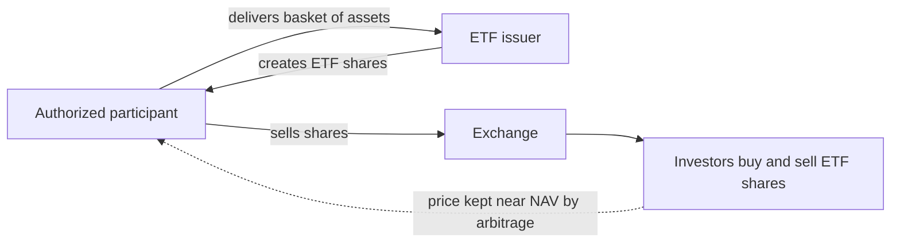
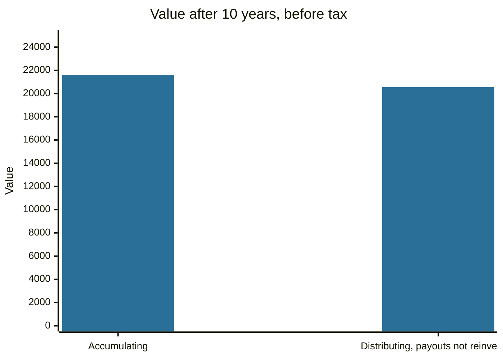

# Funds and ETFs

## Summary

An investment fund pools money from many investors and a manager buys a basket of assets with it. Active funds try to beat a benchmark by choosing assets, and index funds simply copy an index at lower cost. An exchange-traded fund (ETF) is a fund whose shares trade on an exchange all day like a stock, and most ETFs track an index. The points that decide the outcome for an investor are cost, how well the fund tracks what it promises, liquidity and whether income is paid out or reinvested.

*This note is educational. It is not investment advice.*

## Prerequisites

- [Stocks](stocks.md).
- [Bonds](bonds.md).
- [Market efficiency](../financial-markets/market-efficiency.md) for the argument about active versus passive management.

## Core concepts

### Definition

A *fund* (collective investment scheme) is a vehicle in which investors buy units or shares and professional managers invest the pooled assets. The fund's holdings are legally separate from the manager, and a custodian keeps them. The *net asset value (NAV)* is the value of the fund's assets minus liabilities, divided by the number of units.

### Analogy

A fund is a shared shopping basket. Instead of buying 500 items yourself, you buy a share of a basket that already has them, and the person who filled it charges a fee. The analogy has a limit: with a basket you can see what is inside, while a fund's content depends on its rules and can change.

### Types

| Type | Idea | Cost | Pricing |
| --- | --- | --- | --- |
| Active fund | A manager selects assets to beat a benchmark | Higher (often 0.5% to 2% a year) | NAV once a day |
| Index fund | Copies an index | Low | NAV once a day |
| ETF | Fund whose shares trade on an exchange, mostly index-tracking | Low (fund fee plus the spread) | Market price all day |
| Fund of funds | Holds units of other funds | Two layers of fees | NAV |

### How an ETF works

Large financial institutions called *authorized participants* create and redeem ETF shares in blocks, exchanging them for the basket of underlying assets. This mechanism keeps the market price close to the NAV: if the ETF trades above the value of its basket, they create new shares and sell them, and the price falls back.



### Replication

- **Physical replication:** the ETF holds the index components (*full replication*) or a representative sample (*optimized sampling*) when the index is large.
- **Synthetic replication:** the ETF holds other assets and a swap with a bank that pays the index return. It can track hard-to-reach markets, and adds counterparty risk, which regulation limits.

### What to check before buying

1. **Total expense ratio (TER):** yearly cost as a share of assets. The real cost also includes the bid-ask spread and, for foreign holdings, taxes.
2. **Tracking difference and error:** how far the fund's return is from the index. Fees explain most of the difference.
3. **Liquidity and size:** trading volume, spread, assets under management.
4. **Replication method and securities lending.**
5. **Distribution policy:** *distributing* funds pay out income and *accumulating* funds reinvest it inside the fund. Taxation of each differs by country.
6. **Index:** what it holds (a world index is more diversified than a single-country one).

## Worked example

10,000 is invested for 10 years in an index fund with a price growth of 6% a year and a dividend yield of 2% a year, before tax.

```python
# Python 3.12. Accumulating versus distributing fund, before tax, 10,000 for 10 years.
price_growth, div_yield, years = 0.06, 0.02, 10
acc = 10_000 * (1 + price_growth + div_yield) ** years       # dividends reinvested at the fund level
value, cash = 10_000.0, 0.0
for _ in range(years):
    cash += value * div_yield                                  # dividend paid out and spent or kept as cash
    value *= 1 + price_growth
print(f"accumulating: {acc:,.0f}")
print(f"distributing: shares {value:,.0f} + cash {cash:,.0f} = {value + cash:,.0f}")
```

Output:

```text
accumulating: 21,589
distributing: shares 17,908 + cash 2,636 = 20,545
```

The accumulating fund ends with 21,589. The distributing fund pays 2,636 in cash that is not reinvested, and the shares are worth 17,908, so the total is 20,545, which is 1,044 lower because the paid-out income does not compound. If the investor reinvests the payouts, the two outcomes become close, but the investor pays a trading cost and in some countries a tax on each payment. The tax rules decide which type is better for a given investor.



## Trade offs and when to use it

Index funds and ETFs give broad diversification for a small yearly cost and suit most long-term investors. Active funds can add value in some segments, and the evidence is that most do not after fees over long periods (see [market efficiency](../financial-markets/market-efficiency.md)). An ETF is traded like a stock, so it has a spread, an intraday price and can be bought with limit orders. Thematic and leveraged ETFs are narrow or complex and are not substitutes for a diversified fund.

## Common mistakes

- **Comparing funds by past return alone.** Compare costs, strategy and risk.
- **Buying an ETF because it is cheap per share.** The price per share says nothing about value.
- **Ignoring currency, tax and domicile.** They change the net return.
- **Using leveraged or inverse ETFs for long holding periods.** Daily resetting makes the long-term result differ from the index's multiple.

## Practice

1. What does an authorized participant do?
2. What is the difference between physical and synthetic replication?
3. Why does the accumulating fund end higher in the example?

### Answers

1. Creates and redeems ETF shares against the basket of assets, which keeps the price close to the NAV.
2. Physical replication holds the index components, synthetic replication holds a swap that pays the index return and adds counterparty risk.
3. The income is reinvested inside the fund and compounds, while the paid-out income does not.

## Further reading

- FINRA. Exchange-traded funds and products. Financial Industry Regulatory Authority. [Link](https://www.finra.org/investors/investing/investment-products/exchange-traded-funds-and-products). Explains how ETFs are structured, priced and traded.
- Bodie, Z., Kane, A. and Marcus, A. J. (2021). *Investments (12th ed.)*. McGraw Hill. The standard university textbook on securities, portfolio theory and market efficiency.
