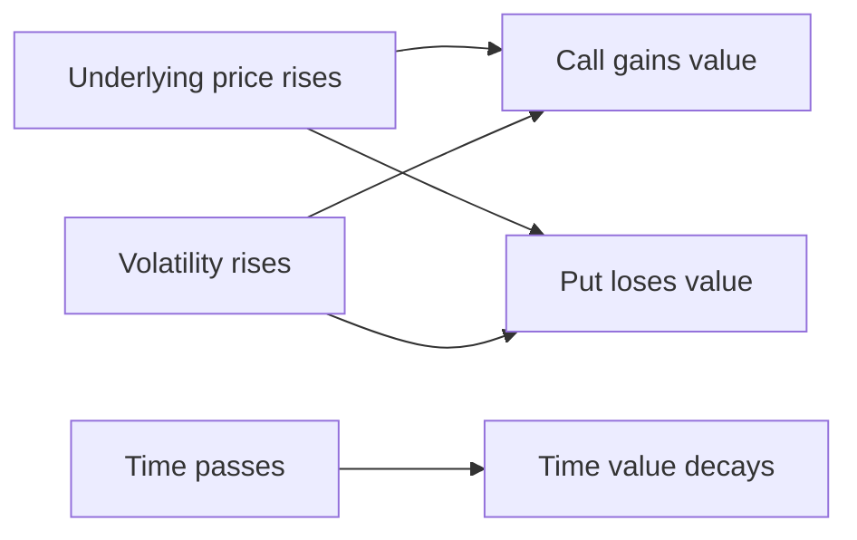
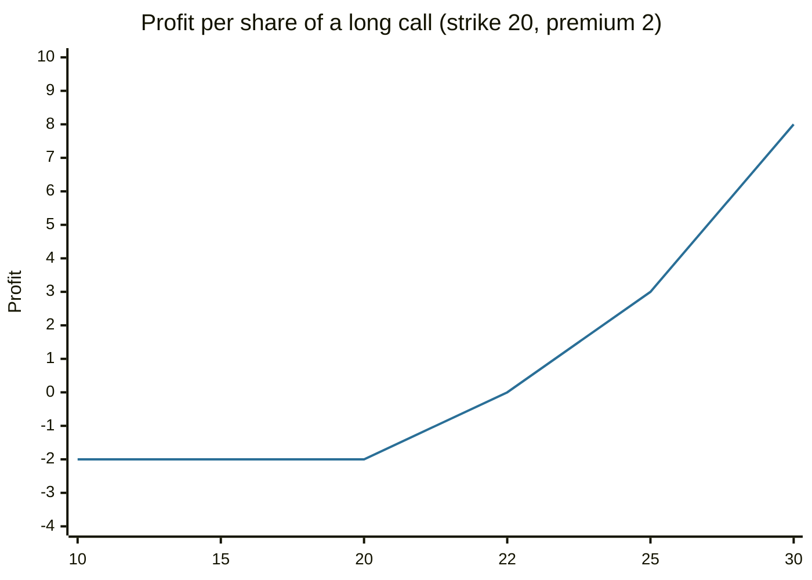

# Options

## Summary

An option gives its buyer the right, but not the obligation, to buy (a call) or sell (a put) an underlying asset at a fixed strike price on or before an expiry date. The buyer pays a premium and can lose at most that premium, while the seller (writer) receives the premium and takes on the obligation. Options are used to hedge, to take a leveraged view and to generate income, and their value depends on the price of the underlying, the strike, time to expiry, volatility and interest rates.

*This note is educational. It is not investment advice. Options are complex and can lose the entire premium quickly.*

## Prerequisites

- [Derivatives overview](derivatives-overview.md).
- [Stocks](stocks.md).

## Core concepts

### Definition

- **Call option:** the right to buy the underlying at the strike price.
- **Put option:** the right to sell the underlying at the strike price.
- **Strike (exercise) price:** the fixed price in the contract.
- **Premium:** the price paid for the option.
- **Expiry:** the date the right ends. *European* options can be exercised only at expiry, *American* options at any time before it.
- **Intrinsic value:** what the option would pay if exercised now. A call has intrinsic value max(S - K, 0), a put max(K - S, 0), where S is the price of the underlying and K the strike.
- **Time value:** premium minus intrinsic value. It falls to zero at expiry.

Exchange-traded options on shares are standardized contracts (in the US, one contract covers 100 shares). They differ from *employee stock options*, which are rights granted by a company to its staff to buy shares at a set price and are not traded.

### Analogy

An option is a reservation deposit on a house. You pay a small amount to hold the right to buy at an agreed price for a few weeks. If the market price rises above the agreed price, you use the right. If it falls, you walk away and lose only the deposit. The analogy has a limit: a house deposit does not lose value every day as expiry approaches, while an option's time value does.

### Mechanism

The payoff at expiry per share for the buyer (long) is:

- Long call: max(S - K, 0) - premium.
- Long put: max(K - S, 0) - premium.

The seller's result is the opposite. Prices before expiry are computed with models such as Black and Scholes (1973), which uses S, K, time, the risk-free rate and volatility. Higher volatility raises the value of both calls and puts, because the right is worth more when large moves are likely.

## Worked example

A call on Company X has a strike of 20 and expires in one month. The premium is 2 per share.

| Price at expiry | Exercise value | Profit of the call buyer | Profit of the call seller |
| --- | --- | --- | --- |
| 10 | 0 | -2 | +2 |
| 15 | 0 | -2 | +2 |
| 20 | 0 | -2 | +2 |
| 22 | 2 | 0 | 0 |
| 25 | 5 | +3 | -3 |
| 30 | 10 | +8 | -8 |

The break-even price is 22 (strike plus premium). The buyer's loss is capped at 2, and the gain grows without limit. The seller's gain is capped at 2, and the loss grows without limit if the seller has no shares to deliver (a *naked* call).

A put with strike 20 and premium 1.5 is the mirror image: at a price of 10 the profit is 10 - 1.5 = 8.5, at 18.5 it is zero, and above 20 the loss is 1.5. Buying a put on a share you own works like insurance: it sets a floor at the strike, less the premium.

## Trade offs and when to use it

Buying options gives leveraged exposure with a known maximum loss, and a protective put insures a portfolio. Writing a covered call (selling a call against shares you own) earns the premium and gives up gains above the strike. The costs are the premium, which decays over time, bid-ask spreads that are wide for illiquid contracts, and complexity. Most option buyers lose the premium because the underlying does not move enough, and writers bear tail risk.

## Common mistakes

- **Buying cheap out-of-the-money options as lottery tickets.** The probability of profit is small.
- **Ignoring time decay.** Being right about direction but too late still loses.
- **Selling naked options without a loss limit.**
- **Confusing exchange-traded options with employee stock options.**

## Practice

1. A put has strike 50 and premium 3. What is the maximum loss and the break-even price?
2. Why are options on volatile stocks more expensive?
3. What is the maximum profit of a long call?

### Answers

1. Maximum loss 3 per share, break-even 47.
2. A larger chance of a big move increases the chance that the option pays out, and the loss is capped at the premium.
3. There is no upper limit, since the price of the underlying can rise without limit.

## Further reading

- FINRA. Options. Financial Industry Regulatory Authority. [Link](https://www.finra.org/investors/investing/investment-products/options). Explains calls, puts and the risks of options trading.
- Black, F. and Scholes, M. (1973). The pricing of options and corporate liabilities. *Journal of Political Economy*, 81(3), 637-654. [DOI](https://doi.org/10.1086/260062). The option pricing model behind modern derivatives valuation.
- Hull, J. C. (2021). *Options, Futures, and Other Derivatives (11th ed.)*. Pearson. The standard reference on how forwards, futures, options and swaps work and are priced.
