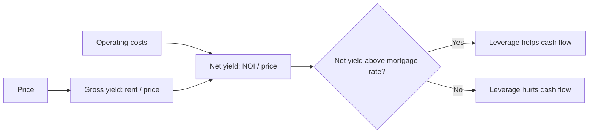
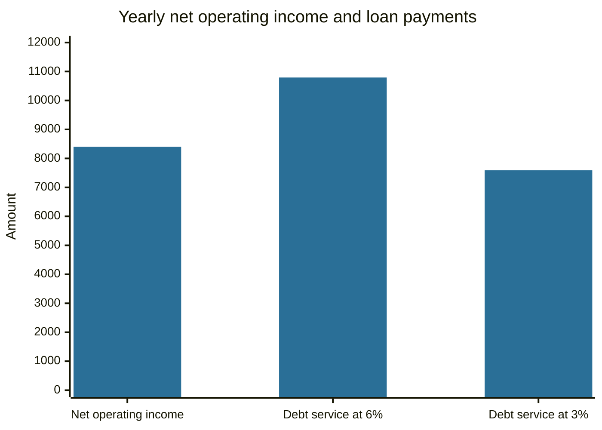

# Real estate investing

## Summary

Real estate investing means buying property to earn rental income, price appreciation or both, directly or through funds and listed companies. Returns come from the rent after costs (the net yield) and from changes in value, and a mortgage magnifies the result, for better or worse. Real estate is illiquid, has high transaction costs and depends on local markets, so the return of a single property can differ greatly from an index.

*This note is educational. It is not investment, tax or legal advice. Rules and taxes differ by country.*

## Prerequisites

- [Mortgages](../credit-and-debt/mortgages.md).
- [Types of investments](types-of-investments.md).

## Core concepts

### Definition

*Real estate* is land and the buildings on it. As an investment, it is a *real asset*: it has intrinsic use value, produces rent and tends to follow prices in the economy over long periods. A property bought to live in provides housing and not a financial return, and a property bought to rent or sell is an investment.

### Analogy

A rental property is a small business whose product is housing. The income is rent, the costs are maintenance, taxes, insurance and vacancy, and the owner is also the manager unless someone is paid to do that. The analogy breaks because, unlike most businesses, the main asset is also the main cost of capital and cannot be sold in parts.

### Ways to invest

| Route | What it is | Strengths | Weaknesses |
| --- | --- | --- | --- |
| Direct rental | Buy, let and manage | Control, leverage, tangible asset | Large capital, concentration, work, vacancy |
| Flipping | Buy, renovate, sell | Fast profit possible | Execution and market risk, taxes, costs |
| REIT (real estate investment trust) | Listed company that owns income-producing property and pays out most of its income | Liquid, diversified, small amounts | Moves with the stock market, no direct control |
| Real estate funds and crowdfunding | Pooled investment in property or loans | Small tickets, access to projects | Fees, illiquidity, platform and project risk |
| Land | Undeveloped plots | Possible appreciation | No income, planning risk |

### Mechanism: yields

- **Gross yield** = annual rent / price.
- **Net yield** (capitalization rate) = net operating income (NOI) / price, where NOI is rent minus operating costs (vacancy, tax, insurance, maintenance, management) and before financing.
- **Cash-on-cash return** = cash flow after loan payments / equity invested.
- **Total return** = net yield + change in value.

A mortgage adds leverage. It raises the return on equity when the property's net yield and growth are above the cost of the loan, and lowers it when they are below (see [debt](../credit-and-debt/debt.md)).



Steps for an investor: set the goal and time horizon, secure capital and a reserve, assess risk (local demand, vacancy, interest rate rises), choose the property and location, compute the return before buying, and choose the structure (direct, REIT, fund).

## Worked example

A flat costs 200,000 and rents for 1,000 a month.

```python
# Python 3.12. Rental property: yields and the effect of a mortgage.
price, rent_month = 200_000, 1_000
rent = rent_month * 12
noi = rent * 0.70                      # assumed: operating costs take 30% of rent
print("gross yield", f"{rent / price:.1%}", "| net yield (NOI / price)", f"{noi / price:.1%}")

def payment(loan, rate, years=30):
    i = rate / 12; n = years * 12
    return loan * i / (1 - (1 + i) ** -n)

for rate in (0.06, 0.03):
    loan = 0.75 * price
    debt_service = payment(loan, rate) * 12
    cash_flow = noi - debt_service
    equity = price - loan
    print(f"mortgage {rate:.0%}: debt service {debt_service:,.0f}, cash flow {cash_flow:,.0f}, cash-on-cash {cash_flow / equity:.1%}")
```

Output:

```text
gross yield 6.0% | net yield (NOI / price) 4.2%
mortgage 6%: debt service 10,792, cash flow -2,392, cash-on-cash -4.8%
mortgage 3%: debt service 7,589, cash flow 811, cash-on-cash 1.6%
```

The 30% cost assumption is an illustration. With a 6% mortgage, the loan costs more than the property yields, so the owner pays 2,392 a year out of pocket and relies on price growth. With a 3% mortgage, the cash flow is positive. The same property gives opposite results, because the interest rate changed the sign of the leverage effect.



Cash flow is the first bar minus the other bar: negative at the 6% mortgage rate and positive at 3%.

## Trade offs and when to use it

Real estate offers income, a partial hedge against inflation (rents and values tend to follow prices over long periods, though not every year) and the possibility of leverage. The costs: a large, indivisible purchase, transaction costs of several percent each way, taxes, maintenance, vacancy and tenant risk, and exposure to one location. A REIT or a fund suits an investor who wants exposure without managing property, with the trade-off that its price moves with the stock market. A home bought to live in should be judged by what it costs to live in compared with renting, and not as a pure investment.

## Common mistakes

- **Using gross yield to judge a deal.** Use net yield after costs.
- **Ignoring the reserve for repairs and vacancy.**
- **Assuming prices only rise.** Local markets fall too.
- **Over-leveraging,** which leaves no margin when rates rise.
- **Counting the home you live in as diversification.**

## Practice

1. A property costs 300,000 and earns rent of 18,000 a year with costs of 5,400. What are the gross and net yields?
2. When does a mortgage reduce cash flow?
3. What is a REIT?

### Answers

1. Gross 6.0%, net 4.2% ((18,000 - 5,400) / 300,000).
2. When the loan's cost is higher than the net yield of the property.
3. A listed company that owns income-producing property and distributes most of its income, giving small investors liquid exposure to real estate.

## Further reading

- Bodie, Z., Kane, A. and Marcus, A. J. (2021). *Investments (12th ed.)*. McGraw Hill. The standard university textbook on securities, portfolio theory and market efficiency.
- Brealey, R. A., Myers, S. C., Allen, F. et al. (2023). *Principles of Corporate Finance (14th ed.)*. McGraw Hill. Covers valuation, risk and the cost of capital.
- Consumer Financial Protection Bureau. Owning a home: mortgages. CFPB. [Link](https://www.consumerfinance.gov/consumer-tools/mortgages/). Consumer guidance on mortgage types, costs and shopping around.
