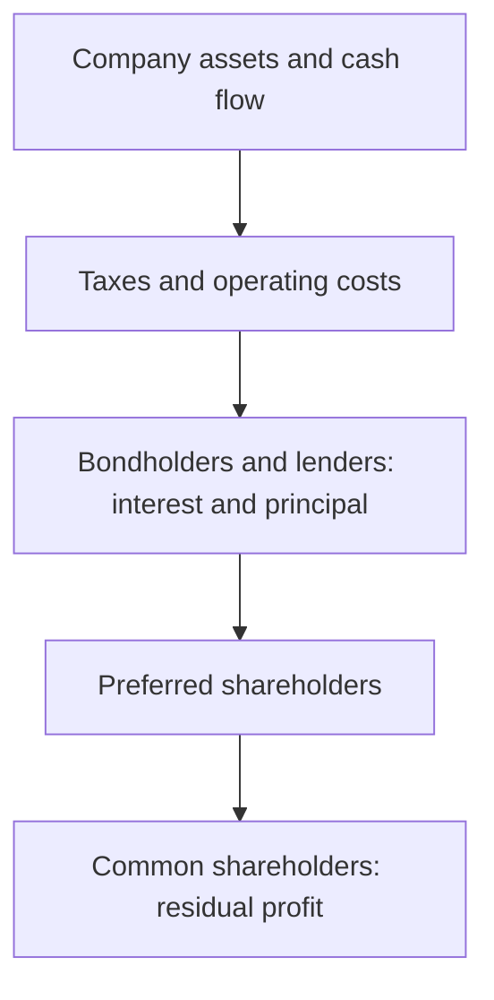
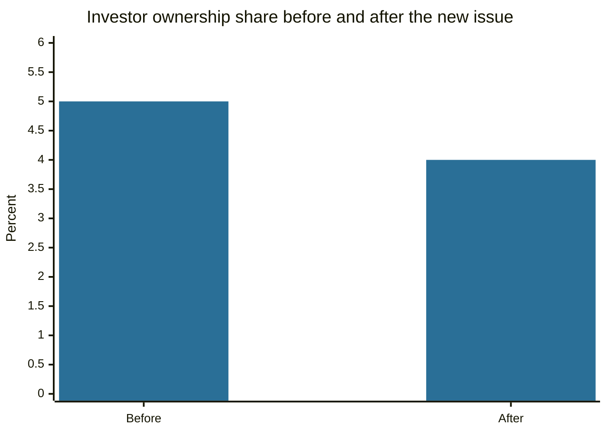

# Stocks

## Summary

A stock (share) is a unit of ownership in a company. Shareholders have a residual claim: they are paid after lenders and bondholders, which is why stocks are riskier than bonds, and in return they take part in the company's growth through dividends and rising prices. Shares differ by the rights they carry (common and preferred, voting and non-voting), by the form of ownership transfer and by how the company's capital was paid in.

*This note is educational. It is not investment advice.*

## Prerequisites

- [Equity markets](../financial-markets/equity-markets.md).

## Core concepts

### Definition

A *stock* or *share* is a security that represents a proportional ownership claim on the assets and earnings of a corporation. A *shareholder* (stockholder) is a co-owner of the company, with rights set by law and by the company's articles. Typical rights are to vote at the general meeting, to receive dividends if declared, to receive a share of the assets in liquidation after creditors, and, in many jurisdictions, pre-emption rights to buy new shares to avoid dilution.

### Analogy

Owning stock is like owning a slice of a pizza business, not of a pizza. The slice entitles you to a share of the future profits, not to a fixed payment. If the business closes, you are paid last, after the suppliers and the bank. The analogy breaks because a slice of a listed company can be sold in seconds at a market price, which a stake in a local shop cannot.

### Types of shares

| Basis | Types | Meaning |
| --- | --- | --- |
| Rights | Common | One vote per share (usually) and dividends if declared |
| | Preferred | Priority in dividends and in liquidation, often no or fewer votes |
| Voting | Different classes (A and B) | Some companies give a class extra votes to founders |
| Transfer | Registered and bearer | Registered shares name the owner. Bearer shares belong to whoever holds them, and many countries have abolished them for listed companies |
| Payment | Cash and in kind | Shares paid for with money or with non-cash contributions such as property |
| Listing | Public and private | Public shares trade on an exchange. Private shares do not |

### Risks

- **Systematic (market) risk:** affects all shares, such as a recession or a change in interest rates. It cannot be removed by diversification.
- **Specific (idiosyncratic) risk:** affects one company, such as a failed product, a lawsuit or fraud. It can be reduced by holding many shares (see [diversification](../portfolio-management/diversification.md)).
- **Dilution risk:** issuing new shares reduces the percentage held by each existing holder.

### Stocks versus bonds

Shareholders own the company and share its profit, with votes and no promised payment. Bondholders are lenders: they have a claim on interest and principal under a contract, rank ahead of shareholders in insolvency and have no ownership rights or votes. A company can have both, and both can trade on an exchange, which does not change their legal nature. A listed bond does not become a share (see [bonds](bonds.md)).

The order shows who is paid first. Common shareholders receive what is left, which can be a lot or nothing.

## Worked example

A company has 1,000,000 shares, and an investor owns 50,000 (5%). The company issues 250,000 new shares to raise capital, and the investor does not take part.

| | Before | After |
| --- | --- | --- |
| Total shares | 1,000,000 | 1,250,000 |
| Investor's shares | 50,000 | 50,000 |
| Ownership share | 5.0% | 4.0% |
| Share of a 10,000,000 profit | 500,000 | 400,000 |

The investor's stake is smaller by a fifth. If the proceeds raise profit enough, the smaller slice can be worth more, which is why a pre-emptive right to buy a proportional part of the new shares protects holders who want to keep their percentage.

## Trade offs and when to use it

Stocks have been the highest-return mainstream asset class in the long US record (see [types of investments](types-of-investments.md)). The costs are volatility, the possibility of losing the whole investment in a single company and the need for research or a diversified fund. A new or small company carries more specific risk than a mature one. Individual stocks suit investors who can analyze companies and accept concentrated risk, and a diversified fund suits most others.

## Common mistakes

- **Holding a few stocks and calling it diversification.**
- **Confusing a low share price with a cheap company.** What matters is the price relative to earnings and assets (see [price-to-earnings ratio](../fundamental-analysis/price-to-earnings-ratio.md)).
- **Assuming dividends are guaranteed.** The board can cut them.
- **Ignoring the share class,** which can limit voting rights.

## Practice

1. Who is paid first in liquidation: bondholders or shareholders?
2. A company has 2,000,000 shares and issues 500,000 more. What percentage does a holder of 100,000 shares have before and after?
3. Give one difference between systematic and specific risk.

### Answers

1. Bondholders, as creditors.
2. 5% before and 4% after.
3. Systematic risk affects the whole market and cannot be diversified away, specific risk affects one company and can be.

## Further reading

- U.S. Securities and Exchange Commission, Office of Investor Education and Advocacy. Stocks. Investor.gov. [Link](https://www.investor.gov/introduction-investing/investing-basics/investment-products/stocks). Plain-language regulator guide to common and preferred stock and their risks.
- FINRA. Stocks. Financial Industry Regulatory Authority. [Link](https://www.finra.org/investors/investing/investment-products/stocks). Industry regulator overview of stock investing.
- Bodie, Z., Kane, A. and Marcus, A. J. (2021). *Investments (12th ed.)*. McGraw Hill. The standard university textbook on securities, portfolio theory and market efficiency.
- Damodaran, A. (2012). *Investment Valuation: Tools and Techniques for Determining the Value of Any Asset (3rd ed.)*. Wiley. A detailed treatment of intrinsic and relative valuation, including the earnings multiples.
