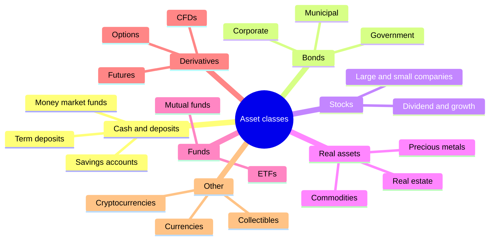
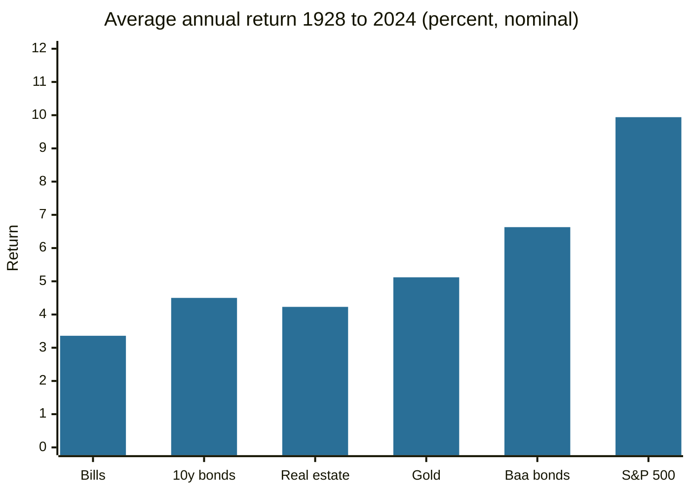

# Types of investments

## Summary

Investments are grouped into asset classes that behave differently: cash and deposits, bonds (lending), stocks (ownership), real estate, commodities and precious metals, currencies, funds that hold baskets of these, derivatives and newer assets such as cryptocurrencies. Each class sits at a different point on the scale of risk, expected return, liquidity and income. Long US data show that higher average returns came with larger swings, which is the main fact to keep in mind when comparing them.

*This note is educational. It is not investment advice.*

## Prerequisites

- [Financial markets overview](../financial-markets/financial-markets-overview.md).

## Core concepts

### Definition

An *investment* is the commitment of money to an asset in the expectation of a return: income, price gains or both. An *asset class* is a group of assets with similar legal form, market and risk characteristics. The classes below follow the usual division in investment textbooks and professional curricula.

### Analogy

Asset classes are the different tools in a toolbox. A hammer is not better than a saw, they do different jobs. Deposits are for money needed soon, bonds for steady income, stocks for long-term growth, and commodities or gold as a hedge against some kinds of shocks. The analogy breaks because a tool does not change its behavior as you use it, while the correlations between asset classes shift over time.

### The classes

| Class | What you hold | Typical role | Main risks |
| --- | --- | --- | --- |
| Deposits and cash | A claim on a bank | Safety, liquidity | Inflation, bank failure above insurance |
| Bonds | A loan to a government or company | Income, stability | Interest rate, credit, inflation |
| Stocks | Part ownership of a company | Growth over long periods | Large price swings, company failure |
| Real estate | Property or a share of one | Income, inflation link | Illiquidity, high costs, local markets |
| Commodities, precious metals | Physical goods or futures | Diversification, inflation hedge | Volatility, no income, roll costs |
| Funds and ETFs | A basket of the above | Diversification at low cost | Fees, tracking, risks of the contents |
| Derivatives | A contract on an underlying asset | Hedging, speculation | Leverage, complexity |
| Currencies | One currency against another | Trading, travel and trade needs | Leverage, central bank action |
| Cryptocurrencies | Digital tokens on a blockchain | Speculation | Extreme volatility, fraud, regulation |
| Collectibles, cars, art | Physical objects | Passion, store of value | Illiquidity, valuation, storage |

### What the data show

Damodaran's dataset of annual US returns from 1928 to 2024 (checked October 2026) gives the following geometric averages and the standard deviation of annual returns, which measures the typical size of the swings.

| Asset | Average annual return | Standard deviation |
| --- | --- | --- |
| 3-month Treasury bills | 3.36% | 3.1% |
| 10-year Treasury bonds | 4.50% | 7.9% |
| Baa corporate bonds | 6.63% | 7.7% |
| Real estate | 4.23% | 6.2% |
| Gold | 5.12% | 20.8% |
| S&P 500 with dividends | 9.94% | 19.5% |

The figures are nominal, for the US, and the real estate series is an index, not a rental property after costs. They describe the past.

The chart shows that stocks paid the most on average. The table shows the price: swings about six times as large as bills.

## Worked example

Compare 10,000 placed for 30 years at the geometric averages above (an illustration, as real paths vary).

| Asset | Growth factor over 30 years | Value |
| --- | --- | --- |
| T-bills at 3.36% | 1.0336^30 = 2.70 | about 27,000 |
| 10-year bonds at 4.50% | 1.045^30 = 3.75 | about 37,500 |
| S&P 500 at 9.94% | 1.0994^30 = 17.17 | about 171,700 |

The gap is large, and it is available only to someone who held through years such as 1931 or 2008. The worst year of the S&P 500 in the dataset lost 43.8%, and 26 of the 97 years were negative. An investor who needs the money in two years should not hold stocks, whatever the 30-year averages say.

## Trade offs and when to use it

Match the asset to the time horizon and to the ability to bear a loss. Money needed within a few years belongs in cash, deposits or short-term bonds. Money for decades can be exposed to stocks. Diversifying across classes reduces the risk of any single one (see [diversification](../portfolio-management/diversification.md) and [asset allocation](../portfolio-management/asset-allocation.md)).

## Common mistakes

- **Choosing by past return.** The best class of one decade is often not the best of the next.
- **Ignoring costs and taxes.** Fees compound as returns do.
- **Treating illiquid assets like liquid ones.** Selling a property or a collectible takes months.
- **Buying what you do not understand,** especially leveraged products and new assets.

## Practice

1. Rank bills, bonds and stocks by expected return and by risk, and say what the ranking shows.
2. Why is real estate described as illiquid?
3. In the dataset, what share of years had a negative S&P 500 return?

### Answers

1. Bills lowest on both, bonds in the middle, stocks highest on both. Higher expected return came with higher risk.
2. A sale takes time and has high transaction costs, so it cannot be turned into cash quickly at a known price.
3. 26 of 97 years, about 27%.

## Further reading

- Damodaran, A. Damodaran Online. NYU Stern. [Link](https://pages.stern.nyu.edu/~adamodar/). Free datasets on historical returns, multiples and valuation by industry.
- Bodie, Z., Kane, A. and Marcus, A. J. (2021). *Investments (12th ed.)*. McGraw Hill. The standard university textbook on securities, portfolio theory and market efficiency.
- Siegel, J. J. (2014). *Stocks for the Long Run (5th ed.)*. McGraw Hill. Long-run US data on stock, bond and bill returns.
- CFA Institute. CFA Program curriculum. CFA Institute. [Link](https://www.cfainstitute.org/programs/cfa-program/curriculum). The professional topic outline for investment analysis.
