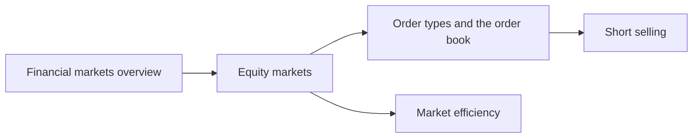

# Financial markets

How securities are traded and how prices form: the structure of markets, the equity market, order types and the order book, market efficiency and short selling. This subfield belongs to [Finance and investing](../README.md). It describes the arena where the instruments in [financial instruments](../financial-instruments/README.md) trade and where the methods of [fundamental analysis](../fundamental-analysis/README.md) and [technical analysis](../technical-analysis/README.md) are applied.

## Map of the subfield

The map follows the path from the general structure of markets to the mechanics of one trade and to the question of whether prices can be beaten.

## Notes in reading order

1. [Financial markets overview](financial-markets-overview.md): functions, primary and secondary markets, money and capital markets, participants.
2. [Equity markets](equity-markets.md): structure, participants, price formation, returns, risks and regulation.
3. [Order types and the order book](order-types-and-order-book.md): bid, ask, spread, market, limit and stop orders, with a computed fill.
4. [Market efficiency](market-efficiency.md): the efficient market hypothesis, its three forms, evidence and the cost of active management.
5. [Short selling](short-selling.md): mechanics, costs, risk and the squeeze.

## Planned topics

- Bond markets and the yield curve
- Foreign exchange market structure
- Market microstructure and high-frequency trading
- Clearing, settlement and custody
- Behavioral finance and market bubbles

## How to use this subfield

Read notes 1 to 3 in order. Note 4 changes how you read the notes on analysis methods, so read it before the notes on [technical analysis](../technical-analysis/technical-analysis.md).

These notes are educational. They are not investment advice.

## Navigation

- Back to [Finance and investing](../README.md).
