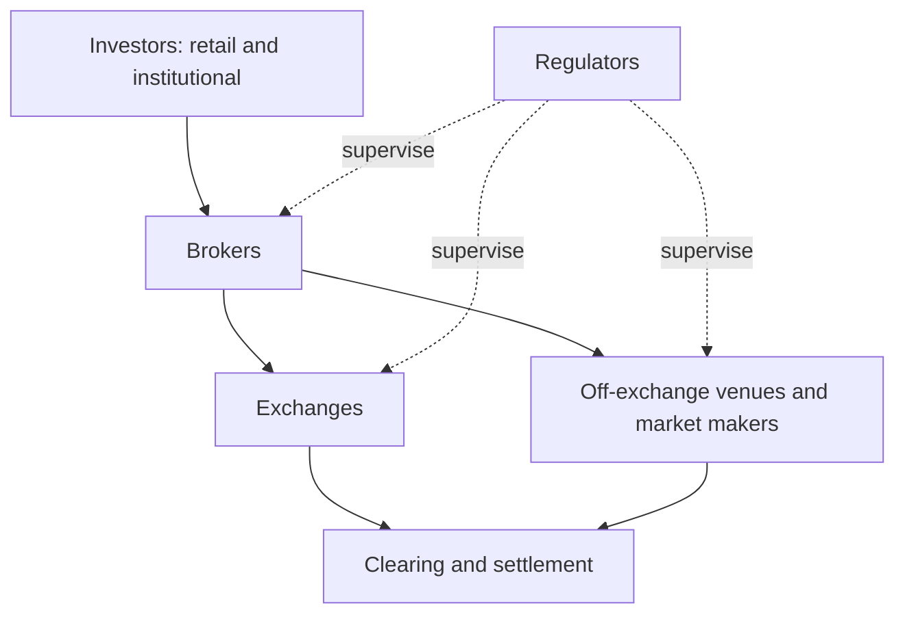
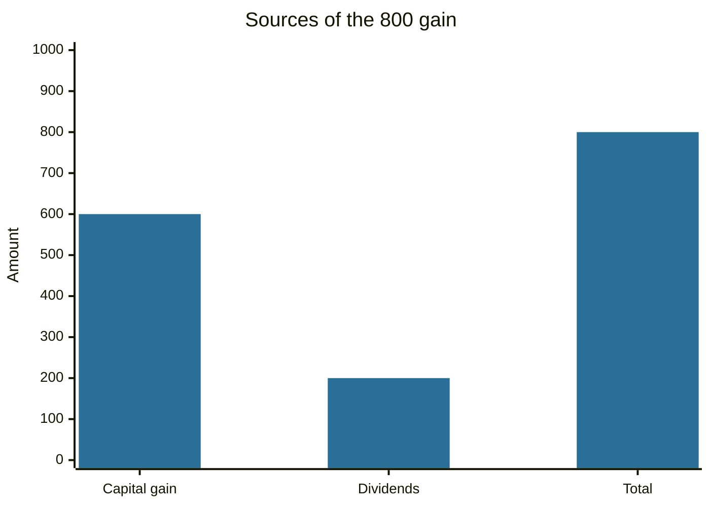

# Equity markets

## Summary

The equity market is where shares of companies are issued and traded. A share is a claim on a company's profits and assets after creditors are paid. Prices are set by the interaction of buyers and sellers on exchanges and other trading venues, and they move with company results, industry trends, the economy and investor sentiment. Investors earn from dividends and from price gains, and bear market risk, company-specific risk and economic risk. Regulators supervise issuers, venues and intermediaries to protect investors.

*This note is educational. It is not investment advice. Structure is described for the United States, with notes for Europe.*

## Prerequisites

- [Financial markets overview](financial-markets-overview.md).
- [Order types and the order book](order-types-and-order-book.md).

## Core concepts

### Definition

*Equities* (stocks, shares) are securities that represent ownership in a company. The *equity market* (stock market) is the collection of venues and participants where they are issued and traded. Share ownership is detailed in [stocks](../financial-instruments/stocks.md).

### Analogy

An equity market is an auction house open all day for small pieces of businesses. Each piece has a price that moves with what bidders believe the business will earn. The limit of the analogy is that the auction house also lets the businesses sell new pieces to raise money, which a normal auction does not.

### Structure

In the US, shares trade on national securities exchanges and off exchange.

- **Exchange groups.** The New York Stock Exchange (NYSE) and its sister exchanges belong to Intercontinental Exchange (ICE). Nasdaq operates the Nasdaq exchanges. Cboe and other operators run further exchanges.
- **Off-exchange trading.** A substantial share of volume is executed away from exchanges, in alternative trading systems (including dark pools) and by wholesale market makers who fill retail orders.
- **Europe and Poland.** European shares trade on exchanges such as Euronext, Deutsche Boerse and the Warsaw Stock Exchange (GPW). Supervision is by national authorities (in Poland, the Financial Supervision Authority, KNF) and, for EU-wide rules, by ESMA.

### Participants

- **Retail investors:** individuals investing through brokers.
- **Institutional investors:** pension funds, mutual funds, insurers, hedge funds. They trade large sizes and hold most of the market value.
- **Market makers:** firms that quote both a bid and an ask and earn the spread, which gives liquidity.
- **Brokers:** intermediaries that execute orders for clients.

### What sets a price

The price at any moment is where buying and selling interest meet (see [order types and the order book](order-types-and-order-book.md)). Behind it are:

1. **Company performance:** earnings, growth, margins, management quality.
2. **Industry trends:** demand, competition, regulation.
3. **Macroeconomic factors:** interest rates, inflation, growth, currency moves.
4. **Investor sentiment:** optimism or fear. A rational view follows information, and an irrational one follows crowds, rumors and recent returns. De Long and co-authors (1990) show that traders acting on sentiment can keep prices away from fundamental value for a long time, because correcting them is risky.

### How investors earn and what they risk

- **Income:** dividends (see [dividends](../financial-instruments/dividends.md)).
- **Capital appreciation:** selling at a higher price than the purchase price.
- **Total return** = (price change + dividends) / purchase price.

Risks: **market risk** (the whole market falls), **company-specific risk** (a particular firm does badly) and **economic risk** (recession, inflation, rate rises). Diversification reduces company-specific risk and not market risk (see [diversification](../portfolio-management/diversification.md)).

### Regulation

In the US, the Securities and Exchange Commission (SEC) enforces securities laws, requires public companies to file audited financial statements, and oversees exchanges. FINRA is a self-regulatory organization that supervises broker-dealers. Rules aim at disclosure, fair trading and the prevention of fraud and manipulation.

## Worked example

An investor buys 100 shares at 50 (5,000). During a year the company pays dividends of 2 a share, and the investor sells at 56.

| Item | Per share | For 100 shares |
| --- | --- | --- |
| Purchase | 50 | 5,000 |
| Dividends | 2 | 200 |
| Sale | 56 | 5,600 |
| Capital gain | 6 | 600 |
| Total gain | 8 | 800 |
| Total return | 16% | |

Commissions and taxes would reduce the result. The return is for one year only and says nothing about the next.

## Trade offs and when to use it

Equities have historically earned more than bonds and cash over long periods, and the price for that is large temporary losses (see [risk and return](../portfolio-management/risk-and-return.md)). They suit long horizons and money that is not needed soon. Individual stocks carry company-specific risk that a diversified fund does not.

## Common mistakes

- **Buying a stock because its price fell,** without checking why.
- **Concentrating in one stock or sector.**
- **Confusing a good company with a good price.**
- **Trading too much.** Barber and Odean (2000) found that the most active individual investors earned much lower net returns than the least active.

## Practice

1. What are the three kinds of risk in the equity market?
2. A share bought at 40 pays a dividend of 1 and is sold at 38. What is the total return?
3. What is the role of a market maker?

### Answers

1. Market risk, company-specific risk and economic risk.
2. (38 - 40 + 1) / 40 = -2.5%.
3. To quote buy and sell prices continuously, which gives liquidity, and to earn the spread.

## Further reading

- U.S. Securities and Exchange Commission, Office of Investor Education and Advocacy. Stocks. Investor.gov. [Link](https://www.investor.gov/introduction-investing/investing-basics/investment-products/stocks). Plain-language regulator guide to common and preferred stock and their risks.
- FINRA. Stocks. Financial Industry Regulatory Authority. [Link](https://www.finra.org/investors/investing/investment-products/stocks). Industry regulator overview of stock investing.
- Barber, B. M. and Odean, T. (2000). Trading is hazardous to your wealth: the common stock investment performance of individual investors. *The Journal of Finance*, 55(2), 773-806. [DOI](https://doi.org/10.1111/0022-1082.00226). Shows with brokerage data that the most active individual traders earned the lowest net returns.
- De Long, J. B., Shleifer, A., Summers, L. H. et al. (1990). Noise trader risk in financial markets. *Journal of Political Economy*, 98(4), 703-738. [DOI](https://doi.org/10.1086/261703). Explains why prices can stay away from fundamental value when sentiment-driven traders are active.
- Bodie, Z., Kane, A. and Marcus, A. J. (2021). *Investments (12th ed.)*. McGraw Hill. The standard university textbook on securities, portfolio theory and market efficiency.
