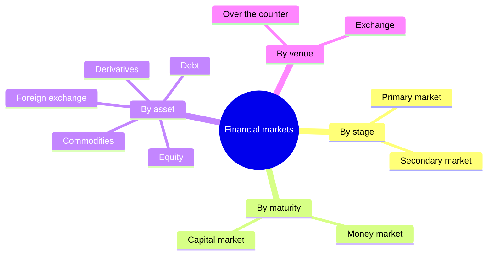
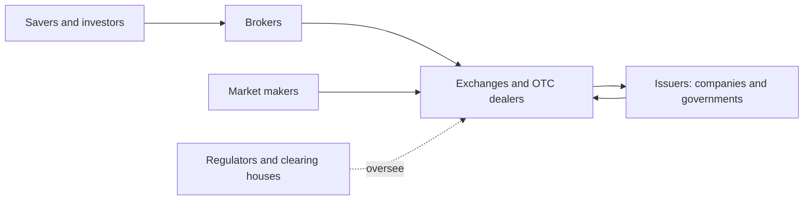

# Financial markets overview

## Summary

A financial market is a place or network where buyers and sellers trade financial assets such as shares, bonds, currencies and derivatives. Markets move savings to the people and firms that can use them, set prices that reflect available information and let investors sell assets before they mature. The main distinctions are between primary and secondary markets, between money and capital markets, and between organized exchanges and over-the-counter trading.

*This note is educational. It is not investment advice.*

## Prerequisites

No prior notes are needed.

## Core concepts

### Definition

A *financial market* is any arrangement through which financial assets are created and exchanged. In the classification of the American Economic Association, financial markets and the pricing of financial assets are covered by JEL group G1, and financial institutions by G2.

### Analogy

A financial market is a marketplace with a clearing house attached. Stalls are the exchanges and brokers, the traders are buyers and sellers, and the price board is the quote screen. The analogy has a limit: a market stall sells goods once, while financial assets are resold many times and each resale carries information about the price.

### Functions

- **Capital allocation.** Savers lend or invest, and borrowers and companies use the money to produce.
- **Price discovery.** The interaction of buyers and sellers sets prices that summarize expectations about future cash flows and risk.
- **Liquidity.** An investor can convert an asset to cash quickly and at low cost. A long-term project can be funded by investors who may sell at any time.
- **Risk sharing.** Derivatives and insurance contracts move risk to those who are willing to carry it.

### Classification

- **Primary market:** new securities are issued and the issuer receives the money (an initial public offering of shares, a bond issue).
- **Secondary market:** existing securities change hands between investors, and the issuer receives nothing from these trades. Liquidity in the secondary market is what makes primary issues attractive.
- **Money market:** short-term debt (under one year), such as Treasury bills and commercial paper.
- **Capital market:** longer-term debt and equity.
- **Exchange:** a regulated venue with standard rules and a central order book (see [order types and the order book](order-types-and-order-book.md)).
- **Over the counter (OTC):** bilateral trades arranged by dealers, common for bonds, currencies and many derivatives.

For scale, the Bank for International Settlements reported in its Triennial Survey that trading in the global foreign exchange market averaged about 9.6 trillion US dollars per day in April 2025.

### Participants

Participants are retail investors, institutions (pension funds, mutual funds, insurers, banks), market makers who quote buy and sell prices, brokers who route orders and regulators who supervise the rules.

## Worked example

A company issues 1,000,000 new shares at 20 each in an initial public offering. In the primary market, the company receives 20,000,000 (less fees). Later, an investor buys 500 of these shares from another investor at 24 on the exchange. That trade moves 12,000 between the two investors and gives the company nothing. It does tell the company, and everyone else, that investors now price its shares at 24, and so, if those are all its shares, the company's market value at that price is 24,000,000. This is price discovery, and it makes a second issue of shares possible at a price based on market information.

## Trade offs and when to use it

Liquid, regulated markets lower costs and give the public fair access, but they can be volatile and prone to bubbles and crashes, and trading itself has costs (commissions, spreads, taxes). OTC markets are flexible and less transparent. A small or new market may be illiquid, which means a large order can move the price against the investor.

## Common mistakes

- **Believing that a share purchase on the exchange funds the company.** Only primary issues do.
- **Thinking that price equals value.** Price is what the last trade cleared at (see [market value and intrinsic value](../fundamental-analysis/market-value-and-intrinsic-value.md)).
- **Ignoring liquidity when choosing an asset.** The price shown can be unreachable for a large order.

## Practice

1. What is the difference between the primary and the secondary market?
2. Why is the secondary market important for the primary one?
3. Give one example each of a money market and a capital market instrument.

### Answers

1. In the primary market the issuer sells new securities and gets the money. In the secondary market investors trade existing securities with each other.
2. Investors buy new issues more readily when they can sell them later.
3. Treasury bill (money market) and a share or a 10-year bond (capital market).

## Further reading

- Bodie, Z., Kane, A. and Marcus, A. J. (2021). *Investments (12th ed.)*. McGraw Hill. The standard university textbook on securities, portfolio theory and market efficiency.
- American Economic Association. JEL classification system. American Economic Association. [Link](https://www.aeaweb.org/econlit/jelCodes.php?view=jel). The classification of economics and finance that groups topics into fields such as G (financial economics).
- CFA Institute. CFA Program curriculum. CFA Institute. [Link](https://www.cfainstitute.org/programs/cfa-program/curriculum). The professional topic outline for investment analysis.
- Bank for International Settlements (2025). Triennial Central Bank Survey of foreign exchange and OTC derivatives markets in 2025. Bank for International Settlements. [Link](https://www.bis.org/statistics/rpfx25.htm). The standard source for the size of the global foreign exchange market.
