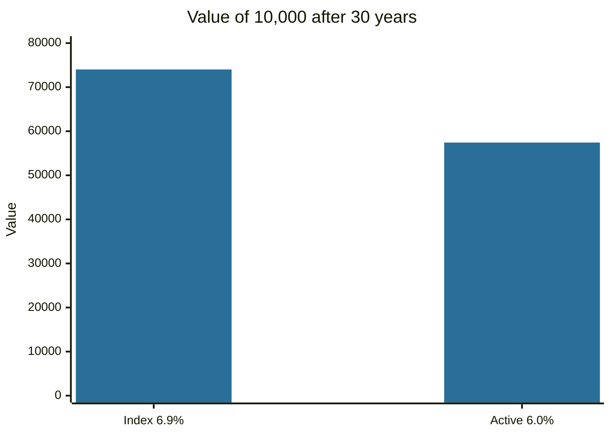

# Market efficiency

## Summary

The efficient market hypothesis (EMH) says that prices in a competitive market already reflect available information, so it is hard to earn a return above the market's risk-adjusted return by trading on that information. Fama (1970) separated three forms depending on the information set: past prices (weak), all public information (semi-strong) and all information including private (strong). Evidence supports the weak and semi-strong forms in large, liquid markets to a high degree, and shows anomalies and limits to arbitrage. The practical conclusion is that low-cost diversified investing is a strong default, and that beating the market requires an edge that others lack.

*This note is educational. It is not investment advice.*

## Prerequisites

- [Financial markets overview](financial-markets-overview.md).
- [Equity markets](equity-markets.md).

## Core concepts

### Definition

A market is *informationally efficient* if prices fully reflect the available information. Then price changes are driven by new information, which is by nature unpredictable, so prices follow a random walk. Efficiency does not say that prices are always correct, but that they are unbiased estimates that cannot be reliably beaten with the information in the stated set.

| Form | Information reflected in prices | Implication |
| --- | --- | --- |
| Weak | Past prices and volume | Technical analysis cannot earn excess returns |
| Semi-strong | All public information | Fundamental analysis on public data cannot earn excess returns |
| Strong | All information, including private | Even insiders cannot earn excess returns (not supported by evidence, and insider trading is illegal) |

### Analogy

A busy market is like a crowd guessing the number of beans in a jar. The average guess is often very close, although single guessers are often far off, so it is hard to beat the average. The analogy breaks down when the crowd shares a bias, or when guessers can't act on their view because it is costly or risky.

### Mechanism

Competition among informed traders pushes prices toward value. If a stock were underpriced on public news, buyers would bid it up at once. The mechanism requires that information is cheap to act on, trading costs are small and arbitrage is possible. When these conditions fail, prices can deviate.


**Evidence and anomalies.** Studies find that few active managers beat their benchmarks after costs, over long periods. At the same time, researchers have documented patterns that standard models do not explain: for example, Fama and French (1992) found that size and the book-to-market ratio explain average returns better than market beta. Whether these are compensation for risk or a mispricing is debated. De Long and co-authors (1990) show that noise traders can keep prices away from value when arbitrage is risky.

**Joint hypothesis problem.** A test of efficiency is always a test of efficiency and of an asset pricing model together. A finding of excess returns can mean an inefficient market or a wrong model of risk.

## Worked example

An index fund charges 0.10% a year and an active fund charges 1.00%. Both hold similar risk. If before costs the active fund matches the index at 7.0% a year, then after costs:

| Fund | Return before costs | Cost | Return after costs | 30-year growth of 10,000 |
| --- | --- | --- | --- | --- |
| Index | 7.0% | 0.10% | 6.9% | 74,017 |
| Active | 7.0% | 1.00% | 6.0% | 57,400 |

```python
# Python 3.12. Effect of fees on 10,000 invested for 30 years.
for name, r in [("index", 0.069), ("active", 0.060)]:
    print(name, round(10_000 * (1 + r) ** 30))
```

Output:

```text
index 74017
active 57435
```

The 0.90 percentage point cost difference leaves about 16,582 less after 30 years in this illustration. The returns are assumptions for the example, not forecasts.



## Trade offs and when to use it

If markets are mostly efficient, the sensible default for most investors is a diversified low-cost portfolio. Trading to beat the market is a zero-sum game before costs and a negative-sum game after them, since for each winner there is a loser. Active management may add value in less efficient segments (small or illiquid markets) or for investors with real information or analytical advantages. Efficiency is a matter of degree: it differs by market and by period.

## Common mistakes

- **"Efficient means prices are always right."** They are unbiased given the information, and they can be far off with hindsight.
- **"Nobody can beat the market, so research is useless."** Research is what makes prices efficient.
- **Reading a lucky streak as skill.** With thousands of managers, some will outperform by chance.
- **Ignoring costs.** Fees and taxes are certain, and outperformance is not.

## Practice

1. What are the three forms of the EMH?
2. If the weak form holds, what does it say about chart patterns?
3. Why is the joint hypothesis problem a challenge for tests of efficiency?

### Answers

1. Weak (past prices), semi-strong (public information) and strong (all information).
2. They cannot be used to earn consistent excess returns, because past prices are already reflected.
3. Any test uses a model of expected returns, so a result can be due to the model and not to the market.

## Further reading

- Fama, E. F. (1970). Efficient capital markets: a review of theory and empirical work. *The Journal of Finance*, 25(2), 383-417. [DOI](https://doi.org/10.1111/j.1540-6261.1970.tb00518.x). Defines the weak, semi-strong and strong forms of market efficiency.
- Fama, E. F. and French, K. R. (1992). The cross-section of expected stock returns. *The Journal of Finance*, 47(2), 427-465. [DOI](https://doi.org/10.1111/j.1540-6261.1992.tb04398.x). Documents that size and book-to-market ratio explain average stock returns better than market beta.
- De Long, J. B., Shleifer, A., Summers, L. H. et al. (1990). Noise trader risk in financial markets. *Journal of Political Economy*, 98(4), 703-738. [DOI](https://doi.org/10.1086/261703). Explains why prices can stay away from fundamental value when sentiment-driven traders are active.
- Bodie, Z., Kane, A. and Marcus, A. J. (2021). *Investments (12th ed.)*. McGraw Hill. The standard university textbook on securities, portfolio theory and market efficiency.
