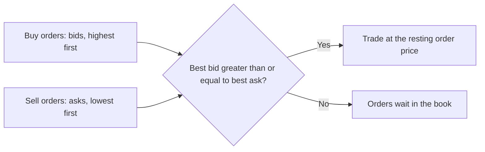
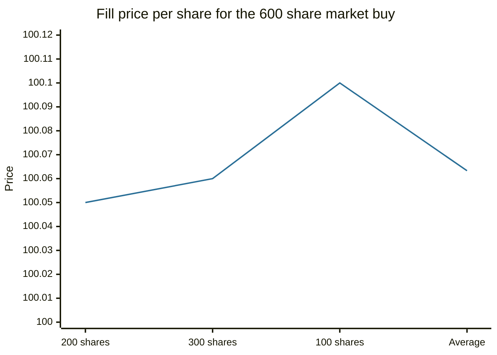

# Order types and the order book

## Summary

An exchange matches buy and sell orders in an order book. The best price a buyer will pay is the bid, the best price a seller will accept is the ask, and the gap between them is the spread. A market order trades now at the best available prices, a limit order trades only at a chosen price or better, and a stop order becomes a market order once a trigger price is reached. Choosing the order type decides whether you control price or certainty of execution.

*This note is educational. It is not investment advice.*

## Prerequisites

- [Financial markets overview](financial-markets-overview.md).

## Core concepts

### Definition

- **Bid:** the highest price a buyer is currently willing to pay.
- **Ask (offer):** the lowest price a seller is currently willing to accept.
- **Spread:** ask minus bid. It is the cost of trading immediately and the pay of market makers, who buy at the bid and sell at the ask. Brokers earn commissions or other fees, and some earn payment for routing orders.
- **Order book:** the list of all open buy and sell orders for a security, sorted by price and then by time of arrival.
- **Market order:** buy or sell at once at the best available price.
- **Limit order:** buy at the limit price or lower, or sell at the limit price or higher.
- **Stop order (stop-loss):** an order that becomes a market order when the price reaches the stop price. A *stop-limit order* becomes a limit order instead.

### Analogy

The order book is a queue at a market stall with two lines. Buyers line up with the price they will pay, sellers with the price they want, and whenever the best buyer meets the best seller a trade occurs. A market order is a person who walks past the line and takes whatever the cheapest stall offers. A limit order is a person who stands in the line and waits for the price. The analogy breaks because real stalls rarely let you see how many people stand behind the first.

### Mechanism

Orders are matched by price priority (best price first) and then by time priority. The top of the book (*Level I* data) shows only the best bid, best ask and the last trade price. *Level II* data shows several price levels with their sizes.



Behavior of each type:

| Type | You control | You do not control | Risk |
| --- | --- | --- | --- |
| Market | Execution now | Price | Slippage in thin or fast markets |
| Limit | Price | Whether and when it fills | May never fill |
| Stop (market) | A trigger level | The fill price after the trigger | Gap past the stop gives a worse price |
| Stop-limit | Trigger and a limit on the price | Whether it fills after the trigger | May not fill if the price gaps |

Important: a limit order to sell *below* the current price fills immediately at the market, and does not work as a protective stop. A protective sale needs a stop order.

## Worked example

An order book for a share:

| Side | Price | Size |
| --- | --- | --- |
| Ask | 100.10 | 500 |
| Ask | 100.06 | 300 |
| Ask | 100.05 | 200 |
| Bid | 100.00 | 400 |
| Bid | 99.99 | 300 |
| Bid | 99.95 | 600 |

The spread is 100.05 - 100.00 = 0.05, which is 0.05% of the mid price of 100.025. A market order to buy 600 shares fills as follows.

```python
# Python 3.12. A market buy of 600 shares walks up the ask side of the book.
asks = [(100.05, 200), (100.06, 300), (100.10, 500)]   # (price, size), best first
left, cost = 600, 0.0
for price, size in asks:
    take = min(left, size)
    cost += take * price
    left -= take
    if left == 0:
        break
print(round(cost, 2), round(cost / 600, 4))
```

Output:

```text
60038.0 100.0633
```

The average price is 100.0633, which is 0.0133 above the best ask (this difference is *slippage*). A limit buy at 100.05 for the same 600 shares would fill only 200 and leave 400 waiting in the book.



The line shows the fill price of each block of the order, and the last point is the average price of 100.0633.

## Trade offs and when to use it

Use a market order for liquid securities when speed matters more than a few cents. Use a limit order when the price matters, or for thinly traded securities, where a market order can move the price. Use stops to limit a loss, and know that a stop order is not a guarantee of the stop price: in a fast fall or after an overnight gap the fill can be far below it. Orders also have a time in force: day, good until cancelled, immediate or cancel.

## Common mistakes

- **Using a market order on an illiquid security,** which can fill at a bad price.
- **Using a limit sell below the market as a stop.** It executes at once.
- **Assuming the stop price is the sale price.** It is only the trigger.
- **Ignoring the spread** when trading often. It is paid on every round trip.

## Practice

1. Bid is 49.90 and ask 50.00. What is the spread, and what is the cost of buying and selling at once?
2. Which order type guarantees price but not execution?
3. Why does a market order for a large size cause slippage?

### Answers

1. The spread is 0.10. Buying at the ask and selling at the bid loses 0.10 per share (0.2% of 50).
2. The limit order.
3. It consumes the best price level and then moves to worse levels.

## Further reading

- Bodie, Z., Kane, A. and Marcus, A. J. (2021). *Investments (12th ed.)*. McGraw Hill. The standard university textbook on securities, portfolio theory and market efficiency.
- FINRA. Stocks. Financial Industry Regulatory Authority. [Link](https://www.finra.org/investors/investing/investment-products/stocks). Explains how orders reach the market and how stock trades are priced
- U.S. Securities and Exchange Commission, Office of Investor Education and Advocacy. Stocks. Investor.gov. [Link](https://www.investor.gov/introduction-investing/investing-basics/investment-products/stocks). Plain-language regulator guide to common and preferred stock and their risks.
