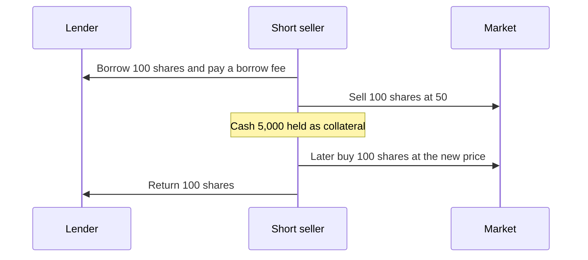
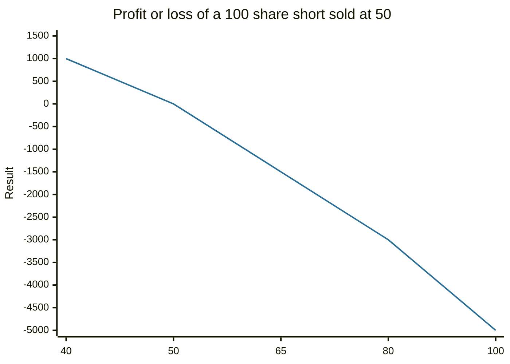

# Short selling

## Summary

Short selling is selling a security the seller does not own, by borrowing it, in the hope of buying it back later at a lower price and returning it. The short seller profits when the price falls and loses when it rises. Potential gains are capped at the sale price, and potential losses are unlimited, because a price can rise without a limit. Short selling adds liquidity and price discovery to markets, and it carries borrowing costs, margin requirements and the risk of a short squeeze.

*This note is educational. It is not investment advice. Short selling is high-risk and not suitable for most individual investors.*

## Prerequisites

- [Order types and the order book](order-types-and-order-book.md).
- [Equity markets](equity-markets.md).
- [Leverage and margin](../portfolio-management/leverage-and-margin.md).

## Core concepts

### Definition

In a *short sale* the seller borrows shares from a lender (usually through a broker), sells them in the market, and later *covers* the short by buying the same number of shares and returning them. The seller's profit or loss is the difference between the sale and the repurchase price, less costs. A *long* position, by contrast, profits when the price rises.

### Analogy

Short selling is like borrowing a neighbor's lawnmower, selling it and promising to return an identical one next month. If new mowers become cheaper, you buy one for less than you sold and keep the difference. If they become more expensive, you pay the higher price. The analogy fails because a lawnmower price cannot rise forever, while a share price in principle can, and the neighbor can ask for the mower back at any time.

### Mechanism

Features and costs:

- **Margin.** The broker requires collateral. If the price rises, the seller must add funds (a *margin call*) or the broker closes the position.
- **Borrow fee.** Hard-to-borrow shares cost more.
- **Dividends.** If the stock pays a dividend while the short is open, the short seller must pay the equivalent amount to the lender.
- **Recall.** The lender can recall the shares, forcing an early cover.
- **Short squeeze.** A rising price forces shorts to buy back, which pushes the price up further.

Rules differ by country. In the US, Regulation SHO governs short sales, including a "locate" requirement before shorting, and the alternative uptick rule, which limits short sales at or below the best bid in a stock that has fallen 10% or more in a day. Regulators have temporarily banned short selling of some stocks in crises.

## Worked example

An investor shorts 100 shares at 50 (proceeds 5,000), ignoring fees and interest.

| Price at cover | Result per share | Result for 100 shares |
| --- | --- | --- |
| 40 | +10 | +1,000 |
| 50 | 0 | 0 |
| 65 | -15 | -1,500 |
| 80 | -30 | -3,000 |
| 100 | -50 | -5,000 |

The maximum gain is 5,000 (price falls to zero). The loss has no upper limit: at a price of 150, the loss is 10,000, which is twice the original proceeds.

The line is the result for each price at which the short is covered: a gain when the price falls below 50, and a loss that keeps growing as the price rises.

## Trade offs and when to use it

Short selling is used for speculation, to hedge a long position (for example, shorting an index against a stock portfolio) and by arbitrageurs. It allows investors with negative views to express them, which improves price discovery. The costs are high for retail investors: borrow fees, margin interest and the asymmetry of the payoff. A short position needs active monitoring. An investor who wants downside exposure with a capped loss can buy a put option instead (see [options](../financial-instruments/options.md)).

## Common mistakes

- **Sizing a short like a long.** A long can lose at most 100%, and a short can lose more.
- **Ignoring the squeeze risk** in stocks with high short interest and small float.
- **Forgetting carrying costs** (borrow fee, dividends).
- **Being right too early.** The price can keep rising before it falls, and margin calls arrive before the thesis plays out.

## Practice

1. Why is the maximum loss on a short sale unlimited?
2. A trader shorts 200 shares at 30 and covers at 24. What is the profit before costs?
3. What is a short squeeze?

### Answers

1. The price can rise without a limit, and the short seller must buy back at the higher price.
2. (30 - 24) × 200 = 1,200.
3. A rising price forces short sellers to cover, and their buying pushes the price up more.

## Further reading

- U.S. Securities and Exchange Commission, Office of Investor Education and Advocacy. Short-selling (glossary). Investor.gov. [Link](https://www.investor.gov/introduction-investing/investing-basics/glossary/short-selling). Regulator definition of short selling and its risks.
- Bodie, Z., Kane, A. and Marcus, A. J. (2021). *Investments (12th ed.)*. McGraw Hill. The standard university textbook on securities, portfolio theory and market efficiency.
- Hull, J. C. (2021). *Options, Futures, and Other Derivatives (11th ed.)*. Pearson. Explains short selling where it matters for forward pricing and arbitrage
