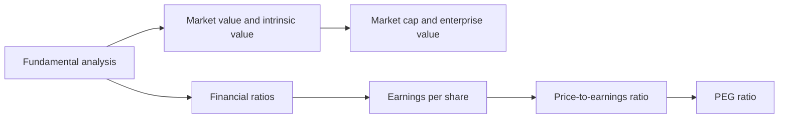

# Fundamental analysis

How to judge what a company is worth from its business and financial statements: the meaning of value, market capitalization and enterprise value, the main financial ratios, earnings per share, the price-to-earnings ratio and the PEG ratio. This subfield belongs to [Finance and investing](../README.md). It uses the vocabulary of [accounting basics](../accounting-basics/README.md) and the valuation tools of [corporate finance](../corporate-finance/README.md). Its counterpart, which studies price charts, is [technical analysis](../technical-analysis/README.md).

## Map of the subfield

The map shows the path from the idea of value to the ratios that compare price with it.

## Notes in reading order

1. [Fundamental analysis](fundamental-analysis.md): the method, top-down and bottom-up, intrinsic value and the margin of safety.
2. [Market value and intrinsic value](market-value-and-intrinsic-value.md): market, book, intrinsic, fair and economic value compared.
3. [Market capitalization and enterprise value](market-capitalization-and-enterprise-value.md): the price of the equity and of the whole business.
4. [Financial ratios](financial-ratios.md): liquidity, leverage, profitability and valuation ratios, and the DuPont split.
5. [Earnings per share](earnings-per-share.md): basic and diluted EPS and the weighted share count.
6. [Price-to-earnings ratio](price-to-earnings-ratio.md): trailing, forward and cyclically adjusted P/E and what drives it.
7. [PEG ratio](peg-ratio.md): P/E adjusted for expected growth.

## Planned topics

- Reading an annual report
- Return on invested capital and economic profit
- Price-to-book and price-to-sales
- Quality of earnings and accounting red flags
- Industry analysis and competitive advantage

## How to use this subfield

Take the annual report of one listed company and compute the ratios in note 4 yourself, then read notes 5 to 7 against the result. Whether any of this can beat the market is discussed in [market efficiency](../financial-markets/market-efficiency.md).

These notes are educational. They are not investment advice.

## Navigation

- Back to [Finance and investing](../README.md).
