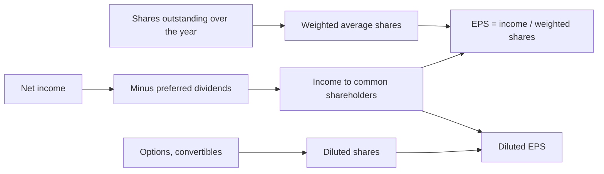
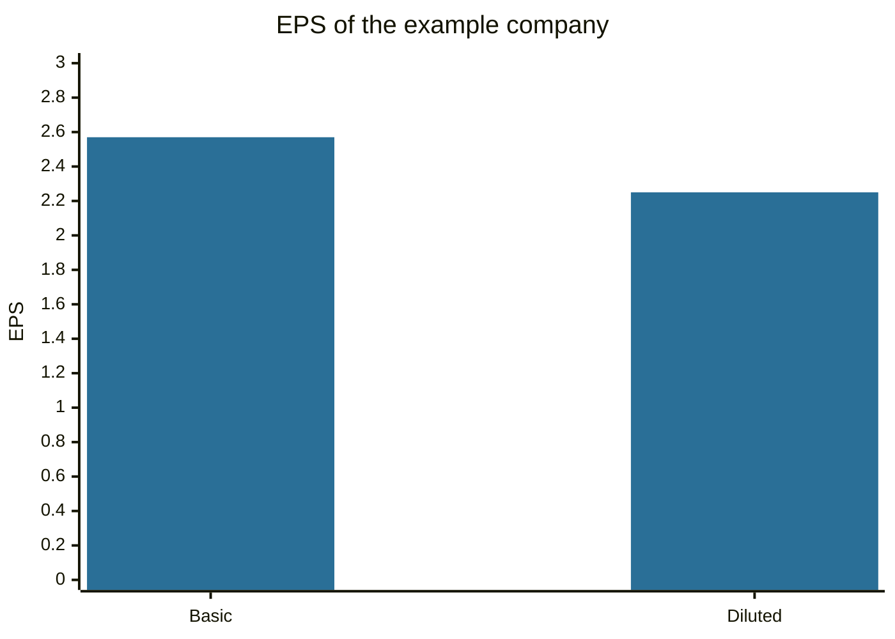

# Earnings per share

## Summary

Earnings per share (EPS) is the profit that belongs to common shareholders divided by the average number of common shares outstanding during the period. It turns a company's total profit into profit per share, so that results can be compared over time and across companies, and it is the denominator of the price-to-earnings ratio. Basic EPS counts the shares that exist, diluted EPS also counts the shares that could be created by options, convertible bonds and similar instruments.

*This note is educational. It is not investment advice.*

## Prerequisites

- [Income and profit](../accounting-basics/income-and-profit.md).
- [Stocks](../financial-instruments/stocks.md).

## Core concepts

### Definition

```text
Basic EPS = (net income - preferred dividends) / weighted average common shares outstanding
```

- **Preferred dividends** are deducted because preferred shareholders are paid first. The result is the profit available to common shareholders.
- **Weighted average shares** weight each share count by the time it was outstanding. New issues and buybacks during the year change the weighting.
- **Diluted EPS** adds the shares that would be issued if dilutive instruments were exercised or converted (options, warrants, convertible bonds and preferred shares), and adjusts income if needed. The standard that sets the rules under IFRS is IAS 33, and US GAAP has an equivalent.
- **Adjusted (non-GAAP) EPS** excludes one-time or non-cash items chosen by the company, and is not standardized.
- **Trailing EPS** uses the last twelve months, and **forward EPS** uses an analyst forecast.

### Analogy

EPS is the slice of the pie each shareholder's share gets. If the pie grows, the slices get bigger. If the pie stays the same and the company cuts it into more slices (by issuing shares), each slice shrinks. The analogy shows why EPS can fall in a year when profit rises, if the share count rises more.

### Mechanism



Buybacks raise EPS by reducing the share count even when profit is flat, which is why analysts look at net income and cash flow as well as EPS. Growth in EPS comes from higher profit, fewer shares, or both.

## Worked example

A company earns net income of 10 million and pays preferred dividends of 1 million. It starts the year with 3 million shares and issues 1 million on 1 July. There are 0.5 million options that are dilutive.

- Weighted average shares = 3 + 1 × 6/12 = 3.5 million.
- Basic EPS = (10 - 1) / 3.5 = 2.57.
- Diluted shares = 3.5 + 0.5 = 4.0 million (a simplification of the treasury stock method).
- Diluted EPS = 9 / 4.0 = 2.25.

| Measure | Value |
| --- | --- |
| Basic EPS | 2.57 |
| Diluted EPS | 2.25 |

The difference of 0.32 is the dilution from potential shares. If the price is 30, the trailing P/E is 30 / 2.57 = 11.7 on basic EPS and 13.3 on diluted EPS, and the choice changes how cheap the stock looks.



## Trade offs and when to use it

EPS is easy to find and to compare for one company over time, and it has weaknesses. It depends on accounting policy and on one-off items. It can be inflated by buybacks funded with debt. It ignores the capital needed to earn the profit, so two companies with the same EPS can differ in return on capital. EPS is not comparable across companies without considering the price (see [P/E](price-to-earnings-ratio.md)) and the quality of earnings, such as the gap between profit and operating cash flow.

## Common mistakes

- **Using the share count at the end of the year.** Use the weighted average.
- **Ignoring dilution.** Compare diluted EPS.
- **Accepting adjusted EPS without reading the adjustments.**
- **Comparing the EPS of companies with different share counts as a size signal.** A high EPS says nothing about being cheap.

## Practice

1. Net income 6 million, preferred dividends 0.5 million, 2.2 million weighted shares. What is basic EPS?
2. Why can EPS rise while net income is flat?
3. What does diluted EPS add to basic EPS?

### Answers

1. 5.5 / 2.2 = 2.50.
2. A share buyback reduces the number of shares.
3. The shares that could be created from options, warrants and convertibles.

## Further reading

- IFRS Foundation. IAS 33 Earnings per Share. IFRS Foundation. [Link](https://www.ifrs.org/issued-standards/list-of-standards/ias-33-earnings-per-share/). The standard that defines basic and diluted earnings per share.
- Damodaran, A. (2012). *Investment Valuation: Tools and Techniques for Determining the Value of Any Asset (3rd ed.)*. Wiley. A detailed treatment of intrinsic and relative valuation, including the earnings multiples.
- Brealey, R. A., Myers, S. C., Allen, F. et al. (2023). *Principles of Corporate Finance (14th ed.)*. McGraw Hill. Covers valuation, risk and the cost of capital.
