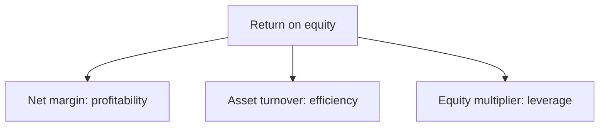
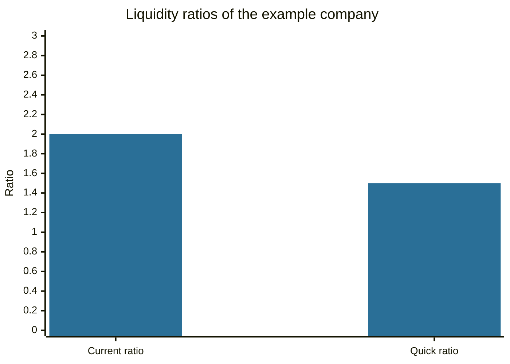

# Financial ratios

## Summary

A financial ratio divides one number from the financial statements or the market by another, to make companies of different sizes comparable. Ratios fall into liquidity (can the company pay its short-term bills), leverage (how much does it rely on debt), profitability (how well does it use its capital) and valuation (how expensive is the stock). No ratio is good or bad in isolation: it has to be read against the industry, the company's own history and other ratios.

*This note is educational. It is not investment advice.*

## Prerequisites

- [Financial statements](../corporate-finance/financial-statements.md).
- [Assets](../accounting-basics/assets.md) and [liabilities](../accounting-basics/liabilities.md).

## Core concepts

### Definition

A *ratio* is a quotient of two financial quantities. Fundamental analysis uses ratios to find strengths and weaknesses in a company, to compare it with peers and to track change over time.

### Analogy

Ratios are like a blood test: each value on its own is a number, and a doctor reads the set against a reference range for age and sex. A single high value can be normal for the person. In the same way, a high debt ratio is normal for a utility and alarming for a software company.

### The main ratios

| Group | Ratio | Formula | What it shows |
| --- | --- | --- | --- |
| Liquidity | Current ratio (working capital ratio) | Current assets / current liabilities | Ability to pay obligations due within a year |
| Liquidity | Quick ratio (acid test) | (Current assets - inventory - prepaid expenses) / current liabilities | The same, excluding assets slow to turn into cash |
| Leverage | Debt-to-equity | Total liabilities / shareholders' equity (some analysts use only interest-bearing debt) | Reliance on borrowing |
| Profitability | Return on equity (ROE) | Net income / average shareholders' equity | Profit earned on owners' capital |
| Profitability | Net margin | Net income / revenue | Profit per unit of sales |
| Valuation | Earnings per share (EPS) | (Net income - preferred dividends) / weighted average shares | Profit per share, see [EPS](earnings-per-share.md) |
| Valuation | Price-to-earnings (P/E) | Price / EPS | Price paid per unit of earnings, see [P/E](price-to-earnings-ratio.md) |
| Valuation | Price-to-book (P/B) | Price / book value per share | Price against recorded net assets |
| Valuation | PEG | P/E / earnings growth rate | P/E adjusted for growth, see [PEG](peg-ratio.md) |
| Cash | Free cash flow | Operating cash flow - capital expenditure | Cash left for owners and lenders, see [free cash flow](../corporate-finance/free-cash-flow.md) |

Rules of thumb for liquidity: a current ratio near 1 means little room, and 2 or more is comfortable, while a very high ratio can mean idle assets. A quick ratio below 1 means the company cannot cover its short-term obligations from liquid assets alone. These thresholds vary by industry. A retailer with fast-turning inventory can run at a lower ratio than a manufacturer.

**ROE and the DuPont split.** ROE = net margin × asset turnover × equity multiplier, that is (net income / revenue) × (revenue / assets) × (assets / equity). It shows whether a high ROE comes from profitability, efficient use of assets or leverage. High leverage can raise ROE and risk together.



## Worked example

A company has revenue of 20 million, net income of 2.6 million, total assets of 20 million and liabilities of 7 million. Current assets are 8 million (of which inventory and prepaid expenses are 2 million), current liabilities 4 million, there is 1 million shares and the price is 30.

```python
# Python 3.12. Ratios for one company, and the DuPont split of ROE.
revenue, net_income = 20.0, 2.6            # millions
assets, liabilities = 20.0, 7.0
equity = assets - liabilities
cur_assets, inv_prepaid, cur_liab = 8.0, 2.0, 4.0
shares, price = 1.0, 30.0                  # millions of shares, price per share
eps = net_income / shares
print("current", cur_assets / cur_liab, "quick", (cur_assets - inv_prepaid) / cur_liab)
print("D/E", round(liabilities / equity, 2), "ROE", f"{net_income / equity:.1%}")
print("EPS", eps, "P/E", round(price / eps, 1), "BVPS", equity / shares, "P/B", round(price / (equity / shares), 2))
margin, turnover, multiplier = net_income / revenue, revenue / assets, assets / equity
print("DuPont", f"{margin:.1%} x {turnover:.2f} x {multiplier:.2f} = {margin * turnover * multiplier:.1%}")
```

Output:

```text
current 2.0 quick 1.5
D/E 0.54 ROE 20.0%
EPS 2.6 P/E 11.5 BVPS 13.0 P/B 2.31
DuPont 13.0% x 1.00 x 1.54 = 20.0%
```

The example uses year-end equity for ROE, and analysts normally use the average of the opening and closing equity.

Reading: liquidity is comfortable (2.0 and 1.5), debt is moderate (0.54), and ROE is 20%, which comes from a 13% margin, an asset turnover of 1.0 and a leverage factor of 1.54. The stock trades at 11.5 times earnings and 2.31 times book. Whether these are cheap or expensive depends on the industry, growth and rates.



## Trade offs and when to use it

Ratios are quick and comparable, and they rely on accounting data, which is affected by policy choices and timing. They describe the past. Seasonality distorts balance-sheet ratios at the year end. Compare with peers using the same accounting rules, use averages for ratios that mix flows and balances (ROE), and read several together.

## Common mistakes

- **Reading a ratio without a benchmark.**
- **Comparing across industries.** Banks, utilities and software companies have different norms.
- **Ignoring how the denominator is built.** "Debt-to-equity" has two common definitions.
- **Ignoring negative equity or negative earnings,** which make some ratios meaningless.
- **Using a single year.** Check the trend.

## Practice

1. Current assets 12, inventory 5, prepaid 1, current liabilities 6. What is the quick ratio?
2. A company has a net margin of 5%, asset turnover of 2 and an equity multiplier of 2. What is ROE?
3. Why can a high ROE be a warning sign?

### Answers

1. (12 - 5 - 1) / 6 = 1.0.
2. 0.05 × 2 × 2 = 20%.
3. It may come from high leverage, which raises risk, and not from better operations.

## Further reading

- Damodaran, A. (2012). *Investment Valuation: Tools and Techniques for Determining the Value of Any Asset (3rd ed.)*. Wiley. A detailed treatment of intrinsic and relative valuation, including the earnings multiples.
- Graham, B. and Dodd, D. L. (2008). *Security Analysis (6th ed.)*. McGraw Hill. The founding text of fundamental analysis and of the idea of intrinsic value.
- Brealey, R. A., Myers, S. C., Allen, F. et al. (2023). *Principles of Corporate Finance (14th ed.)*. McGraw Hill. Covers valuation, risk and the cost of capital.
- IFRS Foundation. IAS 7 Statement of Cash Flows. IFRS Foundation. [Link](https://www.ifrs.org/issued-standards/list-of-standards/ias-7-statement-of-cash-flows/). Defines the cash flow figures behind the free cash flow ratio
