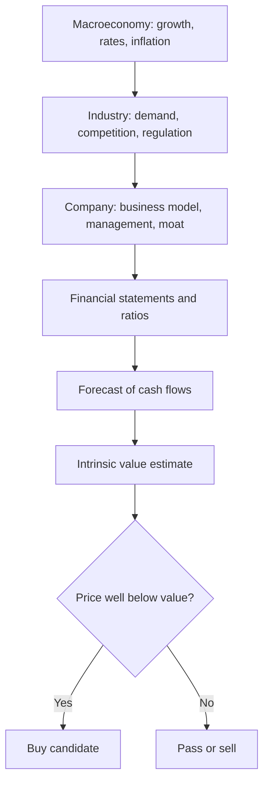
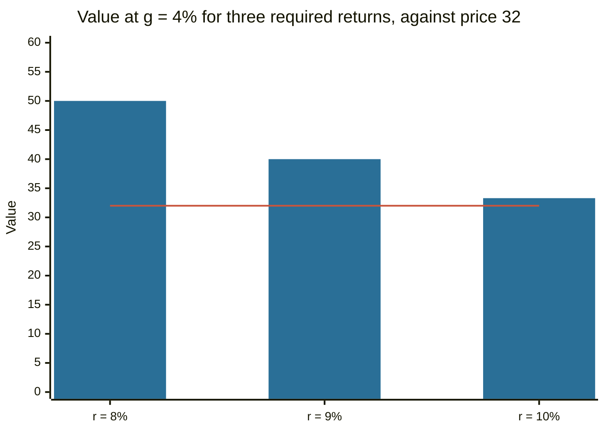

# Fundamental analysis

## Summary

Fundamental analysis estimates what a security is worth from the economics of the business behind it: its revenue, costs, assets, debts, growth, risks and the economy it operates in. The estimated intrinsic value is compared with the market price, and the investor buys when the price is well below it and avoids or sells when it is above. Analysts work top down (economy, then industry, then company) or bottom up (the company first), and use two families of tools: discounted cash flow and relative valuation with ratios.

*This note is educational. It is not investment advice.*

## Prerequisites

- [Financial statements](../corporate-finance/financial-statements.md).
- [Market value and intrinsic value](market-value-and-intrinsic-value.md).

## Core concepts

### Definition

*Fundamental analysis* is the study of the economic factors that determine the value of a security, in order to compare the resulting estimate with its price. It was set out as a discipline by Graham and Dodd in *Security Analysis* (first published 1934). Its opposite in method is [technical analysis](../technical-analysis/technical-analysis.md), which studies price and volume.

### Analogy

Fundamental analysis is a home inspection before buying. The inspector checks the structure, the roof and the plumbing and gives a view on what the house is worth. The seller's asking price is a different thing. The analogy has a limit: a house is inspected once, while a company changes every quarter, and the inspector can never see the future cash flows.

### Mechanism

- **Top down:** start with the economy, pick favorable industries, then pick companies in them.
- **Bottom up:** start with the company and ignore the cycle, on the view that good businesses at fair prices do well.

Two valuation approaches:

1. **Absolute (intrinsic) valuation.** Discount future cash flows or dividends at a required return (see [discounted cash flow](../corporate-finance/discounted-cash-flow.md) and [WACC](../corporate-finance/wacc.md)).
2. **Relative valuation.** Compare ratios such as [price-to-earnings](price-to-earnings-ratio.md), price-to-book and EV/EBITDA with those of similar companies or with the company's own history (see [financial ratios](financial-ratios.md)).

Qualitative factors matter too: the quality of management, the strength of the competitive position (the *moat*), the regulatory environment and accounting quality. The *margin of safety* (Graham) is the gap between value and price that protects against errors in the estimate.

## Worked example

A company is expected to pay a dividend of 2 next year, with dividends growing at 4% a year. The required return is 9%. The Gordon growth model gives an intrinsic value of D1 / (r - g) = 2 / (0.09 - 0.04) = 40. The market price is 32.

- Margin of safety = (40 - 32) / 40 = 20%.
- The estimate is sensitive to the inputs. A change of one percentage point in r or g changes the value a lot.

| Required return | g = 3% | g = 4% | g = 5% |
| --- | --- | --- | --- |
| 8% | 40.0 | 50.0 | 66.7 |
| 9% | 33.3 | 40.0 | 50.0 |
| 10% | 28.6 | 33.3 | 40.0 |

At r = 10% and g = 4% the value is 33.3, which is above the price by only 4%, and the apparent bargain nearly disappears. The table shows why the analyst gives a range and a margin of safety, and not one number.

The line is the market price. The bars are intrinsic values at each required return.

## Trade offs and when to use it

Fundamental analysis gives a reasoned basis for long-term decisions and protects from buying on hype. Its weak points are the sensitivity to estimates, the time needed, and the question of whether public information is already priced in. If markets are efficient in the semi-strong sense, analysis of public data yields no excess return, and it still has a role in making prices efficient (see [market efficiency](../financial-markets/market-efficiency.md)). For most investors, an index fund replaces stock-by-stock analysis. For those who analyze, discipline about assumptions and the margin of safety matters most.

## Common mistakes

- **Confusing a good company with a good investment.** The price paid decides the return.
- **Single-point valuation.** Always test a range.
- **Anchoring on the last price or on the analyst consensus.**
- **Ignoring accounting quality.** Check cash flow against earnings.
- **Using one ratio.** Combine several, in the context of the industry.

## Practice

1. What is the difference between top-down and bottom-up analysis?
2. Dividend next year 3, required return 10%, growth 5%. What is the Gordon value?
3. Why does the analyst demand a margin of safety?

### Answers

1. Top down starts from the economy and industry, bottom up starts from the company.
2. 3 / (0.10 - 0.05) = 60.
3. Estimates are uncertain, and a margin absorbs errors in the inputs.

## Further reading

- Graham, B. and Dodd, D. L. (2008). *Security Analysis (6th ed.)*. McGraw Hill. The founding text of fundamental analysis and of the idea of intrinsic value.
- Damodaran, A. (2012). *Investment Valuation: Tools and Techniques for Determining the Value of Any Asset (3rd ed.)*. Wiley. A detailed treatment of intrinsic and relative valuation, including the earnings multiples.
- Damodaran, A. Damodaran Online. NYU Stern. [Link](https://pages.stern.nyu.edu/~adamodar/). Free datasets on historical returns, multiples and valuation by industry.
- Brealey, R. A., Myers, S. C., Allen, F. et al. (2023). *Principles of Corporate Finance (14th ed.)*. McGraw Hill. Covers valuation, risk and the cost of capital.
