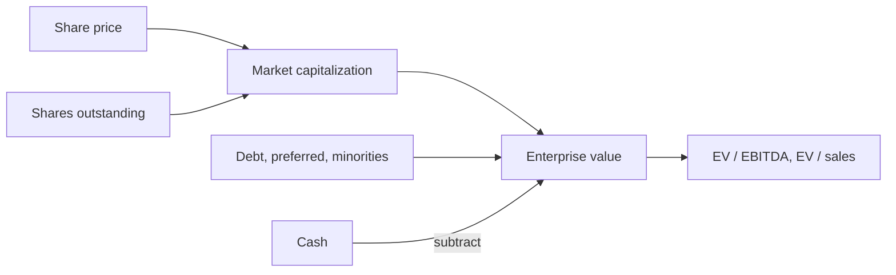
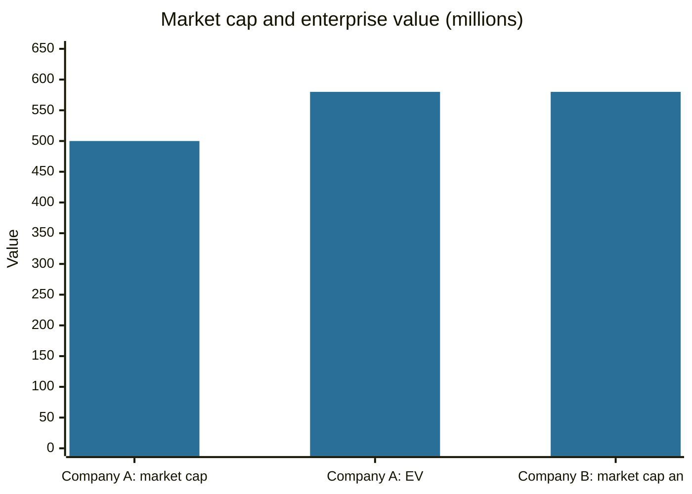

# Market capitalization and enterprise value

## Summary

Market capitalization is the market value of a company's shares: the share price multiplied by the number of shares outstanding. It is the price of the equity only. Enterprise value (EV) adds the debt and other claims and subtracts the cash, so it is the price of the whole operating business and is the right base for comparing companies with different financing. Size classes such as large-cap and small-cap are conventions that differ between index providers.

*This note is educational. It is not investment advice.*

## Prerequisites

- [Market value and intrinsic value](market-value-and-intrinsic-value.md).
- [Stocks](../financial-instruments/stocks.md).

## Core concepts

### Definition

- **Market capitalization (market cap)** = share price × shares outstanding.
- **Enterprise value (EV)** = market cap + debt + preferred shares + minority interests - cash and cash equivalents. It is the theoretical cost of buying the whole business: you pay the owners of the shares and take over the debt, and the cash you acquire reduces the cost.
- **Free float:** the shares available to the public, excluding those held by insiders and strategic holders. Many indexes weight companies by float-adjusted market cap.

### Analogy

Buying a house with a mortgage: the market cap is the equity of the house, the price you would pay to the current owner above the loan. The enterprise value is the full price of the house, equity plus the mortgage that you take over, less any cash left in the safe. Two identical houses are the same price whether one owner has a mortgage or not. The same is true of EV for two otherwise identical companies.

### Size classes

A common convention in the US, used by many data providers, divides companies by market cap: large-cap roughly above 10 billion, mid-cap 2 to 10 billion, and small-cap about 250 million to 2 billion, with micro-cap below. There is no official standard, and the thresholds move with the market and between index providers. Smaller companies are on average more volatile and less liquid, and have historically had higher average returns (Fama and French, 1992, find a size effect in average returns).

### Mechanism and use

Market cap changes with the price alone. A company with 20 million shares at 100 has a market cap of 2 billion, and another with 10,000 shares at 1,000 has 10 million. The share price by itself says nothing about size or cheapness. The number of shares also changes with issues, buybacks and splits, which change the price but not the value of the whole.

EV is used for multiples that compare the business independent of its financing: EV / EBITDA (see [EBITDA](../corporate-finance/ebitda.md)), EV / sales and EV / free cash flow. Price multiples such as P/E (see [price-to-earnings ratio](price-to-earnings-ratio.md)) are equity multiples and use market cap in the numerator.

## Worked example

A company has 10 million shares at 50, debt of 120 million, cash of 40 million, no preferred shares or minorities, and EBITDA of 58 million.

| Item | Amount |
| --- | --- |
| Market cap | 10 million × 50 = 500 million |
| Add debt | +120 million |
| Subtract cash | -40 million |
| Enterprise value | 580 million |
| EV / EBITDA | 580 / 58 = 10.0 |

A competitor with the same EBITDA and no debt, a market cap of 580 million, has the same EV and the same EV / EBITDA, although its market cap is higher. Comparing only the market caps would call the first company cheaper, which misleads, as it carries debt.

## Trade offs and when to use it

Market cap is simple, observable and the base of most stock indexes. EV is better for comparing operating businesses, takeovers and companies with different leverage. EV needs reliable debt and cash figures, and the treatment of leases, pensions and trapped cash varies. Banks and insurers are usually valued with equity multiples because debt is part of their business.

## Common mistakes

- **Judging size by share price.**
- **Comparing market caps of companies with very different debt.**
- **Forgetting preferred shares and minority interests in EV.**
- **Using stale share counts.** Buybacks and issues change them.
- **Treating size classes as official.**

## Practice

1. A company has 5 million shares at 24, debt of 30 million and cash of 10 million. What are the market cap and EV?
2. Why is EV, and not market cap, used with EBITDA?
3. Why does a stock split not change market cap?

### Answers

1. Market cap 120 million, EV 120 + 30 - 10 = 140 million.
2. EBITDA is earned for all providers of capital, so it should be compared with the value claimed by all of them.
3. The number of shares rises in proportion to the fall in the price.

## Further reading

- Damodaran, A. (2012). *Investment Valuation: Tools and Techniques for Determining the Value of Any Asset (3rd ed.)*. Wiley. A detailed treatment of intrinsic and relative valuation, including the earnings multiples.
- Fama, E. F. and French, K. R. (1992). The cross-section of expected stock returns. *The Journal of Finance*, 47(2), 427-465. [DOI](https://doi.org/10.1111/j.1540-6261.1992.tb04398.x). Documents that size and book-to-market ratio explain average stock returns better than market beta.
- Damodaran, A. Damodaran Online. NYU Stern. [Link](https://pages.stern.nyu.edu/~adamodar/). Free datasets on historical returns, multiples and valuation by industry.
- Brealey, R. A., Myers, S. C., Allen, F. et al. (2023). *Principles of Corporate Finance (14th ed.)*. McGraw Hill. Covers valuation, risk and the cost of capital.
