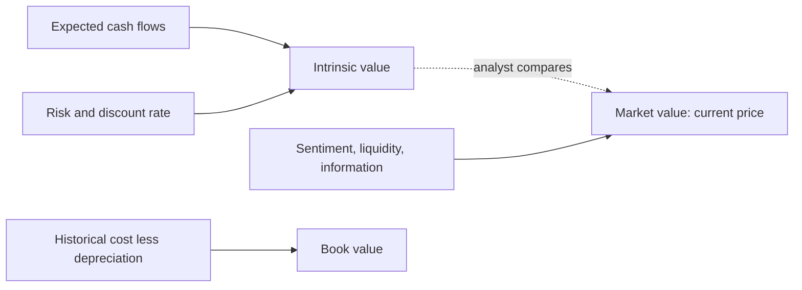
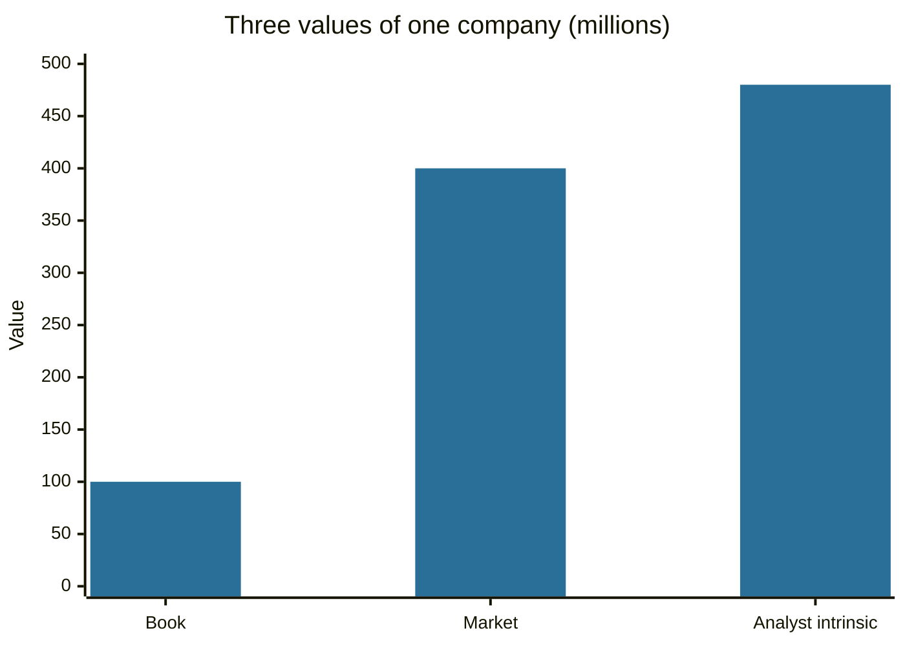

# Market value and intrinsic value

## Summary

Several different numbers are called the "value" of an asset or a company. Market value is what buyers and sellers currently pay. Book value is what the accounts record. Intrinsic value is an estimate of what the future cash flows are worth. Fair value is a defined accounting measure, and economic value is what the asset is worth to a particular user. They differ because markets react to expectations, accounts record history and each estimate depends on assumptions.

*This note is educational. It is not investment advice.*

## Prerequisites

- [Assets](../accounting-basics/assets.md).
- [Financial markets overview](../financial-markets/financial-markets-overview.md).

## Core concepts

### Definition

- **Market value:** the price at which an asset would trade in an open market between willing buyers and sellers. For a listed company, market value of equity = share price × shares outstanding (see [market capitalization and enterprise value](market-capitalization-and-enterprise-value.md)).
- **Book value:** assets minus liabilities as recorded in the accounts, mostly at historical cost less depreciation. It equals shareholders' equity (see [accounting equation](../accounting-basics/accounting-equation.md)).
- **Intrinsic value:** the value of an asset implied by its fundamentals, usually the present value of expected future cash flows discounted at a risk-adjusted rate (see [discounted cash flow](../corporate-finance/discounted-cash-flow.md)). It is an estimate and not an observable fact.
- **Fair value (accounting):** under IFRS 13, the price that would be received to sell an asset or paid to transfer a liability in an orderly transaction between market participants at the measurement date. It is used for many financial instruments on the balance sheet.
- **Economic value:** the maximum amount a particular person would pay for something, see [economic value](../../../social-sciences/economics/microeconomics/economic-value.md).

### Analogy

Think of a used car. The price on the dealer's lot is the market value. The figure in the owner's logbook after years of depreciation is the book value. What the car is worth to you depends on what it lets you do, such as a commute that saves two hours a day, which is closer to economic or intrinsic value. All three can be different at the same moment, and none is the single "true" value.

### Mechanism

The market price is set by supply and demand, and it reflects expectations about future cash flows, risk, interest rates, liquidity and the information available (see [equity markets](../financial-markets/equity-markets.md)). Intrinsic value is built by the analyst from forecasts. When the two differ, the analyst has an opinion: price below intrinsic value suggests undervaluation, above suggests overvaluation. In an efficient market the price is the best estimate of intrinsic value, in a market with noise it can stay away from it for a long time (De Long and others, 1990).

Differences between market and book value are largest for companies whose main assets are not on the balance sheet: brands, software, research and customer relationships. A technology company can have a market value many times its book value, and a bank or industrial company in distress can trade below it.

## Worked example

A company has assets of 500 million and liabilities of 400 million, so book value is 100 million. It has 10 million shares at 40, so the market value is 400 million.

| Measure | Value |
| --- | --- |
| Book value of equity | 100 million |
| Market value of equity | 400 million |
| Price-to-book ratio | 400 / 100 = 4.0 |
| Analyst's intrinsic value estimate | 480 million (48 per share) |
| Margin of safety at the market price | (480 - 400) / 480 = 16.7% |

The market values the company at four times book because investors expect strong future earnings from assets not recorded in the accounts. The analyst's discounted cash flow estimate is higher than the market price, which is a view and may be wrong.

## Trade offs and when to use it

Use market value to know what the market asks now, book value as a check on asset backing (especially for banks and insurers), and intrinsic value to decide whether a price is attractive. Each fails alone: market value includes sentiment, book value ignores intangible assets, and intrinsic value depends on assumptions.

## Common mistakes

- **"Price equals value."** Price is what was paid at the last trade.
- **"Low price-to-book means cheap."** It can mean the assets are impaired or earn poor returns.
- **Treating the discounted cash flow result as a fact.**
- **Mixing equity value and enterprise value** when comparing multiples.

## Practice

1. Which of the five values is observable at any moment for a listed share?
2. Why can market value be higher than book value for a software company?
3. A company has equity of 50 million, 5 million shares priced at 30. What are book value per share and price-to-book?

### Answers

1. Market value, from the quoted price.
2. Its main assets, such as code, brand and customers, are mostly not on the balance sheet.
3. Book value per share is 10, and price-to-book is 30 / 10 = 3.0.

## Further reading

- IFRS Foundation. IFRS 13 Fair Value Measurement. IFRS Foundation. [Link](https://www.ifrs.org/issued-standards/list-of-standards/ifrs-13-fair-value-measurement/). The standard that defines fair value in financial reporting.
- Graham, B. and Dodd, D. L. (2008). *Security Analysis (6th ed.)*. McGraw Hill. The founding text of fundamental analysis and of the idea of intrinsic value.
- Damodaran, A. (2012). *Investment Valuation: Tools and Techniques for Determining the Value of Any Asset (3rd ed.)*. Wiley. A detailed treatment of intrinsic and relative valuation, including the earnings multiples.
- De Long, J. B., Shleifer, A., Summers, L. H. et al. (1990). Noise trader risk in financial markets. *Journal of Political Economy*, 98(4), 703-738. [DOI](https://doi.org/10.1086/261703). Explains why prices can stay away from fundamental value when sentiment-driven traders are active.
