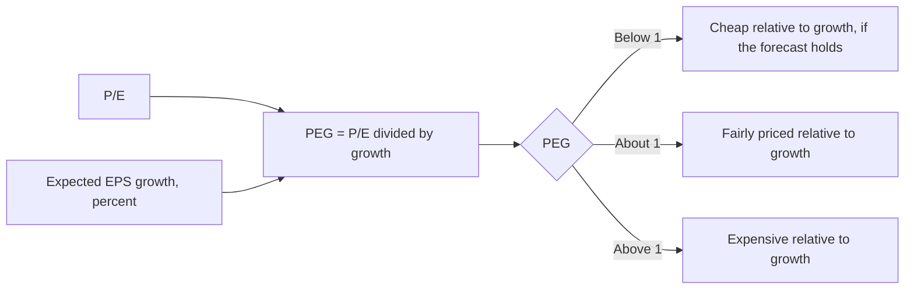
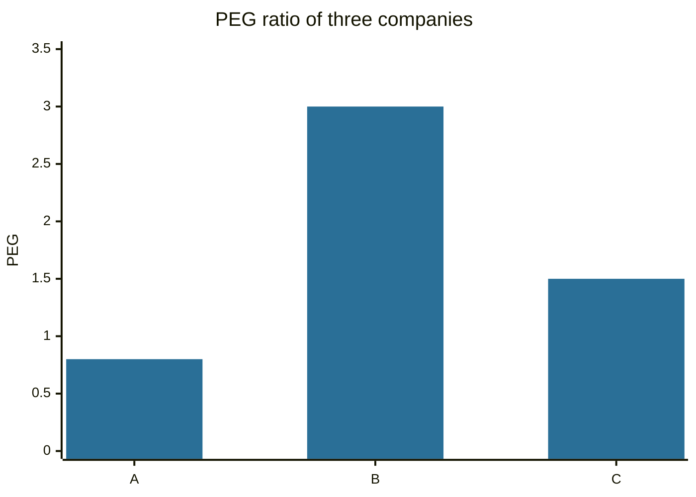

# PEG ratio

## Summary

The PEG ratio divides the price-to-earnings ratio by the expected annual growth rate of earnings, expressed in percent. It adjusts P/E for growth, so a stock with a P/E of 30 and growth of 30% a year has a PEG of 1, while a stock with a P/E of 15 and growth of 3% has a PEG of 5. A PEG near or below 1 is often read as reasonable, and the reading depends on a growth forecast that is uncertain and on the horizon chosen.

*This note is educational. It is not investment advice.*

## Prerequisites

- [Price-to-earnings ratio](price-to-earnings-ratio.md).
- [Earnings per share](earnings-per-share.md).

## Core concepts

### Definition

```text
PEG = P/E / expected annual EPS growth rate (in percent)
```

The growth rate can be a forecast for the next year, an average analyst forecast over three to five years or the historical growth. The choice must be stated, since it changes the result. The rule of thumb that a PEG of 1 means fair value is popularized by the investor Peter Lynch. It has no theoretical basis, and it works as a screening aid.

### Analogy

PEG is the price of speed. Two cars cost 30,000 and 60,000 and reach 100 km/h in 12 and 6 seconds. Comparing the price alone says little, and the price per unit of acceleration says more. The analogy breaks because growth is a forecast and not a fact, and growth cannot go on forever.

### Mechanism

Growth lifts the justified P/E (see the forward P/E formula in the [P/E note](price-to-earnings-ratio.md)), so a high P/E can be consistent with a reasonable price if growth is high enough. PEG puts the P/E and growth on one scale, so growth stocks and mature stocks can be compared more fairly.



## Worked example

Three companies, with the growth rate in percent per year.

| Company | P/E | Growth | PEG | Reading |
| --- | --- | --- | --- | --- |
| A | 20 | 25% | 0.8 | Cheap relative to growth |
| B | 12 | 4% | 3.0 | Expensive relative to growth |
| C | 15 | 10% | 1.5 | Moderately priced |

Company A has the highest P/E and the lowest PEG. If A's growth is 15% instead of 25%, its PEG rises to 1.33 and the picture changes. This sensitivity to the forecast is the main weakness of the ratio.



## Trade offs and when to use it

PEG is a quick screen for growth companies and for comparing stocks with different growth. Its limits:

- **Depends on a growth forecast,** which is often too optimistic, and growth fades over time.
- **Ignores risk, debt and the quality of earnings.**
- **Not usable with negative or zero growth or negative earnings.**
- **Not comparable across industries** with different risk and capital intensity.
- **Short horizons:** a one-year forecast for a company whose growth will fade gives a misleading value.

Use it with other measures such as cash flow, return on capital and a discounted cash flow estimate (see [fundamental analysis](fundamental-analysis.md)).

## Common mistakes

- **Treating 1 as a law.** It is a guide.
- **Using a growth rate that cannot last.**
- **Mixing definitions of growth** between companies.
- **Applying PEG to cyclical companies,** where growth swings with the cycle.

## Practice

1. P/E 24 and expected growth of 12%. What is the PEG?
2. Why can a high P/E company have a low PEG?
3. Name two weaknesses of the ratio.

### Answers

1. 2.0.
2. Its expected growth is high relative to the P/E.
3. It depends on uncertain growth forecasts, and it ignores risk and debt.

## Further reading

- Damodaran, A. (2012). *Investment Valuation: Tools and Techniques for Determining the Value of Any Asset (3rd ed.)*. Wiley. A detailed treatment of intrinsic and relative valuation, including the earnings multiples.
- Graham, B. and Dodd, D. L. (2008). *Security Analysis (6th ed.)*. McGraw Hill. The founding text of fundamental analysis and of the idea of intrinsic value.
- Brealey, R. A., Myers, S. C., Allen, F. et al. (2023). *Principles of Corporate Finance (14th ed.)*. McGraw Hill. Covers valuation, risk and the cost of capital.
