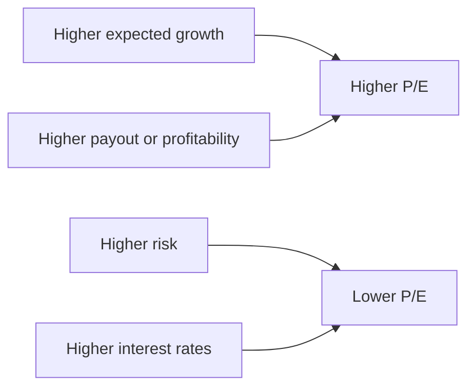
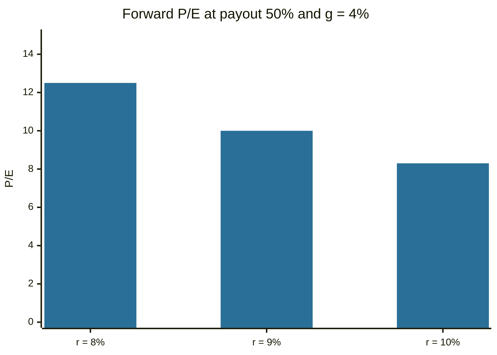

# Price-to-earnings ratio

## Summary

The price-to-earnings (P/E) ratio divides the share price by earnings per share. It says how many units of price investors pay for one unit of annual earnings. A P/E of 15 means 15 years of current earnings at today's price. The ratio rises with expected growth and falls with risk and with interest rates, so a high P/E is not automatically expensive and a low one is not automatically cheap. The common variants are trailing, forward and the cyclically adjusted P/E (CAPE).

*This note is educational. It is not investment advice.*

## Prerequisites

- [Earnings per share](earnings-per-share.md).
- [Time value of money](../corporate-finance/time-value-of-money.md) for the growing perpetuity formula.

## Core concepts

### Definition

```text
P/E = share price / earnings per share = market capitalization / net income
```

The inverse, EPS / price, is the *earnings yield*, which can be compared with the yield on bonds.

| Variant | Earnings used | Strength | Weakness |
| --- | --- | --- | --- |
| Trailing (TTM) | Last twelve months | Based on reported, verifiable data | Looks backward |
| Forward | Analyst forecast for the next twelve months | Looks ahead, useful for growth companies | Depends on forecasts, which are often optimistic |
| CAPE (Shiller P/E) | Average of ten years of inflation-adjusted earnings | Smooths the business cycle, used for whole markets | Less useful for single stocks. Accounting changes affect the history |

CAPE was proposed by Campbell and Shiller, who found that price relative to ten-year average real earnings has been informative about long-horizon returns of the market. Shiller's data are free on his website.

### Analogy

P/E is the payback time of buying a business at today's earnings, if earnings stayed flat. Buying a shop that earns 50,000 a year for 750,000 means a payback of 15 years. A fast-growing shop is worth a longer payback, because the profit will grow. The analogy breaks because earnings are not cash to the buyer, and the horizon of a stock is not fixed.

### Mechanism: what a P/E depends on

In the Gordon growth model with a constant growth rate g, required return r and payout ratio (dividends / earnings) p, the value is D1 / (r - g). Dividing by next year's earnings E1 gives the forward P/E:

```text
forward P/E = P / E1 = p / (r - g)
```

The formula uses next year's earnings, so it describes the forward ratio. It makes the main drivers visible: P/E rises with higher growth and higher payout, and falls with a higher required return, which includes risk and the level of interest rates. This is why sectors differ: technology companies with high growth carry high P/Es, and utilities and cyclical companies carry lower ones.



Reading a P/E: a high value may reflect growth, a durable competitive advantage or market optimism, or overvaluation. A low value may reflect a bargain, market doubt, distress or a declining business. For cyclical companies the ratio can be misleading: at the peak of the cycle earnings are high and the P/E looks low, and at the trough the opposite.

## Worked example

A company has a price of 46.51 and trailing EPS of 4.90, so P/E = 46.51 / 4.90 = 9.49. Investors pay 9.49 for each unit of annual earnings, and the earnings yield is 10.5%.

How growth and the required return change the forward P/E in the model, with a payout ratio of 50%:

| Required return | g = 2% | g = 4% | g = 6% |
| --- | --- | --- | --- |
| 8% | 8.3 | 12.5 | 25.0 |
| 9% | 7.1 | 10.0 | 16.7 |
| 10% | 6.2 | 8.3 | 12.5 |

A rise in the required return from 8% to 10% at g = 4% lowers the justified forward P/E from 12.5 to 8.3, a fall of one third, with no change in the business. This is the link between interest rates and valuations.



## Trade offs and when to use it

P/E is simple and widely quoted, and it allows quick comparison of similar companies in one industry. Limitations:

- **Earnings can be manipulated or distorted** by accounting choices and one-off items.
- **Negative or near-zero earnings** make the ratio meaningless or extreme.
- **Cyclical distortions** as described above.
- **It ignores capital structure.** Two firms with the same operations but different debt have different P/Es. EV-based multiples remove this (see [market capitalization and enterprise value](market-capitalization-and-enterprise-value.md)).
- **It ignores growth.** The [PEG ratio](peg-ratio.md) adjusts for it.

P/E fits stable, profitable companies, and works less well for early-stage growth companies and for banks and asset-heavy businesses, where price-to-book or other measures are used.

## Common mistakes

- **Calling a low P/E cheap without asking why.**
- **Comparing P/Es across industries.**
- **Mixing trailing and forward P/Es** in one comparison.
- **Using the ratio for companies with negative earnings.**
- **Ignoring the interest rate environment.**

## Practice

1. Price 80, EPS 5. What are the P/E and the earnings yield?
2. In the model with payout 60%, r = 10%, g = 5%, what is the forward P/E?
3. Why is the CAPE used for whole markets?

### Answers

1. P/E 16, earnings yield 6.25%.
2. 0.6 / 0.05 = 12.
3. Ten-year average real earnings smooth the business cycle, which makes the ratio more stable as a gauge of market valuation.

## Further reading

- Damodaran, A. (2012). *Investment Valuation: Tools and Techniques for Determining the Value of Any Asset (3rd ed.)*. Wiley. A detailed treatment of intrinsic and relative valuation, including the earnings multiples.
- Campbell, J. Y. and Shiller, R. J. (2001). Valuation ratios and the long-run stock market outlook: an update. NBER Working Paper 8221. [DOI](https://doi.org/10.3386/w8221). Introduces the use of price relative to ten-year average real earnings, the basis of the CAPE ratio.
- Shiller, R. J. Online data Robert Shiller. Yale University. [Link](http://www.econ.yale.edu/~shiller/data.htm). Long-run price, earnings and CAPE data for the US stock market.
- Damodaran, A. Damodaran Online. NYU Stern. [Link](https://pages.stern.nyu.edu/~adamodar/). Free datasets on historical returns, multiples and valuation by industry.
