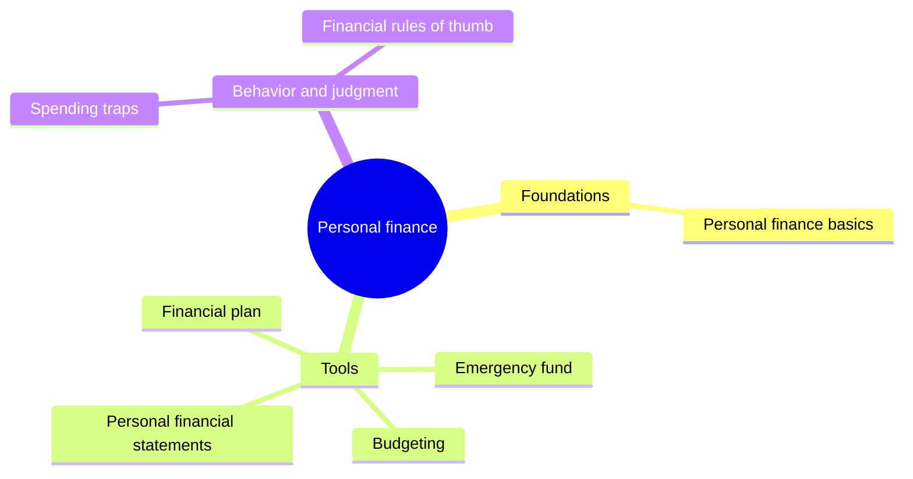

# Personal finance

How a person or household manages money: income, spending, saving, investing and protection. This subfield belongs to [Finance and investing](../README.md). It starts with the five areas and a priority order, moves to the tools (budget, emergency fund, financial plan, personal statements) and ends with the behavior that undermines them and the rules of thumb that people use to decide quickly. Debt and credit have their own subfield: [credit and debt](../credit-and-debt/README.md).

## Map of the subfield

The map groups the notes by purpose.

## Notes in reading order

**Foundations**

1. [Personal finance basics](personal-finance-basics.md): the five areas, financial literacy and the usual priority order.

**Tools**

2. [Budgeting](budgeting.md): building, running and adjusting a spending plan, with 50/30/20 and other methods.
3. [Emergency fund](emergency-fund.md): how much cash to keep, where, and why.
4. [Financial plan](financial-plan.md): goals, actions and the yearly review.
5. [Personal financial statements](personal-financial-statements.md): the household cash flow statement, balance sheet and net worth.

**Behavior and judgment**

6. [Spending traps](spending-traps.md): lifestyle inflation, living paycheck to paycheck, HENRYs and the latte effect.
7. [Financial rules of thumb](financial-rules-of-thumb.md): the rule of 72, the 4% rule, 50/30/20 and others, with the evidence behind each.

## Planned topics

- Insurance and risk transfer
- Taxes for individuals
- Retirement planning and pensions
- Estate planning

## How to use this subfield

Read notes 1 to 3 first. Then write your own statements (note 5), set goals (note 4) and use note 7 only to cross-check the result, never as a replacement for it. Investing in markets is in [portfolio management](../portfolio-management/README.md) and [financial instruments](../financial-instruments/README.md).

These notes are educational. They are not investment, tax or legal advice.

## Navigation

- Back to [Finance and investing](../README.md).
