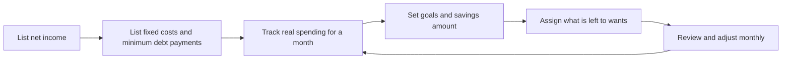
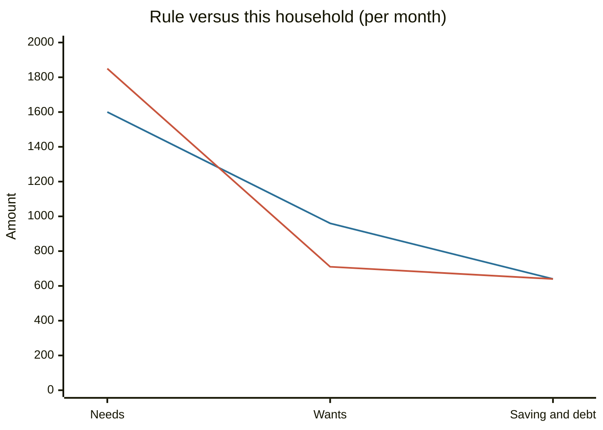

# Budgeting

## Summary

A budget is an estimate of income and expenses for a future period, used to decide in advance where money goes. For a household it is a spending plan built on net income, with room for needs, wants, saving and debt repayment. The method matters less than the habit: a budget works when it is reviewed and adjusted, not when it is perfect on day one.

*This note is educational. It is not financial advice.*

## Prerequisites

- [Personal finance basics](personal-finance-basics.md) for the vocabulary of income, spending and saving.

## Core concepts

### Definition

A *budget* is a plan that assigns expected income to expected spending for a defined period, usually a month. Governments, companies and households all use budgets. The outcome of a budget is one of three states:

- **Surplus:** income is greater than spending. The difference can be saved or invested.
- **Balanced:** income equals spending. Households usually call this "breaking even".
- **Deficit:** spending is greater than income. The gap is covered by savings or by borrowing, so a deficit that lasts raises debt.

### Analogy

A budget is a map drawn before a trip. It does not move you, but it shows where the road ends. The limit of the analogy is that a map of terrain stays valid, while a budget goes out of date as prices, income and plans change.

### Mechanism: building a monthly budget

1. **Add up all net income:** wages, benefits, side income, interest.
2. **List fixed costs:** rent or mortgage, utilities, insurance, minimum payments on every debt.
3. **Track variable spending** for at least one month, from bank statements, so that the plan uses real numbers.
4. **Set goals** (an emergency fund, debt payoff, a purchase) and fix the saving amount first.
5. **Assign what remains** to discretionary spending.
6. **Review monthly** and adjust.

### Methods

| Method | Idea | Strength | Weakness |
| --- | --- | --- | --- |
| 50/30/20 | 50% needs, 30% wants, 20% saving and debt repayment of net income (Warren and Tyagi, 2005) | Simple, quick to start | Needs can exceed 50% in high-cost cities or at low income |
| Zero-based | Every unit of income gets a job until income minus spending is zero | Complete control | Time-consuming |
| Pay yourself first | Transfer the saving amount on payday, spend the rest freely | Almost no tracking | Gives little detail about where money goes |
| Envelopes or purpose accounts | Separate accounts or envelopes for spending, bills, saving and investing | Hard limits on categories | Needs several accounts |

A *static budget* keeps the planned amounts unchanged for the whole period. A *flexible budget* ties some amounts to a driver such as sales or production. Households mostly use static budgets, and companies use flexible ones to compare plan and actual costs at different activity levels.

## Worked example

Net income is 3,200 per month. Fixed needs are rent 1,000, utilities 150, transport 200, groceries 400 and minimum debt payments 100, which is 1,850 or 57.8% of net income. The 50/30/20 rule would allow 1,600 for needs, so the budget is already 250 over.

| Line | Rule of 50/30/20 | This household |
| --- | --- | --- |
| Needs | 1,600 | 1,850 |
| Wants | 960 | 710 |
| Saving and debt | 640 | 640 |
| Total | 3,200 | 3,200 |

The household keeps saving at 20% and takes the 250 from wants, which falls to 710. The rule is a starting point, and the data decides the final split. The chart shows the two plans side by side.

The first line is the rule and the second line is the household.

## Trade offs and when to use it

Budgeting costs attention. It pays off most when money is tight, when a big goal is near or when spending feels out of control. A household with high income and a large surplus may need only a saving rate and an annual review.

Tips that make budgets last: review spending weekly for a few minutes, remove friction from saving (automatic transfers) and add friction to impulse buying (delete saved card details, wait 24 hours before a large purchase), keep a small amount for fun so the plan does not feel like deprivation, and re-evaluate categories every few months.

## Common mistakes

- **"I do not need a budget."** Everyone with a limited income makes spending choices. A budget only makes them visible.
- **Budgeting without tracking.** Plans based on guesses fail. Use a month of real data.
- **No line for irregular costs.** Annual insurance, gifts and repairs break monthly budgets. Divide the yearly total by 12 and save it monthly.
- **Counting on raises and tax refunds.** Budget on income you already have.
- **Quitting after one bad month.** The plan is a feedback loop. Adjust it and continue.

## Practice

1. What is the difference between a budget surplus and a balanced budget?
2. Net income is 2,800. How much is the saving share under 50/30/20?
3. Why is a flexible budget more common in companies than in households?

### Answers

1. A surplus means income exceeds spending, a balanced budget means they are equal.
2. 20% of 2,800 is 560.
3. Company costs move with sales or output, so the allowed amounts must move too. Household costs are mostly fixed.

## Further reading

- Warren, E. and Tyagi, A. W. (2005). *All Your Worth: The Ultimate Lifetime Money Plan*. Free Press. Source of the 50/30/20 budgeting rule.
- Consumer Financial Protection Bureau. Budgeting. CFPB. [Link](https://www.consumerfinance.gov/consumer-tools/budgeting/). Consumer tools for tracking income and expenses.
- Thaler, R. H. and Benartzi, S. (2004). Save More Tomorrow: using behavioral economics to increase employee saving. *Journal of Political Economy*, 112(S1), S164-S187. [DOI](https://doi.org/10.1086/380085). Shows that committing future income to saving in advance raises the saving rate, which is the logic of paying yourself first.
