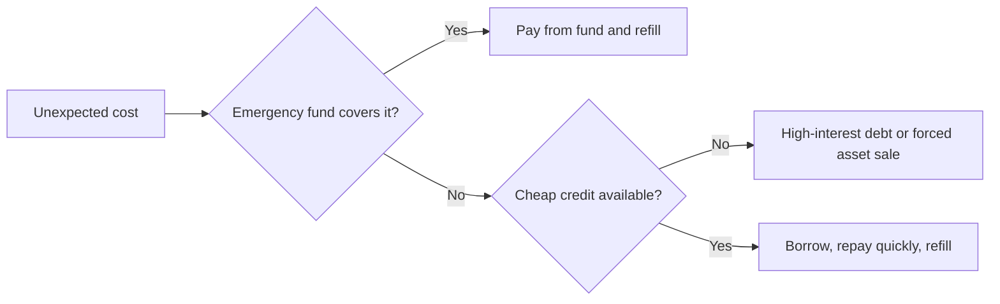

# Emergency fund

## Summary

An emergency fund is cash kept for unplanned costs such as a job loss, a medical bill or a major repair. It exists so that a shock does not force you into high-interest debt or into selling long-term investments at a bad time. A common target is three to six months of essential expenses, held in accounts that are safe and quick to access.

*This note is educational. It is not financial advice.*

## Prerequisites

- [Budgeting](budgeting.md) to know your monthly essential expenses.

## Core concepts

### Definition

An *emergency fund* (also called a rainy-day fund or cash reserve) is a pool of liquid savings reserved for unexpected, necessary spending. *Liquidity* is how fast and cheaply an asset turns into cash at close to its value. The same term "cash reserve" is used for companies, where it covers unplanned operating costs, but the sizing logic below is for households.

### Analogy

An emergency fund is a spare tire. You hope never to use it, it stays in the trunk and does not earn anything while it waits, and the day you need it, nothing else will do. The analogy breaks because a spare tire does not lose value to inflation, while idle cash does, so a fund is best kept in an account that pays interest.

### Mechanism: how much and where

The target is a number of months of *essential* expenses (housing, food, utilities, insurance, minimum debt payments, transport), not of total spending. Guidance in the literature and from consumer agencies converges on a range rather than a single number.

| Situation | Typical target |
| --- | --- |
| Two incomes, stable jobs | About 3 months |
| One income, dependents, or one earner in a cyclical industry | About 6 months |
| Self-employed, irregular income, or a long job search expected | 9 to 12 months |

These ranges are rules of thumb. Each year the US Federal Reserve survey "Economic Well-Being of U.S. Households" reports the share of adults who could pay a small unexpected expense (400) with cash or its equivalent, which shows why even a small fund matters.

Where to keep it: savings accounts, money market accounts and short-term deposits that are insured up to the national limit (in the US, at least 250,000 per depositor, per insured bank, per ownership category; in the EU, 100,000 under the deposit guarantee directive). The fund should not sit in assets whose price can fall when you need to sell, such as stocks.

The decision tree shows the point of the fund: it keeps the first branch open, so a shock is paid from cash and not from expensive debt.

## Worked example

Essential expenses are 2,500 per month.

| Target | Months | Amount |
| --- | --- | --- |
| Starter fund | 1 | 2,500 |
| Basic fund | 3 | 7,500 |
| Full fund | 6 | 15,000 |

Saving 400 per month reaches the basic fund in 19 months (7,500 / 400 = 18.75, rounded up) and the full fund in 38 months. A tax refund or bonus put in the fund shortens this. When the fund is used, refilling it becomes the first saving goal again.

## Trade offs and when to use it

Cash earns less than a long-term investment and may lose purchasing power to inflation, so a very large fund has a cost. The benefit is insurance against forced selling. Households with other sources of liquidity (a stable family safety net, a credit line used only for emergencies, insurance that covers large losses) can hold a smaller fund. Households with high fixed costs, variable income or dependents need a larger one.

## Common mistakes

- **Counting the fund as spare money.** Define "emergency" in advance: loss of income, necessary medical or home repairs, urgent travel. A sale is not an emergency.
- **Keeping the fund in investments.** A market fall often coincides with job losses, which is when you need the cash.
- **Using total spending as the base.** Use essential costs, which are lower.
- **Waiting for the full target before doing anything else.** A starter fund of one month already prevents most small shocks from becoming debt.

## Practice

1. Why is the fund sized on essential expenses and not on total spending?
2. Essential expenses are 1,800 and the target is 4 months. How long does it take to save at 300 per month?
3. Name two features of a good place to hold an emergency fund.

### Answers

1. In an emergency you can cut discretionary spending, so the fund only needs to cover what cannot be cut.
2. 7,200 / 300 = 24 months.
3. Quick access without penalty, and low risk of loss (for example, insured deposits).

## Further reading

- Consumer Financial Protection Bureau. An essential guide to building an emergency fund. CFPB. [Link](https://www.consumerfinance.gov/an-essential-guide-to-building-an-emergency-fund/). Practical guidance on how much to save and where to keep it.
- Board of Governors of the Federal Reserve System. Economic Well-Being of U.S. Households (SHED). Federal Reserve. [Link](https://www.federalreserve.gov/consumerscommunities/shed.htm). The annual survey that measures how households handle expenses and savings.
- Federal Deposit Insurance Corporation. Deposit insurance. FDIC. [Link](https://www.fdic.gov/resources/deposit-insurance/). Official description of US deposit insurance coverage.
