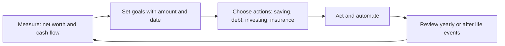

# Financial plan

## Summary

A financial plan is a written document that states where a person stands financially (net worth and cash flow), what they want to achieve and how they will get there. It is built in three steps: measure the starting point, set goals with amounts and dates, then choose actions and a review rhythm. An annual review keeps the plan current as income, prices and goals change.

*This note is educational. It is not financial advice.*

## Prerequisites

- [Personal finance basics](personal-finance-basics.md).
- [Budgeting](budgeting.md).
- [Personal financial statements](personal-financial-statements.md) for net worth and cash flow.

## Core concepts

### Definition

A *financial plan* is a document that records current finances, short- and long-term goals and the strategy for reaching them. A plan is different from a budget. A budget allocates this month's income, while a plan covers years and connects spending, saving, investing, debt, insurance, taxes and estate decisions to goals.

### Analogy

A budget is the daily route, and a financial plan is the route plus the destination and the fuel stops. The limit of the analogy is that a route can be recalculated every minute, while a plan changes at the pace of life events: a new job, a child, a move.

### Mechanism: the planning cycle

1. **Measure.** Net worth is assets minus liabilities. Cash flow is money in minus money out over a period. Both come from [personal financial statements](personal-financial-statements.md).
2. **Set goals.** A goal has an amount, a date and a priority: "emergency fund of 15,000 by December 2028", "down payment of 40,000 in five years", "retire at 65 with an income of X". Goals fall into short term (under 2 years), medium term (2 to 10) and long term (over 10), and the time horizon decides how much risk the money can take.
3. **Choose actions.** Saving rates, debt payoff order, investment mix, insurance cover and estate documents (a will, and where relevant a living will and a healthcare power of attorney).
4. **Review.** Once a year and after any major life event.

### What an annual plan contains

- Current net worth and the change since last year.
- Cash flow for the year and the saving rate achieved.
- Progress on each goal.
- Debt balances and rates.
- Investment allocation versus target (see [asset allocation](../portfolio-management/asset-allocation.md)).
- Insurance cover and beneficiaries.
- Tax items to prepare, such as receipts and deductions for the next filing.

## Worked example

A person aged 32 writes the starting point for the plan.

| Item | Amount |
| --- | --- |
| Assets: savings 6,000, retirement account 18,000, car 9,000 | 33,000 |
| Liabilities: student loan 14,000, car loan 5,000, credit card 1,000 | 20,000 |
| Net worth | 13,000 |
| Net income per month | 3,200 |
| Spending per month | 2,700 |
| Monthly cash flow | +500 |

Goals and actions: pay off the credit card (1,000) in two months, build the emergency fund to 3 months of essential costs (7,500) in 12 months, then split the 500 between extra student loan payments and retirement saving. The first review is set for twelve months later, when net worth is recalculated.

## Trade offs and when to use it

A plan gives direction and a measure of progress, and it reduces decisions made under stress. The costs are the effort of writing it and the false precision of long forecasts: returns, inflation and income in year 20 are unknown. Use ranges and update often. A professional adviser (in the US, for example, a certified financial planner) can help with complex cases such as business ownership, stock compensation or cross-border tax; check fees and conflicts of interest first.

## Common mistakes

- **Goals without numbers.** "Save more" cannot be tracked. State amount and date.
- **No review.** A plan that is not updated after a job change or a child no longer describes your situation.
- **Planning around the average return.** Use cautious assumptions and test a bad year.
- **Forgetting protection.** Plans that cover investing but not insurance and estate documents leave the largest risks open.

## Practice

1. How is a financial plan different from a budget?
2. A goal is 24,000 in four years. What monthly saving reaches it ignoring interest?
3. Why do short-term goals call for lower-risk assets than long-term goals?

### Answers

1. A budget allocates income for a short period. A plan links goals, actions and reviews over years.
2. 24,000 / 48 = 500 per month.
3. Short-term money cannot wait for a recovery after a market fall, while long-term money has time to recover.

## Further reading

- Consumer Financial Protection Bureau. Budgeting. CFPB. [Link](https://www.consumerfinance.gov/consumer-tools/budgeting/). Consumer tools for tracking income and expenses.
- Lusardi, A. and Mitchell, O. S. (2014). The economic importance of financial literacy: theory and evidence. *Journal of Economic Literature*, 52(1), 5-44. [DOI](https://doi.org/10.1257/jel.52.1.5). Reviews the evidence that financial literacy is low and that it predicts saving and planning.
- Board of Governors of the Federal Reserve System. Economic Well-Being of U.S. Households (SHED). Federal Reserve. [Link](https://www.federalreserve.gov/consumerscommunities/shed.htm). The annual survey that measures how households handle expenses and savings.
