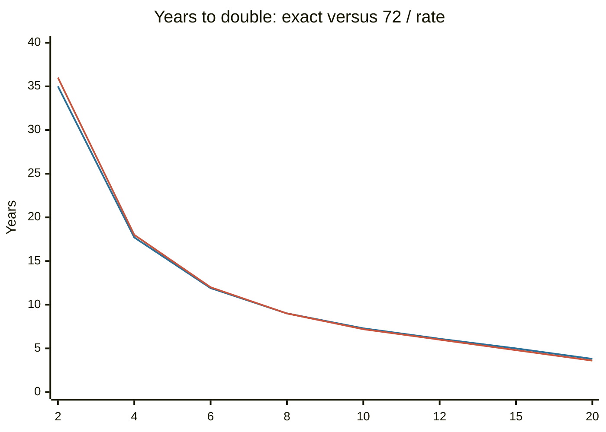

# Financial rules of thumb

## Summary

Personal finance is full of short rules: 50/30/20, the rule of 72, the 4% rule, "100 minus your age". A rule of thumb trades accuracy for speed. Some are arithmetic facts (the rule of 72), some come from a specific study with stated limits (the 4% rule), and some are folk advice with no source. This note lists the common ones, says where each comes from and how far it can be trusted.

*This note is educational. It is not financial advice. The rules are starting points and fail in particular cases.*

## Prerequisites

- [Personal finance basics](personal-finance-basics.md).
- [Time value of money](../corporate-finance/time-value-of-money.md) for compounding.

## Core concepts

### Definition

A *rule of thumb* (heuristic) is a simple decision rule that gives a good-enough answer without detailed analysis. It is useful when the cost of a precise answer is higher than the cost of being roughly right, and dangerous when applied outside the conditions it was built for.

### Evidence status

The table classifies each rule by the strength of its support. *Math* means it follows from arithmetic. *Study* means it comes from an identifiable analysis with stated assumptions. *Convention* means it is widely used by lenders or advisers without a single source. *Folk* means advice repeated widely without an identifiable source.

| Rule | What it says | Status | Main caveat |
| --- | --- | --- | --- |
| Rule of 72 | Years to double is about 72 divided by the percentage rate | Math | Accurate for rates of about 6% to 10%, less outside |
| 4% rule | Withdraw 4% of the starting portfolio in year one, adjust for inflation after, for 30 years | Study | Based on US data from 1926, 30-year horizon, 50% to 75% stocks |
| Net worth benchmark | Expected net worth = age × pre-tax income / 10 | Study | From surveys of US households in the 1990s, a benchmark and not a goal |
| 50/30/20 | 50% needs, 30% wants, 20% saving of net income | Convention | Needs can exceed 50% |
| Housing 28/36 | Housing cost up to 28% of gross income, all debt up to 36% | Convention | Lender qualifying guideline, not a measure of affordability |
| Car 20/4/10 | 20% down, loan of at most 4 years, car costs under 10% of income | Folk | Popular advice with no single source |
| Retirement saving | Save 15% of income for retirement, employer match included | Convention | Depends on start age and target income |
| 100 minus age | Share of stocks in the portfolio equals 100 minus age | Convention | Variants use 110 or 120. Ignores risk tolerance |
| Stock return | Stocks average about 10% a year | Study | Nominal, US, historical |
| Take the match | Always contribute enough to get the employer match | Math | Depends on the plan terms and vesting |
| Bonus in thirds | One third each for fun, retirement, debt | Folk | |
| 24-hour rule | Wait a day before a non-essential purchase | Folk | Plausible, cheap to try |
| Life insurance multiple | Cover of 5 times income | Convention | Quoted multiples range widely. A needs-based estimate is better |
| 10% purchase rule | Do not buy what costs over 10% of account value | Folk | Unclear what "account" means |

### Rule of 72

At a compound rate r percent, money doubles when (1 + r/100)^t = 2, so t = ln 2 / ln(1 + r/100), which is about 0.693 / (r/100) for small r. Dividing 72 by r instead of 69.3 makes the answer close for typical rates because 72 has many divisors. The chart compares the exact and approximate doubling times.

The two lines almost overlap between 6% and 12%. The x axis is the rate in percent.

### The 4% rule

Bengen (1994) tested retirees who withdrew a fixed share of the starting portfolio in year one and adjusted the amount for inflation each year. Using US returns from 1926, the highest rate that lasted 30 years in every starting year was close to 4% for portfolios of 50% to 75% stocks. The Trinity study (Cooley, Hubbard and Walz, 1998) tested similar rules. Read the result as "a historically survivable rate in US data over 30 years", not as a guarantee. A longer retirement, lower expected returns, high fees or a different country can make a lower rate safer. The rule also implies a target: portfolio = 25 × yearly spending.

### The stock return figure

Damodaran's dataset of US returns (checked October 2026) gives about 9.9% a year for the S&P 500 with dividends reinvested, as a geometric average over 1928 to 2024. This is a nominal figure. After inflation the number is lower, and the figures cited in the long-run literature (for example Siegel, 2014) are about 6% to 7%. Individual years varied widely: 26 of those 97 years were negative, and the worst year lost about 44%.

## Worked example

Applying the rules to one person: age 35, pre-tax income 80,000 a year (6,667 a month), net income 5,200 a month, yearly spending 36,000.

| Rule | Result |
| --- | --- |
| Net worth benchmark: 35 × 80,000 / 10 | 280,000 |
| Retirement saving at 15% of income | 12,000 a year, 1,000 a month |
| Housing at 28% of gross monthly income | 1,867 a month at most |
| Stock share by "100 minus age" | 65% |
| 4% rule target: 25 × 36,000 | 900,000 |
| Years to double at 7% (72 / 7) | about 10.3 (exact 10.2) |

The numbers give a frame for discussion. They do not tell this person what to do: a 35-year-old with a secure state pension, or with a high tolerance for risk, may choose differently.

## Trade offs and when to use it

Use a rule to get an order of magnitude in seconds, to check a spreadsheet result or to set a default. Replace it with a calculation as soon as money at stake is large or the situation is unusual (variable income, early retirement, high debt). A rule that came from one country's data should be tested against local returns, taxes and costs.

## Common mistakes

- **Treating the 4% rule as a safe, fixed income.** It is a historical result with a failure tail.
- **Using the 10% stock return in plans.** The historical figure is nominal, and the average hides large losses in some years. Plan with real returns and test a bad sequence.
- **Mixing gross and net income** across rules. 50/30/20 uses net income, while housing and retirement rules use gross.
- **Using "100 minus age" without thinking about risk tolerance** or other income.
- **Applying the rule of 72 to very high rates,** where it is less accurate.

## Practice

1. At 9% a year, about how long does money take to double by the rule of 72?
2. A person wants to spend 30,000 a year in retirement. What portfolio does the 4% rule imply?
3. Why is the stock return figure of about 10% misleading in a retirement plan?

### Answers

1. 72 / 9 = 8 years (exact: 8.04).
2. 30,000 / 0.04 = 750,000.
3. It is nominal and average. After inflation it is lower, and the path matters: large losses early in retirement hurt more than the average suggests.

## Further reading

- Bengen, W. P. (1994). Determining withdrawal rates using historical data. *Journal of Financial Planning*, 7(4), 171-180. The study that produced the 4 percent rule from US data from 1926.
- Cooley, P. L., Hubbard, C. M. and Walz, D. T. (1998). Retirement savings: choosing a withdrawal rate that is sustainable. *AAII Journal*, 20(2), 16-21. The Trinity study, which tested withdrawal rates against stock and bond mixes.
- Stanley, T. J. and Danko, W. D. (1996). *The Millionaire Next Door*. Longstreet Press. Source of the age times income divided by 10 net worth benchmark.
- Warren, E. and Tyagi, A. W. (2005). *All Your Worth: The Ultimate Lifetime Money Plan*. Free Press. Source of the 50/30/20 budgeting rule.
- Damodaran, A. Damodaran Online. NYU Stern. [Link](https://pages.stern.nyu.edu/~adamodar/). Free datasets on historical returns, multiples and valuation by industry.
- Siegel, J. J. (2014). *Stocks for the Long Run (5th ed.)*. McGraw Hill. Long-run US data on stock, bond and bill returns.
