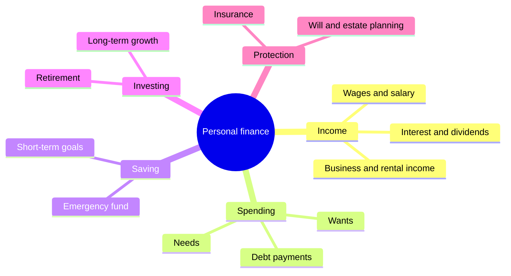
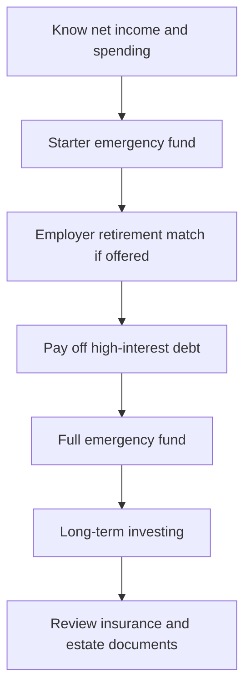
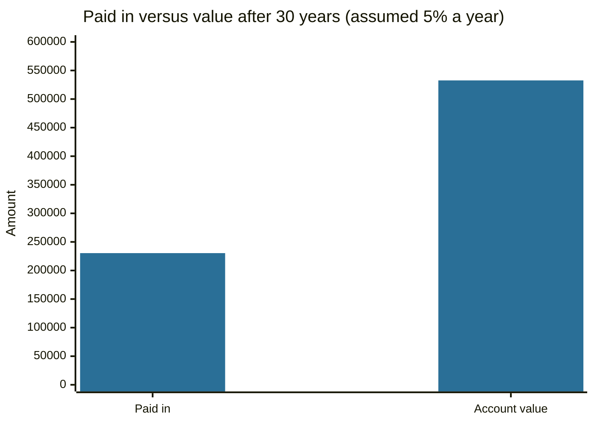

# Personal finance basics

## Summary

Personal finance is the management of a person's or household's money: what comes in, what goes out, what is saved, what is invested and what is protected against loss. It has five areas (income, spending, saving, investing and protection) and a short list of habits that matter more than any single product: knowing your take-home pay, spending less than you earn, keeping a cash reserve, avoiding expensive debt and starting to save early. Financial literacy is the skill that ties them together, and studies link it to better saving and planning.

*This note is educational. It is not investment, tax or legal advice, and examples use rules from the United States unless stated otherwise. Tax and retirement systems differ by country.*

## Prerequisites

No prior notes are needed.

## Core concepts

### Definition

*Personal finance* is the planning and control of the financial resources of an individual or household over time. In the classification of the American Economic Association it sits under household saving and personal finance (JEL code D14), next to corporate finance (G3) and public finance (H). The same decisions are made by a company, but the goals, tax rules and risks of a household are different.

*Financial literacy* is the ability to understand and use financial concepts such as interest, inflation, risk and diversification to make decisions. Lusardi and Mitchell (2014) reviewed evidence from many countries and found that low literacy is common and that people with higher literacy plan more for retirement and hold more wealth.

### Analogy

A household is a small water system. Income is the water flowing in, spending is the water flowing out, savings are the tank and investments are the tank that is allowed to fluctuate in exchange for growth. Protection (insurance) is the overflow valve that stops one burst pipe from emptying everything. The analogy breaks because money can be created by skill and by borrowing against the future, while a tank cannot be refilled by a decision alone.

### The five areas

The map below shows the areas and the question each one answers.

- **Income** is what you receive for work, assets or transfers. *Gross income* is before tax and deductions, *net income* (take-home pay) is after them. Budgets are built on net income. See [income and profit](../accounting-basics/income-and-profit.md).
- **Spending** divides into needs (housing, food, transport, minimum debt payments) and wants (everything you could do without).
- **Saving** is money set aside in safe, accessible form for a known purpose, starting with the [emergency fund](emergency-fund.md).
- **Investing** buys assets such as stocks and bonds to earn a return over years, at the price of risk. See [risk and return](../portfolio-management/risk-and-return.md).
- **Protection** transfers large, unlikely losses to an insurer: health, disability, life, home and car cover, plus a will and, where needed, a trust.

### Mechanism: a priority order

Most guides arrange the areas into a sequence, because a euro cannot do two jobs at once. The order below is a common teaching heuristic, not a law: it puts certain returns (paying off a 20% card) ahead of uncertain ones (stock returns).

Three habits explain most of the sequence:

1. **Pay yourself first.** Move the savings amount out on payday, so saving is a fixed bill and spending is what remains.
2. **Borrow only what you can repay.** Debt can buy an appreciating or income-producing asset (a house, an education), but borrowing for consumption at a high rate loses money. See [debt](../credit-and-debt/debt.md).
3. **Restrain spending relative to income.** A high income does not build wealth if spending is higher. Behavior, not income, separates savers from non-savers at every level (see [spending traps](spending-traps.md)).

## Worked example

A household has a net income of 3,200 per month and wants to see the system in numbers.

| Item | Monthly amount | Share of net income |
| --- | --- | --- |
| Needs (rent, food, transport, minimum debt payments) | 1,600 | 50% |
| Wants | 960 | 30% |
| Saving and debt repayment | 640 | 20% |

If the 640 is invested at an assumed 5% a year for 30 years (monthly compounding, constant contributions, no fees or taxes), it grows to about 532,600, of which only 230,400 is the money paid in. The assumption is an illustration, not a forecast: real returns vary year to year.

The chart compares what was paid in with what the account holds at the end.

The gap is the effect of compounding, the same mechanism explained in [time value of money](../corporate-finance/time-value-of-money.md).

## Trade offs and when to use it

A written system makes decisions repeatable and protects against impulse. Its costs are time (tracking), the need to revise it when life changes, and the risk of treating rules of thumb as laws. The priority order above assumes stable income and access to credit. A household with irregular income needs a larger cash reserve before it invests. A household with a low income may find that needs alone exceed 50% of net income, and then the fixed shares in a rule do not apply (see [financial rules of thumb](financial-rules-of-thumb.md)).

## Common mistakes

- **Investing before building a cash buffer.** A car repair then forces the sale of investments at a bad time or a card loan. Build the [emergency fund](emergency-fund.md) first.
- **Ignoring insurance.** One serious illness or accident can erase years of saving. Insurance is cheaper when bought young and healthy.
- **Treating financial literacy as a one-off.** Rules, rates and products change. Review the plan at least once a year (see [financial plan](financial-plan.md)).
- **Copying advice from another country.** Retirement accounts, tax credits and deposit insurance differ by jurisdiction.

## Practice

1. Name the five areas of personal finance and give one decision in each.
2. Why does the common priority order pay a 20% credit card before investing in stocks?
3. A household nets 2,400 per month. What does the 50/30/20 split give for needs, wants and saving?

### Answers

1. Income (negotiating pay), spending (cutting a subscription), saving (funding a reserve), investing (buying an index fund), protection (taking out disability insurance).
2. Repaying the card is a guaranteed return equal to its interest rate, while expected stock returns are higher on average but uncertain.
3. 1,200 for needs, 720 for wants and 480 for saving and debt repayment.

## Further reading

- Lusardi, A. and Mitchell, O. S. (2014). The economic importance of financial literacy: theory and evidence. *Journal of Economic Literature*, 52(1), 5-44. [DOI](https://doi.org/10.1257/jel.52.1.5). Reviews the evidence that financial literacy is low and that it predicts saving and planning.
- American Economic Association. JEL classification system. American Economic Association. [Link](https://www.aeaweb.org/econlit/jelCodes.php?view=jel). The classification of economics and finance that groups topics into fields such as G (financial economics).
- Consumer Financial Protection Bureau. Budgeting. CFPB. [Link](https://www.consumerfinance.gov/consumer-tools/budgeting/). Consumer tools for tracking income and expenses.
- Board of Governors of the Federal Reserve System. Economic Well-Being of U.S. Households (SHED). Federal Reserve. [Link](https://www.federalreserve.gov/consumerscommunities/shed.htm). The annual survey that measures how households handle expenses and savings.
