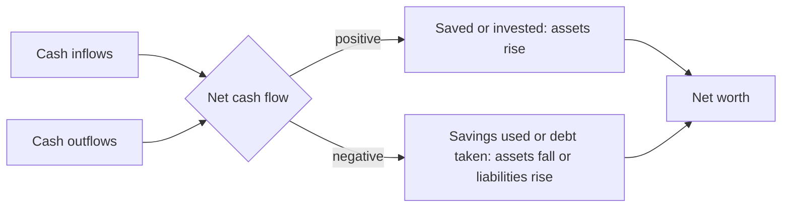

# Personal financial statements

## Summary

A household can keep the same two reports as a company: a cash flow statement that shows money in and out over a period, and a balance sheet that shows what is owned and owed on one date. The difference between assets and liabilities is net worth, the simplest measure of accumulated wealth. Together the two statements show whether spending is sustainable and whether wealth is growing.

*This note is educational. It is not financial advice.*

## Prerequisites

- [Personal finance basics](personal-finance-basics.md).
- [Assets](../accounting-basics/assets.md) and [liabilities](../accounting-basics/liabilities.md) for the definitions used here.

## Core concepts

### Definition

- The *personal cash flow statement* lists cash inflows (salary, interest, dividends, proceeds from selling assets) and cash outflows (rent, utilities, food, transport, entertainment, debt payments) over a period. The result is *net cash flow*.
- The *personal balance sheet* lists assets, liabilities and net worth at a date. *Net worth* = assets - liabilities.

The corporate versions are explained in [financial statements](../corporate-finance/financial-statements.md). The household versions follow the same logic with fewer lines.

### Analogy

The cash flow statement is a film of the month, and the balance sheet is a photograph on the last day. One tells you how you moved, the other where you are. Net cash flow explains why the second photo differs from the first, with one gap: asset prices can change net worth without any cash moving.

### Mechanism

Assets on a personal balance sheet fall into three groups, valued at current market value, not at purchase price:

- **Liquid assets:** cash, checking and savings accounts, money market funds.
- **Investments:** stocks, bonds, funds, retirement accounts, and real estate held for return.
- **Use assets:** the home, vehicles, furniture, art. These can be sold, but you may need them, so many planners show net worth with and without them.

Liabilities are what you owe: credit card balances, mortgage, student and car loans, taxes due and unpaid bills.

The diagram links the two statements: net cash flow moves assets and liabilities, which move net worth.

*Negative net worth* means liabilities exceed assets. A person leaving university with a student loan and little else often starts there. The fix is to run a positive net cash flow and to pay down the most expensive debt first (see [debt repayment strategies](../credit-and-debt/debt-repayment-strategies.md)).

*High-net-worth individual (HNWI)* is an industry label, not a legal category. A common industry threshold is liquid financial assets of at least 1 million, and "ultra high net worth" begins at 30 million in many industry reports. In the US the legal term is *accredited investor*, defined in SEC rules in part by a net worth above 1 million excluding the primary residence, or by income thresholds. The definition can change, so check the current rule.

## Worked example

Month: assets at the start 33,000 and liabilities 20,000, so net worth 13,000.

| Cash flow for the month | Amount |
| --- | --- |
| Salary (net) | 3,200 |
| Interest | 10 |
| Total inflows | 3,210 |
| Rent, utilities, food, transport | 1,850 |
| Wants | 710 |
| Debt payments (principal and interest) | 450 |
| Total outflows | 3,010 |
| Net cash flow | +200 |

If the 200 goes to savings, assets rise by 200. If part of the debt payments is principal (say 350), liabilities fall by 350. Net worth rises by about 550 from cash flow alone (200 + 350). If the retirement account also gains 150 in value, net worth rises to 13,700.

## Trade offs and when to use it

Updating both statements takes an hour a month with bank exports or a spreadsheet. The benefit is a factual base for the [budget](budgeting.md) and the [financial plan](financial-plan.md). Limits: the balance sheet relies on estimates for illiquid assets, and net worth hides liquidity, since a high net worth in a house gives no cash for emergencies.

## Common mistakes

- **Using purchase price instead of market value** for the car or house.
- **Counting the pension or home as spendable** in an emergency.
- **Confusing income with net cash flow.** A large income with a negative net cash flow is a path to debt.
- **Mixing loan payments with expenses.** Only the interest is a cost. The principal repaid reduces liabilities.

## Practice

1. Assets are 55,000 and liabilities 62,000. What is the net worth and what does it mean?
2. How can net worth rise while net cash flow is negative?
3. Why is the market value of a used car, not its purchase price, used on the balance sheet?

### Answers

1. -7,000. Debts exceed assets, so the household should focus on paying down debt.
2. Asset prices can rise: for example, an investment gains value without any cash coming in.
3. The balance sheet shows what the assets could be sold for now, which is what matters for solvency.

## Further reading

- IFRS Foundation (2018). Conceptual Framework for Financial Reporting. IFRS Foundation. [Link](https://www.ifrs.org/issued-standards/list-of-standards/conceptual-framework/). Official definitions of asset, liability and equity.
- Consumer Financial Protection Bureau. Budgeting. CFPB. [Link](https://www.consumerfinance.gov/consumer-tools/budgeting/). Consumer tools for tracking income and expenses.
- Lusardi, A. and Mitchell, O. S. (2014). The economic importance of financial literacy: theory and evidence. *Journal of Economic Literature*, 52(1), 5-44. [DOI](https://doi.org/10.1257/jel.52.1.5). Reviews the evidence that financial literacy is low and that it predicts saving and planning.
