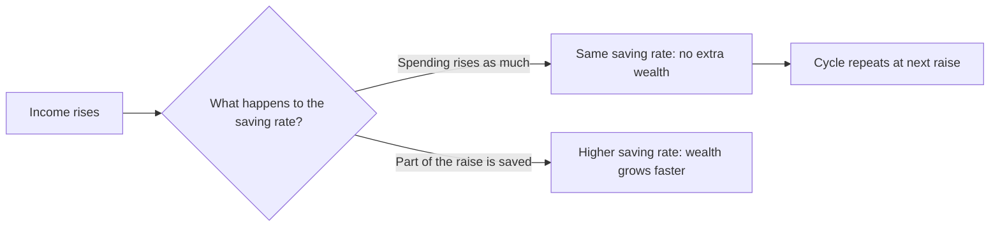
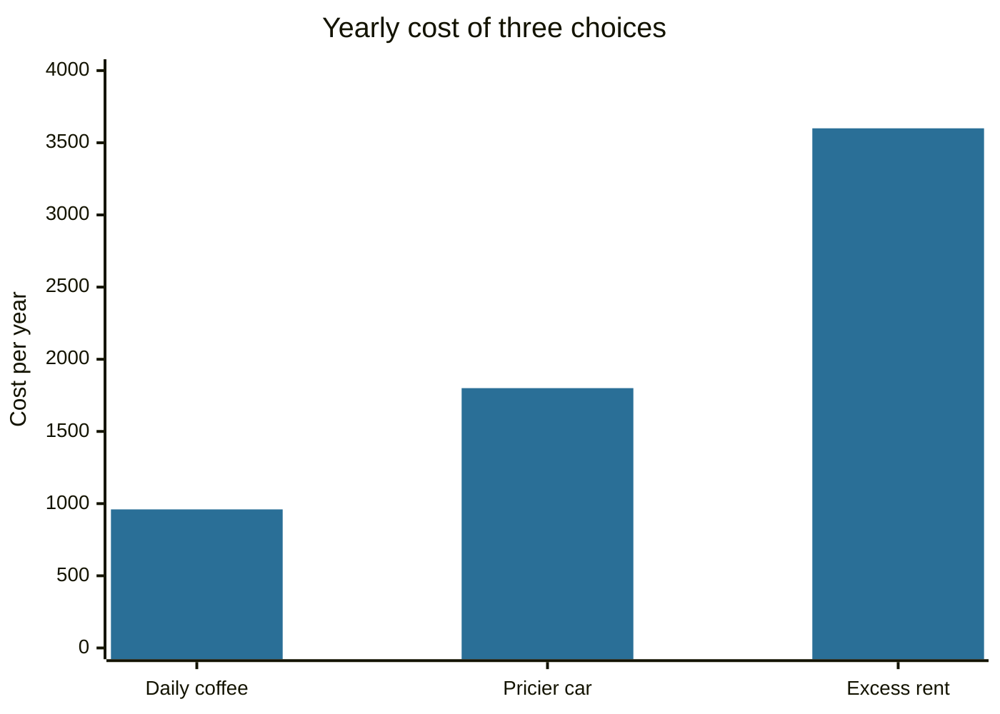

# Spending traps

## Summary

Several patterns keep people from building wealth even when income rises: lifestyle inflation (spending grows with every raise), living paycheck to paycheck (no buffer between pay dates), the HENRY situation (a high income with little saved) and saving without a goal. The small-purchase argument known as the latte effect is the best known and the least useful of them, because it focuses on cheap items and ignores the big decisions of housing, transport and debt.

*This note is educational. It is not financial advice.*

## Prerequisites

- [Budgeting](budgeting.md).
- [Emergency fund](emergency-fund.md).

## Core concepts

### Definition

- **Lifestyle inflation** (also lifestyle creep) is a rise in spending that follows a rise in income, so that the saving rate does not increase.
- **Paycheck to paycheck** is an informal expression for a household that could not meet its obligations if income stopped for a short time. It occurs at low incomes because of low pay, and at high incomes when spending matches earnings.
- **HENRY** (high earner, not rich yet) describes households with a high income, in the original 2003 magazine usage roughly 250,000 to 500,000 a year in the US, who spend most of it on taxes, housing, schooling and family costs and so have little saved. The label is marketing, not an economic category.
- **Latte effect** is the argument that small, frequent purchases add up to a large sum if saved and invested.

### Analogy

Lifestyle inflation is a leaky bucket under a tap that you open wider every time you get a bigger bucket. The flow in grows, and the level of water does not. The analogy breaks because spending also buys real benefits (health, family, comfort) that the bucket does not represent, so the aim is a deliberate split, not zero spending.

### Mechanism

The counter-measure is to decide the split of each raise before the first paycheck arrives. The Save More Tomorrow program of Thaler and Benartzi (2004) applies this idea: employees commit in advance to put a share of future raises into retirement saving, so the money never counts as spendable. The authors report that participants' saving rates rose substantially over the first implementations of the program.

Other common strategies:

- **Calculate the real change.** After tax and higher costs, a raise is often smaller than it looks.
- **Prefer experiences to objects** where this raises satisfaction for the same money (a personal preference, partly supported by happiness research).
- **Change gradually.** A bigger home brings higher heating, repair and tax costs.

The arithmetic of the latte effect is correct: a 4 coffee on 20 days a month costs 960 a year. The weakness is its size compared with other decisions, as the example below shows.

## Worked example

| Option | Yearly cost | Comment |
| --- | --- | --- |
| Daily coffee, 4, 20 days a month | 960 | Easy to cut, small |
| Car that costs 150 a month more than a cheaper one | 1,800 | One decision, repeated 12 times |
| Rent 300 a month above the need | 3,600 | The largest of the three |

The 80 a month from coffee, invested for 10 years at an assumed 7% a year, grows to about 13,800, of which 9,600 is paid in. That is a real sum, and it is also smaller than the effect of the rent decision above, which is why advisers put housing, transport and debt ahead of coffee.

## Trade offs and when to use it

Cutting small items gives quick wins and builds the habit, but it has a limit: nobody can cut their way to wealth without raising income or lowering large fixed costs. Cutting too hard leads to rebound spending. Keep a fixed amount for pleasures and cut elsewhere.

Saving with no goal is also a trap: without a purpose it is hard to stay motivated, and money tends to be spent on whatever is at hand. Name each pot (emergency, house, retirement) and give it an amount and a date.

## Common mistakes

- **Treating a raise as spendable in full.** Commit a fixed share, for example half, to saving before it starts.
- **Cutting only small items.** Review the three biggest lines first: housing, transport, food.
- **Assuming high income solves the problem.** HENRY households fail the same way as others when spending tracks income.
- **Relying on credit to bridge the gap.** If monthly spending exceeds income, the first step is a budget and, if the gap is large, more income or lower fixed costs.

## Practice

1. What is lifestyle inflation and how can a household prevent it?
2. Why is the latte effect a weak guide for most households?
3. A raise adds 300 a month after tax. Commit half to saving. How much extra is saved per year?

### Answers

1. Spending rising with income. Decide the saving share of each raise in advance and automate it.
2. The sums are small compared with housing, car and debt costs, so the focus is misplaced.
3. 150 × 12 = 1,800 per year.

## Further reading

- Thaler, R. H. and Benartzi, S. (2004). Save More Tomorrow: using behavioral economics to increase employee saving. *Journal of Political Economy*, 112(S1), S164-S187. [DOI](https://doi.org/10.1086/380085). The field evidence that committing future raises to saving raises saving rates a lot.
- Board of Governors of the Federal Reserve System. Economic Well-Being of U.S. Households (SHED). Federal Reserve. [Link](https://www.federalreserve.gov/consumerscommunities/shed.htm). The annual survey that measures how households handle expenses and savings.
- Consumer Financial Protection Bureau. Budgeting. CFPB. [Link](https://www.consumerfinance.gov/consumer-tools/budgeting/). Consumer tools for tracking income and expenses.
