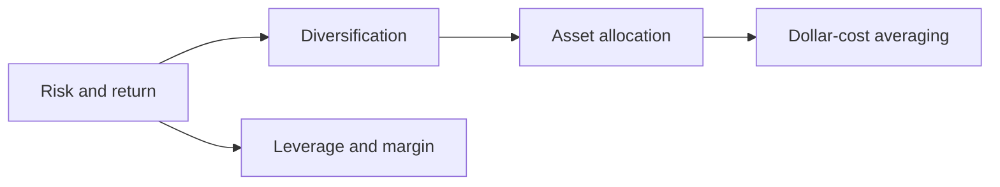

# Portfolio management

How to combine investments into a portfolio that fits a goal: the measurement of risk and return, diversification, asset allocation, regular investing and the use of leverage. This subfield belongs to [Finance and investing](../README.md). It comes after [financial instruments](../financial-instruments/README.md), because it treats the instruments as building blocks, and it supports the personal planning in [personal finance](../personal-finance/README.md).

## Map of the subfield

The map shows how the notes lead from measuring risk to the decisions that shape a portfolio.

## Notes in reading order

1. [Risk and return](risk-and-return.md): holding period return, arithmetic and geometric means, standard deviation, Sharpe ratio.
2. [Diversification](diversification.md): correlation, the two-asset formula, specific and market risk.
3. [Asset allocation](asset-allocation.md): strategic and tactical allocation, risk capacity and tolerance, rebalancing.
4. [Dollar-cost averaging](dollar-cost-averaging.md): fixed-amount investing, the harmonic mean and the lump sum comparison.
5. [Leverage and margin](leverage-and-margin.md): borrowing to invest, margin calls and forced sales.

## Planned topics

- Modern portfolio theory and the efficient frontier
- Capital asset pricing model and factor models
- Performance measurement and attribution
- Behavioral biases in investing
- Retirement withdrawal strategies

## How to use this subfield

Read the notes in order. Test the examples with your own numbers, and use the allocation note together with the [financial plan](../personal-finance/financial-plan.md).

These notes are educational. They are not investment advice.

## Navigation

- Back to [Finance and investing](../README.md).
