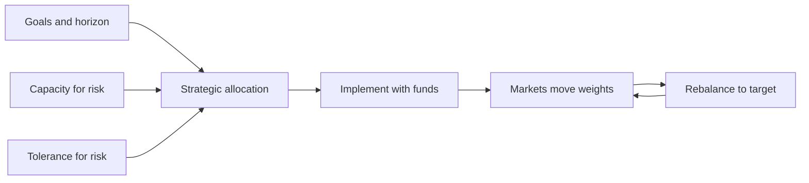
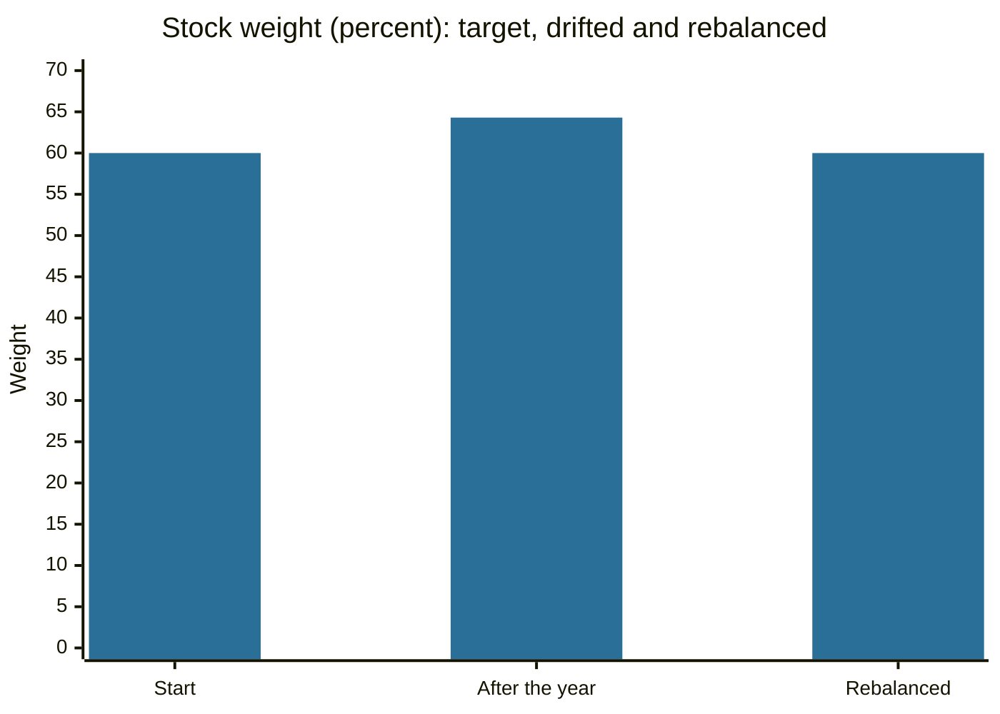

# Asset allocation

## Summary

Asset allocation is the division of a portfolio among asset classes such as stocks, bonds and cash. Studies of pension funds have found that this policy choice explains most of the variation of a portfolio's returns over time, more than picking individual securities. A sound allocation follows from the investor's goals, time horizon, ability to bear a loss and willingness to bear one. Rebalancing returns the portfolio to its target after markets move.

*This note is educational. It is not investment advice.*

## Prerequisites

- [Risk and return](risk-and-return.md).
- [Diversification](diversification.md).
- [Types of investments](../financial-instruments/types-of-investments.md).

## Core concepts

### Definition

*Asset allocation* is the policy that sets the target share of each asset class in a portfolio. *Strategic* allocation is the long-term target, set from the investor's profile. *Tactical* allocation is a temporary deviation based on views about markets. *Rebalancing* is buying and selling to return to the target weights.

Brinson, Hood and Beebower (1986) analyzed the returns of large US pension plans and concluded that the allocation policy explained the great majority of the variation in the plans' quarterly returns over time. Later work has debated how to interpret this (variation over time is not the same as differences between investors, or in the level of returns), but the main message that allocation matters more than security selection has held.

### Analogy

Asset allocation is how you load a ship, before the weather decides the voyage. Cargo that is too heavy on one side makes the ship tip in a storm. A good load is planned for the route and the crew, and the captain checks the balance periodically. The analogy fails because a ship's weather is observed, while market conditions are not.

### Setting the allocation

Three factors decide it:

1. **Time horizon.** Money needed in under five years should not depend on stock prices. Long horizons allow more risk.
2. **Ability to take risk** (capacity). Stable income, a large reserve and no near-term needs allow more risk.
3. **Willingness to take risk** (tolerance). The investor must be able to hold through a fall without selling at the bottom.

Rules of thumb exist. One subtracts the investor's age from 100 (or 110 or 120) to get the share in stocks. It gives a starting point and ignores capacity and tolerance (see [financial rules of thumb](../personal-finance/financial-rules-of-thumb.md)). Target-date funds apply a glide path that lowers the stock share as the date approaches.

### Rebalancing

Markets change the weights, so the portfolio drifts toward the asset that did best and becomes riskier. Rebalancing sells some of the winner and buys the laggard. It can be done on a calendar (yearly) or by threshold (when a weight is 5 percentage points off its target). New contributions and withdrawals can do part of the work without selling.

## Worked example

A portfolio of 100,000 has a target of 60% stocks and 40% bonds. In a year, stocks gain 20% and bonds are unchanged.

| | Start | After the year | Weight | Target value | Trade |
| --- | --- | --- | --- | --- | --- |
| Stocks | 60,000 | 72,000 | 64.3% | 67,200 | sell 4,800 |
| Bonds | 40,000 | 40,000 | 35.7% | 44,800 | buy 4,800 |
| Total | 100,000 | 112,000 | | 112,000 | |

Without rebalancing, the portfolio is now 64.3% in stocks and carries more risk than planned. Selling 4,800 of stocks and buying 4,800 of bonds restores 60/40. Taxes, trading costs and the possibility of buying new assets with new money should be considered, since selling can create a tax bill in a taxable account.

## Trade offs and when to use it

A fixed allocation with rebalancing is simple, disciplined and low-cost. It forces buying low and selling high in a mechanical way, and it does not require forecasts. Tactical changes need forecasting skill that few have, and frequent rebalancing adds costs. More complex allocations (several asset classes, factors, alternatives) add diversification and complexity, which may not pay for small portfolios.

## Common mistakes

- **Choosing the allocation by recent returns,** adding stocks after a boom and selling after a fall.
- **Never rebalancing,** which leaves the risk to drift upward.
- **Setting risk tolerance in good times.** Imagine a 30% fall before deciding how much to hold.
- **Ignoring the rest of your balance sheet.** A job in a cyclical industry plus a stock-heavy portfolio doubles the risk.

## Practice

1. Why does a portfolio become riskier if it is never rebalanced after a stock rally?
2. A 70/30 portfolio of 200,000 has drifted to 75,000 bonds and 125,000 stocks. What trade restores the target?
3. Name the three factors that decide the allocation.

### Answers

1. The stock weight grows beyond the target, and stocks are the more volatile part.
2. The target stock value is 140,000, so buy 15,000 of stocks and sell 15,000 of bonds.
3. Time horizon, ability to take risk and willingness to take risk.

## Further reading

- Brinson, G. P., Hood, L. R. and Beebower, G. L. (1986). Determinants of portfolio performance. *Financial Analysts Journal*, 42(4), 39-44. [DOI](https://doi.org/10.2469/faj.v42.n4.39). Found that the asset allocation policy explained most of the variation in pension plan returns over time.
- Bodie, Z., Kane, A. and Marcus, A. J. (2021). *Investments (12th ed.)*. McGraw Hill. The standard university textbook on securities, portfolio theory and market efficiency.
- FINRA. Stocks. Financial Industry Regulatory Authority. [Link](https://www.finra.org/investors/investing/investment-products/stocks). Includes regulator education on investing with a plan and time horizon
